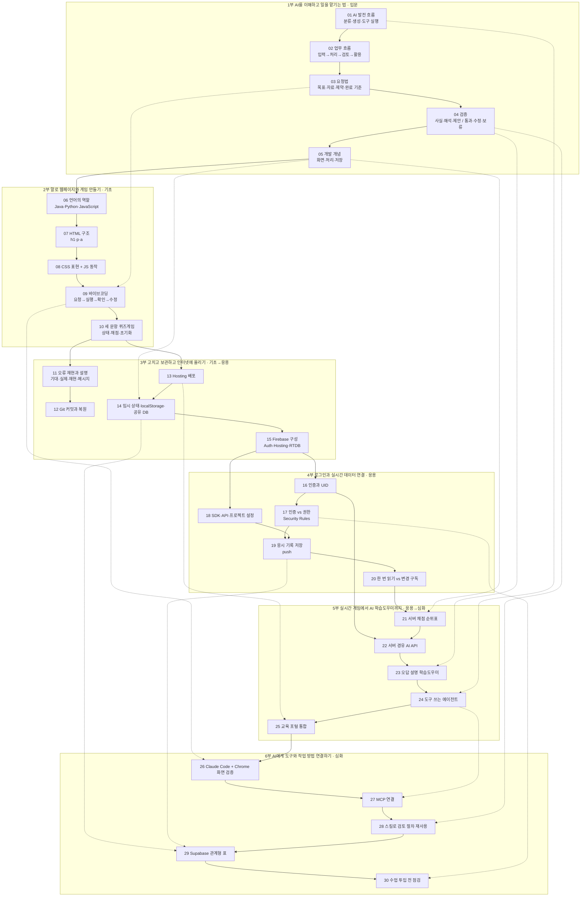

> **[교수 검토용 초안]** 이 문서는 커리큘럼 설계자가 만든 **초안**입니다. 캡틴(교수)의 검토·수정·승인 전에는 학생에게 쓰지 않습니다. 모든 문항의 상태는 `draft`입니다.

# AI Agent 실무자 단기실습과정 — 스킬트리 · 레벨 · 문항 은행 (초안)

**한 줄 요약**: 30강을 6개 부·4단계 레벨의 스킬트리로 정리했고, 맛보기 범위(1~3부, 01~15강)의 퀴즈 대결용 문항 **54개**(강의마다 난이도 1·2·3 최소 1개씩, 객관식 47 + OX 7)를 강의대본에 있는 내용으로만 만들었습니다.

- 작성: 교육기획팀 커리큘럼 설계자 / 작성일: 2026-11-01
- 근거 자료: `00_캡틴/강의자료/강의대본_텍스트.md` (김형태 교수 강의용, 2026-10-31판). 각 강의의 학습 목표, 핵심 개념, 화면 실습, 작동 확인, 실습 요청문과 성공 기준 부분을 근거로 삼았습니다.
- 앱용 파일: `03_교육기획팀/문항은행/questions_part1-3.json` (아래 표와 내용이 같습니다)
- 원칙: 대본에 없는 사실은 보태지 않았습니다. 해설의 근거 위치는 문항마다 '근거' 칸에 적었습니다.

---

## 1. 스킬트리 (지식 지도)

화살표 A → B는 "A를 알아야 B를 배울 수 있다"는 뜻입니다. 대본은 매 강의가 "이전 결과물에 작은 기능을 더하는" 구조여서 기본은 강의 순서를 따르고, 부를 건너뛰는 선수 관계(예: 05강 화면·처리·저장 → 14강 저장 방식)는 점선으로 표시했습니다.

### 개념 묶음 (스킬 가지) — 퀴즈 대결에서 '단원'으로 쓸 수 있는 단위

| 가지 | 포함 강의 | 한마디 |
|---|---|---|
| A. AI에게 일 맡기기 | 01, 02, 03 | AI 기능 구분 → 업무 흐름 → 요청문 |
| B. 결과 검증하기 | 04, 09, 11, 28 | 근거 대조, 실행 결과로 확인, 회귀 점검, 검토 절차 재사용 |
| C. 웹의 세 역할 | 05, 06, 07, 08 | 화면·처리·저장 / HTML·CSS·JS |
| D. 게임 만들기 | 09, 10, 21 | 바이브코딩 → 로컬 퀴즈 → 서버 채점 순위 |
| E. 보관과 배포 | 12, 13, 25 | Git 기준점, Hosting, 포털 |
| F. 데이터 저장 | 14, 15, 19, 20, 29 | 저장 위치 선택 → DB 종류 → 기록·구독 → 관계형 표 |
| G. 누구인가와 무엇을 허용하나 | 15, 16, 17, 22, 30 | 인증 ≠ 권한, 비밀 키는 서버에 |
| H. 도구를 쓰는 AI | 01, 22, 23, 24, 26, 27 | API → 학습도우미 → 에이전트 → MCP |

---

## 2. 부별 레벨과 학습 목표

| 부 | 강의 | 레벨 | 학습 목표 (이 부를 마치면 학습자는 …할 수 있다) |
|---|---|---|---|
| 1부 AI를 이해하고 일을 맡기는 법 | 01~05 | **입문** | AI 기능을 분류·생성·도구 실행으로 구분하고, 목표·자료·제약·완료 기준을 갖춘 요청과 원문 대조 검증으로 수업에 쓸 결과만 남길 수 있다. |
| 2부 말로 웹페이지와 게임 만들기 | 06~10 | **기초** | HTML·CSS·JavaScript의 역할을 구분해 자연어로 수정을 요청하고, 세 문항 퀴즈게임의 선택·채점·종료·초기화 흐름을 실행 결과로 검증할 수 있다. |
| 3부 고치고 보관하고 인터넷에 올리기 | 11~15 | **기초 → 응용** | 오류를 네 항목으로 설명해 최소 수정을 요청하고, Git으로 정상 버전을 복원하며, 게임을 배포하고 데이터별 저장 위치와 Firebase 서비스 역할을 고를 수 있다. |
| 4부 로그인과 실시간 데이터 연결 | 16~20 | **응용** | 로그인한 사용자를 UID로 식별하고, 자기 경로만 허용하는 권한 아래에서 응시 기록을 저장·구독할 수 있다. |
| 5부 실시간 게임에서 AI 학습도우미까지 | 21~25 | **응용 → 심화** | 서버 채점 순위표와 서버를 거친 AI 호출을 구성하고, 검토된 해설에 근거한 학습도우미와 도구를 쓰는 에이전트를 포털로 묶을 수 있다. |
| 6부 AI에게 도구와 작업 방법 연결하기 | 26~30 | **심화** | 브라우저 검증·MCP·스킬로 AI 작업 환경을 확장하고, 작동·권한·정확성·비용을 점검해 소규모 시범 사용 범위를 정할 수 있다. |

### 문항 난이도와 레벨의 대응 (퀴즈 대결 매칭용 제안)
| 난이도 | 뜻 | 예 |
|---|---|---|
| 1 | 용어·정의를 알아본다 (입문) | "문단을 나타내는 요소는?" |
| 2 | 개념을 구분하거나 오해를 바로잡는다 (기초) | OX, "이 문장은 네 항목 중 무엇?" |
| 3 | 상황을 보고 판단한다 (응용) | "이런 오류가 나면 무엇을 먼저?", 짝짓기형 |

> 한 강의 = 약 5분 영상 + 퀴즈 3~4문항(약 2~3분)이라 "한 단계 5~10분" 원칙에 맞습니다.

---

## 3. 문항 은행 — 1부~3부 (01~15강, 54문항)

- 표기: 선택지 번호 ①②③④ = JSON의 `answer_index` 0·1·2·3. OX는 ①=O, ②=X.
- 정답 위치 분포: ① 13개, ② 17개, ③ 12개, ④ 12개 (OX는 O 3개, X 4개). 앱에서 선택지를 섞을 경우 `answer_index`와 `common_wrong_index`도 같이 옮겨야 합니다.
- 난이도 분포: 1 = 15개, 2 = 22개, 3 = 17개.

### 1부 AI를 이해하고 일을 맡기는 법

| ID | 강 | 난이도 | 유형 | 문제 | 선택지 | 정답 | 해설 | 자주 하는 오답 | 근거 |
|---|---|---|---|---|---|---|---|---|---|
| L01-Q1 | 01 | 1 | 객관식 | AI 역사의 중요한 출발점으로 소개한 사건은? | ① 1991년 파이썬 공개 ② 1956년 다트머스 연구 모임 ③ 1995년 자바스크립트 등장 ④ 생성형 AI의 등장 | ② | 대본은 1956년 다트머스 연구 모임을 출발점으로 소개. 1991·1995년은 06강의 언어 공개 연도, 생성형 AI는 이후의 변화. | ④ 요즘 많이 듣는 생성형 AI를 시작으로 착각 | 01강 핵심 개념 |
| L01-Q2 | 01 | 2 | 객관식 | '도구를 통한 실행'에 해당하는 업무는? | ① 문의 종류를 학사 문의로 고르기 ② 강의 메모로 해설 초안 쓰기 ③ 학습 기록을 조회하기 ④ 수업 문항 초안 작성하기 | ③ | 문의 종류 고르기=분류, 해설 초안=생성, 학습 기록 조회=도구 실행. | ① 분류와 실행을 섞음 | 01강 작동 확인 |
| L01-Q3 | 01 | 3 | 객관식 | 01강 내용과 일치하는 설명은? | ① 생성형 AI 이후 규칙 중심 방식은 안 쓰인다 ② 모델은 DB 그 자체라 권한 설계가 필요 없다 ③ 패턴 분류기는 언제나 정확하다 ④ 앞선 기술은 사라지지 않고 목적에 따라 함께 쓰인다 | ④ | 앞선 기술은 목적에 따라 함께 사용. 규칙 방식은 조건이 분명한 업무에 유용, 모델은 허용된 도구로 정보를 받아 권한 설계 필요, 분류기는 오분류 가능. | ① 기술 발전을 '교체'로 오해 | 01강 핵심 개념, 실습 1·2·4 |
| L02-Q1 | 02 | 1 | 객관식 | AI 활용 네 단계의 올바른 순서는? | ① 입력→처리→검토→활용 ② 처리→입력→활용→검토 ③ 입력→검토→처리→활용 ④ 활용→입력→처리→검토 | ① | 넣을 것을 정하고, 처리를 맡기고, 결과를 검토한 뒤, 실제 업무에 사용. 검토는 결과가 나온 뒤. | ③ 검토를 처리 앞에 둠 | 02강 핵심 개념 |
| L02-Q2 | 02 | 2 | 객관식 | 성과 확인 때 기록할 세 가지에 해당하지 **않는** 것은? | ① 초안과 검토를 합친 시간 ② 수정한 문항 수 ③ AI 답변의 글자 수 ④ 실제 수업에서 썼는지 여부 | ③ | 기록할 것은 시간(초안+검토), 수정 문항 수, 수업 사용 여부. AI 가치는 답변 길이가 아니라 업무 변화에서 찾음. | ④ 성과를 숫자로만 생각해 '수업 사용 여부'를 빼기 쉬움 (2026-11-01 품질검수 반영 수정) | 02강 완성 장면, 작동 확인, 오늘의 미션 |
| L02-Q3 | 02 | 3 | 객관식 | 3문항 중 두 번째가 메모 밖 내용을 묻는다. 맞는 처리는? | ① 3개를 채웠으니 통과 ② 학생에게 먼저 풀린 뒤 고친다 ③ 범위를 원문으로 좁혀 수정 ④ 메모를 버리고 AI 지식으로 새로 만든다 | ③ | 문항 수를 채웠다는 이유로 통과시키지 않고 원문 범위로 좁혀 고침. 사람은 평가 대상을 정하고 잘못된 근거를 거른다. | ① 개수가 나오면 끝났다고 여김 | 02강 실습 2·3 |
| L02-Q4 | 02 | 2 | OX | 측정하지 않았어도 작성 시간이 절반으로 줄었다고 말해도 된다. | ① O ② X | ② X | 측정하지 않았다면 절반으로 줄었다고 말할 수 없음. 기준을 정하고 반복 측정. | ① AI는 당연히 빠르다는 인상 | 02강 작동 확인 |
| L03-Q1 | 03 | 1 | 객관식 | 요청문 네 항목에 해당하지 **않는** 것은? | ① 목표 ② 자료 ③ 사용할 AI 모델의 이름 ④ 완료 기준 | ③ | 네 항목은 목표·자료·제약·완료 기준. 특별한 주문 대신 일이 전달되는 요청문. | ④ 완료 기준을 낯설게 느낌 | 03강 핵심 개념 |
| L03-Q2 | 03 | 2 | 객관식 | '원문에 없는 임상 내용을 추가하지 마'는 어느 항목? | ① 제약 ② 목표 ③ 자료 ④ 완료 기준 | ① | 제약 = 지켜야 할 범위나 하지 말아야 할 작업. 대본 예시 '임상적 추론을 추가하지 않고'도 제약. | ③ '원문'이라는 말 때문에 자료로 고름 | 03강 핵심 개념, 실습 3 |
| L03-Q3 | 03 | 3 | 객관식 | 세 번째 문항에만 근거 문장이 빠졌다. 권장한 후속 요청은? | ① 세 문항 전부 다시 ② 세 번째 문항 근거를 표시하고, 근거가 없으면 그 문항 교체 ③ 더 길고 자세하게 ④ 자신 있는지 묻기 | ② | 빠진 부분만 짚어 수정해야 괜찮던 부분이 흔들리지 않음. 확인과 수정을 짧게 반복. | ① 전부 다시 시키는 게 안전하다고 생각 | 03강 실습 4 |
| L03-Q4 | 03 | 2 | OX | 네 항목을 갖춘 요청문을 써도, 전문 내용은 근거를 직접 읽고 확인하는 단계가 남아 있다. | ① O ② X | ① O | 요청문이 좋아도 정확성은 보장되지 않음. 전문 내용은 근거 직접 확인. | ② 좋은 요청 = 정확한 결과로 기대 | 03강 작동 확인 |
| L04-Q1 | 04 | 1 | 객관식 | AI 결과 문장의 성격을 나눈 세 가지는? | ① 입력, 처리, 활용 ② 분류, 생성, 실행 ③ 사실, 해석, 제안 ④ 목표, 자료, 제약 | ③ | 사실은 근거와 대조, 해석은 자료에서 결론이 나오는지, 제안은 목적·조건에 맞는지. 다른 보기는 02·01·03강 개념. | ② 01강 개념과 혼동 | 04강 핵심 개념 |
| L04-Q2 | 04 | 2 | OX | AI에게 '자신 있나요?'라고 다시 물어 확신 있는 답이 나오면 검증은 끝이다. | ① O ② X | ② X | 다시 묻는 것만으로 검증이 끝나지 않음. 같은 오류를 더 확신 있게 말할 수 있음. 원문·출처 직접 확인, 확인 못 하면 보류. | ① 확신 있는 말투를 정확성으로 착각 | 04강 핵심 개념 |
| L04-Q3 | 04 | 3 | 객관식 | A는 근거·표현 확인, B는 선택지 하나가 정답과 비슷한 뜻, C는 근거를 못 찾음. 바르게 나눈 것은? | ① A 통과, B 보류, C 수정 ② A 수정, B 통과, C 보류 ③ A 통과, B 통과, C 수정 ④ A 통과, B 수정, C 보류 | ④ | 확인되면 통과, 선택지 겹치면 수정, 근거 없으면 보류. 보류할 수 있어야 검증이 작동. | ① 근거 없는 문항을 수정으로 처리 | 04강 실습 4, 작동 확인 |
| L05-Q1 | 05 | 1 | 객관식 | '답을 비교하거나 점수를 계산하는 일'은 어느 영역? | ① 화면 ② 저장 ③ 배포 ④ 처리 | ④ | 화면=보고 누르는 부분, 처리=비교·계산, 저장=다음에도 쓸 데이터. 배포는 세 영역에 없음. | ① 점수가 화면에 보여서 화면으로 고름 | 05강 핵심 개념 |
| L05-Q2 | 05 | 2 | 객관식 | '정답을 골랐는데 점수가 오르지 않는다'면 먼저 볼 영역은? | ① 버튼 색과 크기(화면) ② 다음 접속 때의 기록(저장) ③ 휴대폰 화면 크기(화면) ④ 답과 정답을 비교하는 흐름(처리) | ④ | 버튼 색으로 해결 안 됨. 처리 흐름을 봐야 함. 버튼이 작으면 화면, 다음 접속에 기록이 없으면 저장. | ② '안 남는' 문제와 '안 오르는' 문제를 혼동 | 05강 실습 2, 작동 확인 |
| L05-Q3 | 05 | 3 | 객관식 | 05강 내용과 일치하지 **않는** 것은? | ① 브라우저는 화면 표시와 일부 처리를 맡는다 ② 모든 처리는 반드시 서버에서만 일어난다 ③ DB는 여러 사용자의 기록을 관리할 수 있다 ④ 프런트엔드·백엔드는 사용자 쪽·서버 쪽 역할부터 떠올린다 | ② | 대본: 모든 처리가 반드시 서버에서만 일어나는 것은 아니다. | ④ 낯선 용어 때문에 틀렸다고 오해 | 05강 핵심 개념 |
| L05-Q4 | 05 | 3 | 객관식 | 공정한 순위가 필요할 때 알맞은 채점 위치는? | ① 화면 점수 숫자를 그대로 기록 ② 믿을 수 있는 위치(서버)에서 채점하고 DB에 남김 ③ 학생이 점수 직접 입력 ④ 각자 브라우저에만 저장 | ② | 완성본은 서버가 채점하고 DB에 결과를 남김. 화면 숫자를 바꿔도 공식 기록이 바뀌면 안 됨. | ① 화면 점수 = 공식 점수로 생각 | 05강 실습 4 |

### 2부 말로 웹페이지와 게임 만들기

| ID | 강 | 난이도 | 유형 | 문제 | 선택지 | 정답 | 해설 | 자주 하는 오답 | 근거 |
|---|---|---|---|---|---|---|---|---|---|
| L06-Q1 | 06 | 1 | 객관식 | 이 과정에서 브라우저 게임을 만드는 주 언어는? | ① 자바 ② 파이썬 ③ 자바스크립트 ④ 자바와 파이썬 둘 다 | ③ | 브라우저 게임에는 자바스크립트. 파이썬은 연구 데이터 확장 때, 자바는 기존 시스템이 요구할 때. 세 언어 모두 설치할 필요 없음. | ① 자바와 자바스크립트 혼동 | 06강 핵심 개념 |
| L06-Q2 | 06 | 2 | OX | 자바와 자바스크립트는 둘 다 1995년에 등장했으므로 같은 언어의 다른 이름이다. | ① O ② X | ② X | 같은 해 등장했지만 자바스크립트는 웹페이지 동작을 만드는 별개의 언어. 자바는 이식성을 목표로 했고 자바 가상 머신으로 실행. | ① 연도·이름이 비슷해 착각 | 06강 완성 장면, 핵심 개념 |
| L06-Q3 | 06 | 3 | 객관식 | (가) 웹 버튼 움직이기 (나) 가상 설문 파일 정리 (다) 이미 자바로 만든 서버 수정 — 언어 짝은? | ① 파이썬/자바스크립트/자바 ② 자바/파이썬/자바스크립트 ③ 자바스크립트/자바/파이썬 ④ 자바스크립트/파이썬/자바 | ④ | 작동 확인 정리 그대로. 언어 선택은 해결할 문제와 실행 환경에 따른다. | ② '버튼'에 자바를 연결 | 06강 작동 확인 |
| L07-Q1 | 07 | 1 | 객관식 | HTML에서 '문단'을 나타내는 요소는? | ① h1 ② a ③ p ④ css | ③ | 제목 h1, 문단 p, 링크 a. CSS는 HTML 요소가 아니라 표현 담당(08강). | ① 제목과 문단 혼동 | 07강 핵심 개념 |
| L07-Q2 | 07 | 2 | 객관식 | 제목을 고쳤는데 화면이 그대로다. 가장 먼저 확인할 것은? | ① 저장했는지, 같은 파일을 열었는지 ② 인터넷 연결 속도 ③ 자바 설치 여부 ④ 다른 사람이 접속할 수 있는지 | ① | 대본: 저장했는지, 같은 파일을 열었는지부터. 지금은 내 컴퓨터의 파일을 보고 있으므로 인터넷과 무관. | ② 인터넷 문제로 생각 | 07강 실습 1·2 |
| L07-Q3 | 07 | 3 | 객관식 | 링크 글자를 바꿨는데 클릭하면 예전 페이지로 간다. 원인은? | ① 브라우저가 HTML을 못 읽음 ② 보이는 문구와 이동 주소는 따로 있어, 주소 속성을 안 바꿈 ③ 인코딩이 UTF-8이어서 ④ h1 태그를 지워서 | ② | 클릭할 글자만 고쳤다고 목적지가 바뀌지 않음. 주소를 적는 속성도 확인. | ① 다른 원인을 찾음 | 07강 실습 3 |
| L07-Q4 | 07 | 2 | 객관식 | 웹페이지로 열리지 않을 수 있다고 주의를 준 저장 형태는? | ① index.html ② index.html.txt ③ UTF-8로 저장한 index.html ④ 제목을 바꾼 index.html | ② | index.html.txt처럼 저장되면 웹페이지로 열리지 않을 수 있어 확장자 확인. | ③ UTF-8을 원인으로 오해 | 07강 실습 4, 작동 확인 |
| L08-Q1 | 08 | 1 | 객관식 | 버튼의 색·크기·여백 같은 '표현'을 정하는 것은? | ① CSS ② HTML ③ 자바스크립트 ④ Git | ① | HTML=구조, CSS=표현, 자바스크립트=클릭 시 동작. Git은 12강 버전 관리. | ② 버튼을 HTML로 만드니 모양도 HTML로 생각 | 08강 핵심 개념 |
| L08-Q2 | 08 | 2 | 객관식 | 버튼 이름만 바꾸고 코드의 대상은 그대로 두면? | ① 버튼 색이 자동으로 바뀐다 ② 클릭해도 설명이 나타나지 않을 수 있다 ③ 한글이 깨진다 ④ 아무 영향 없다 | ② | 클릭 감지 부분과 표시 대상은 같은 이름으로 연결해야 함. 11강 오류본에서 다시 나옴. | ④ 이름은 겉모습일 뿐이라 생각 | 08강 실습 3 |
| L08-Q3 | 08 | 3 | 객관식 | '누르면 보이고 다시 누르면 숨김'으로 고쳤다. 완료 확인 방법은? | ① 한 번 눌러 열리면 완료 ② 버튼 색만 확인 ③ 두 번 눌러 열리고 닫히는지 + 좁은 화면에서 버튼이 읽히는지 확인 ④ AI가 수정했다고 하면 완료 | ③ | 한 번만 보면 닫기 오류를 놓침. 완료 기준은 두 번 눌러 열리고 닫히는 것, 성공 기준에 좁은 화면 가독성 포함. | ① 되돌아가는 동작을 시험하지 않음 | 08강 실습 4, 미션, 성공 기준 |
| L09-Q1 | 09 | 1 | 객관식 | '바이브코딩'의 뜻은? | ① 코드를 확인하지 않고 느낌대로 완성 ② 음악을 들으며 코딩 ③ 자바로만 만들기 ④ 자연어로 원하는 동작을 설명하며 AI와 함께 프로그램을 만드는 방식 | ④ | 대본의 정의. 느낌만 전하고 끝내지 않고, AI가 완료했다 해도 실제 화면 확인이 남음. | ① '바이브'라는 말 때문에 오해 | 09강 핵심 개념 |
| L09-Q2 | 09 | 2 | 객관식 | 긴 선택지가 버튼 밖으로 나간다. 다음 요청은? | ① 다시 예쁘게 ② 긴 선택지 줄바꿈이 안 돼 오른쪽이 잘린다고 화면 폭·문장과 함께 알림 ③ 새 페이지로 다시 ④ 채점 방식도 바꿔 달라 | ② | 실패한 조건을 구체적으로 전달해야 다음 수정의 기준이 명확. 채점 로직은 유지 범위. | ① 막연하게 다시 요청 | 09강 실습 3 |
| L09-Q3 | 09 | 3 | 객관식 | 버튼 개선 작업의 '완료' 근거가 **아닌** 것은? | ① 모바일에서 글자가 안 잘림 ② 버튼이 눌림 ③ 채점 결과가 이전과 같음 ④ AI가 '완료했습니다'라고 답함 | ④ | 완료 기준은 ①②③. AI가 완료했다고 해도 실제 확인이 남고, 파일에 반영 안 된 경우도 있음. | ③ 화면만 고쳤으니 채점은 안 봐도 된다고 생각 | 09강 핵심 개념, 실습 2, 작동 확인 |
| L10-Q1 | 10 | 1 | 객관식 | 3문항, 정답마다 1점. 가능한 점수 범위는? | ① 0점~3점 ② 1점~3점 ③ 0점~10점 ④ 3점 고정 | ① | 0점(모두 오답)~3점(모두 정답). 두 경계값이 성공 기준. | ② 0점을 빠뜨림 | 10강 핵심 개념, 작동 확인 |
| L10-Q2 | 10 | 2 | 객관식 | 문항마다 q01~q03 식별자를 두는 이유는? | ① 예쁘게 보이려고 ② 나중에 어떤 문제를 틀렸는지 기록하려고 ③ 정답 위치를 자동으로 섞으려고 ④ 배포하려고 | ② | 식별자가 있어야 틀린 문제를 기록할 수 있고, 제목이 바뀌어도 유지 가능. 정답 위치를 바꾸면 정답 표시는 따로 맞춰야 함. | ③ 식별자와 정답 섞기 혼동 | 10강 실습 1 |
| L10-Q3 | 10 | 3 | 객관식 | 10강 퀴즈 검증 항목으로 적절하지 **않은** 것은? | ① 미선택 제출 시 안내 ② 연속 클릭해도 점수는 한 번만 ③ 다시 시작 시 첫 문항·0점 ④ 이 브라우저 채점 점수를 공식 순위에 그대로 사용 | ④ | 10강 게임은 브라우저 채점 연습용. 공식 순위용 채점은 뒤에서 서버에 연결. | ② 연속 클릭 점수 증가를 정상으로 착각 | 10강 실습 2·4, 작동 확인 |
| L10-Q4 | 10 | 3 | 객관식 | 다시 시작 때 결과 화면만 초기화하고 내부 점수를 두면? | ① 문항 ID가 사라진다 ② 다음 시도에 이전 점수가 섞일 수 있다 ③ 한글이 깨진다 ④ 배포 주소가 바뀐다 | ② | 화면과 함께 상태(현재 문항, 고른 답, 점수)가 초기화되어야 함. 다음 문항으로 갈 때 이전 선택도 초기화. | ① 화면이 처음 같으면 상태도 처음이라 생각 | 10강 핵심 개념, 실습 3·4 |

### 3부 고치고 보관하고 인터넷에 올리기

| ID | 강 | 난이도 | 유형 | 문제 | 선택지 | 정답 | 해설 | 자주 하는 오답 | 근거 |
|---|---|---|---|---|---|---|---|---|---|
| L11-Q1 | 11 | 1 | 객관식 | 오류 수정 요청의 네 항목에 해당하지 **않는** 것은? | ① 기대 동작 ② 실제 동작 ③ 재현 순서 ④ 전체를 새로 만들어 달라는 요청 | ④ | 네 항목은 기대 동작·실제 동작·재현 순서·오류 메시지. 전체 재작성은 멀쩡한 부분까지 바꿀 수 있음. | ③ 재현 순서를 덜 중요하게 여김 | 11강 완성 장면, 핵심 개념 |
| L11-Q2 | 11 | 2 | 객관식 | 오류 메시지를 AI에 보내기 전 확인할 것은? | ① 영어인지 ② 세 줄 이하인지 ③ 전부 해석했는지 ④ 비밀 키와 개인정보가 들어 있지 않은지 | ④ | 메시지는 원인을 좁힐 단서지만 비밀 키·개인정보 확인이 먼저. 해석 못 해도 파일과 위치 정보는 전달 가능. | ③ 이해해야만 보낼 수 있다고 생각 | 11강 핵심 개념, 실습 2 |
| L11-Q3 | 11 | 3 | 객관식 | 고친 뒤 두 번째 문항과 다시 시작까지 확인했다. 이 확인의 이름과 목적은? | ① 배포 점검—주소가 열리는지 ② 회귀 점검—수정 주변 기능이 계속 작동하는지 ③ 커밋—정상 상태 기록 ④ 인증—사용자 확인 | ② | 대본: 이 확인을 회귀 점검이라 부를 수 있다. 성공 기준도 같은 재현 순서에서 성공 + 인접 기능 유지. | ③ '다시 확인'과 '기록'을 혼동 | 11강 실습 4, 성공 기준 |
| L12-Q1 | 12 | 1 | 객관식 | Git과 GitHub의 관계로 알맞은 것은? | ① Git은 버전 관리 도구, GitHub는 저장소를 올려 협업하는 서비스 ② 같은 것의 다른 이름 ③ GitHub는 내 컴퓨터 전용, Git은 인터넷 서비스 ④ Git은 웹 배포 도구 | ① | 대본: Git과 GitHub는 같은 것이 아니다. 배포는 13강 Hosting. | ② 이름이 비슷해 같다고 생각 | 12강 핵심 개념 |
| L12-Q2 | 12 | 2 | OX | 커밋을 했다고 해서 그 파일이 다른 컴퓨터에 백업된 것은 아니다. | ① O ② X | ① O | 대본: 커밋을 했다고 다른 컴퓨터에 백업된 것은 아니다. 12강은 내 컴퓨터에서 기록·복원. | ② 저장=백업으로 오해 | 12강 핵심 개념 |
| L12-Q3 | 12 | 3 | 객관식 | 복원 실습과 일치하는 설명은? | ① 복원하면 DB 기록도 자동으로 되돌아간다 ② 모든 파일을 습관적으로 커밋한다 ③ 전체 폴더 강제 초기화가 가장 안전하다 ④ 복원은 미커밋 수정을 버릴 수 있으니 먼저 남길지 판단한다 | ④ | 지정 파일만 되돌리고 전체 강제 초기화는 하지 않음. Git은 DB를 되돌리지 않음. 커밋은 해당 파일만, 비밀 파일 제외. | ① 코드 버전과 운영 데이터를 같게 봄 | 12강 실습 1·3·4, 작동 확인 |
| L12-Q4 | 12 | 2 | 객관식 | 권장에 가장 가까운 커밋 메시지는? | ① 새 버전 ② 수정함 ③ 세 문항 퀴즈 정상 동작 ④ 1234 | ③ | 무엇이 되는 상태인지 적으면 나중에 찾기 쉬움. 이 기록이 복원 기준점. | ① 짧고 일반적인 메시지 | 12강 실습 2 |
| L13-Q1 | 13 | 1 | 객관식 | '준비된 웹 파일을 제공 환경에 올려 적용하는 작업'은? | ① 배포 ② 호스팅 ③ 커밋 ④ 인증 | ① | 호스팅=파일을 방문자에게 제공하는 환경, 배포=그 환경에 올려 적용하는 작업. | ② 환경과 작업을 같은 말로 씀 | 13강 핵심 개념 |
| L13-Q2 | 13 | 2 | 객관식 | 'firebase deploy --only hosting'의 설명으로 알맞은 것은? | ① DB 규칙과 서버 함수까지 배포 ② Git 커밋을 만든다 ③ 로그인 기능을 켠다 ④ 현재 연결한 프로젝트에 웹 파일만 적용 | ④ | 웹 파일 적용 명령이며 DB 규칙이나 서버 함수까지 배포하지 않음. | ① 'deploy'라서 전부 올라간다고 생각 | 13강 실습 2 |
| L13-Q3 | 13 | 3 | 객관식 | 배포 이후에 대한 설명으로 일치하는 것은? | ① 주소가 복잡하면 접근이 보호된다 ② 주소를 알면 로그인 권한이 생긴다 ③ 배포 완료 메시지와 방문자가 새 화면을 보는지는 각각 확인 ④ Hosting에 올리면 서버 비밀 키 기능도 생긴다 | ③ | 완료 메시지 ≠ 방문자 화면 반영. 주소로 권한·보호가 생기지 않음. 비밀 키 처리는 Hosting만으로 안 생김. | ① 긴 주소 = 안전으로 생각 | 13강 핵심 개념, 실습 4, 작동 확인 |
| L13-Q4 | 13 | 2 | 객관식 | 다시 배포했는데 휴대폰에 예전 제목이 보인다. 차례로 볼 것은? | ① 배포 프로젝트, 파일 위치, 캐시 상태 ② 커밋 메시지, 버튼 색, 인코딩 ③ 로그인 제공자, UID, 권한 규칙 ④ 파이썬 설치, 자바 버전, 서버 함수 | ① | 대본이 제시한 순서 그대로. 다른 기기에서 직접 열어 보는 것도 도움. | ③ 권한 문제로 생각(이 게임은 로그인 없는 연습용) | 13강 실습 3·4 |
| L14-Q1 | 14 | 1 | 객관식 | 점수를 JS 변수에만 두고 새로고침하면? | ① 초기화되어 0점으로 돌아갈 수 있다 ② 다른 기기로 자동 공유 ③ DB에 영구 저장 ④ 다른 브라우저에서도 보인다 | ① | 변수 값은 다시 불러오면 초기화될 수 있음. 프로그램이 새로 시작하며 상태를 다시 만듦. | ③ 보였던 값은 어딘가 저장됐다고 생각 | 14강 핵심 개념, 실습 1 |
| L14-Q2 | 14 | 2 | 객관식 | localStorage 설명으로 알맞은 것은? | ① 다른 기기로 자동 공유 ② 사이트 데이터를 지워도 안 사라짐 ③ 같은 출처 데이터를 해당 브라우저에 저장, 새로고침 후에도 읽지만 다른 기기로 자동 공유 안 됨 ④ 공용 PC에서도 남이 못 보니 공식 저장소로 바로 사용 | ③ | 대본 정의 그대로. 사이트 데이터를 지우면 없어질 수 있고 공용 PC에서는 남이 볼 수 있어 공식 저장소로는 조건 검토 필요. | ① 새로고침해도 남으니 어디서나 보인다고 생각 | 14강 핵심 개념, 실습 2·3 |
| L14-Q3 | 14 | 3 | 객관식 | (가) 이 브라우저의 글자 크기 (나) 여러 기기에서 보는 개인 이력 (다) 학생 간 순위 — 저장 위치 짝은? | ① 공유 DB/로컬/로컬 ② 로컬/공유 DB/공유 DB ③ 임시/임시/공유 DB ④ 로컬/로컬/임시 | ② | 글자 크기=로컬 저장, 여러 기기 개인 이력·순위=공유 저장. 누가 읽고 쓰는지도 함께 정함. | ④ 개인 이력을 로컬로 고름 | 14강 작동 확인 |
| L14-Q4 | 14 | 2 | OX | 공유 DB에 있더라도 다른 사용자가 무엇을 볼지는 권한으로 정한다. | ① O ② X | ① O | 서버에 있다고 모두에게 공개되지 않음. 개인 기록과 순위용 공개 정보를 나눠 저장 예정. | ② 공유 = 전체 공개로 오해 | 14강 실습 4 |
| L15-Q1 | 15 | 1 | 객관식 | '학생이 누구인지 확인'을 맡는 Firebase 서비스는? | ① Hosting ② Authentication ③ Realtime Database ④ Cloud Firestore | ② | 누구인지=Authentication, 게임 주소=Hosting, 응시 기록=데이터베이스. | ① 주소로 접속하니 Hosting으로 생각 | 15강 핵심 개념, 작동 확인 |
| L15-Q2 | 15 | 2 | 객관식 | 두 데이터베이스의 구조 짝은? | ① Firestore: 문서와 컬렉션 / RTDB: JSON 트리 ② Firestore: JSON 트리 / RTDB: 문서와 컬렉션 ③ 둘 다 표 ④ 둘 다 실시간 동기화 미지원 | ① | 둘 다 실시간 동기화 지원. Firestore는 문서·컬렉션, Realtime Database는 JSON 트리. | ② 반대로 기억 | 15강 핵심 개념 |
| L15-Q3 | 15 | 3 | 객관식 | 15강 내용과 일치하는 것은? | ① 데이터가 안 읽히면 규칙을 공개로 ② Hosting에 올리면 DB 자동 연결 ③ RTDB 선택은 작은 실시간 게임이라는 교육 목적에 따른 것이며 모든 프로젝트가 같을 필요 없음 ④ Google은 신규 고객에게 RTDB부터 검토 안내 | ③ | 공개 규칙으로 바꾸지 않음, 웹 파일 업로드로 DB 자동 연결 안 됨, Google은 신규 고객에게 Firestore부터 검토 안내. | ④ 실습 선택을 Google 권장으로 착각 | 15강 핵심 개념, 실습 1·4, 작동 확인 |
| L15-Q4 | 15 | 2 | OX | 이름을 입력받는 화면을 만들면 그것이 곧 인증이다. | ① O ② X | ② X | 이름은 다른 사람이 똑같이 적을 수 있음. 인증은 계정의 주체를 확인하는 과정. | ① 이름으로 누구인지 안다고 생각 | 15강 실습 2 |

---

## 4. 4부~6부 (16~30강) — 강의별 핵심 개념 목록 (문항은 다음 단계)

| 부 | 강 | 강의 제목 | 핵심 개념 (대본 '학습 목표'·'핵심 개념' 기준) |
|---|---|---|---|
| 4부 | 16 | Firebase 인증으로 접속한 사용자 확인하기 | Google 로그인, UID는 프로젝트 안에서 사용자를 구분하는 식별자(화면 이름과 다름), 인증 상태에 따른 화면 변화, 로그인 ≠ 모든 데이터 접근 권한 |
| 4부 | 17 | 인증과 권한을 구분하고 데이터 접근 막기 | 인증 = 누구인가 / 권한 = 무엇을 읽고 쓸 수 있나, Realtime Database Security Rules(접근과 데이터 검증), practice/UID 경로, 로그인 UID와 경로 UID가 같을 때만 허용(소유자 조건) |
| 4부 | 18 | SDK와 API로 웹사이트와 Firebase 연결하기 | API = 다른 기능을 호출할 때 지키는 인터페이스, SDK = 라이브러리·도구 묶음(경쟁 관계 아님), 프로젝트 설정, 데이터베이스 URL, SDK 초기화와 데이터 읽기 |
| 4부 | 19 | Realtime Database에 연습 기록 한 건 남기기 | UID 아래 응시 식별자(attemptId), 문항 ID·선택 답·점수·저장 시각, 같은 경로에 쓰면 기존 값이 바뀜, push로 새 키 만들기, 저장 성공 후 다시 읽기 |
| 4부 | 20 | 두 화면을 새로고침 없이 함께 바꾸기 | 한 번 읽기 vs 변경 구독(onValue), 처음 연결 때 현재 값도 받음, 실시간에도 지연 있음, 연결 상태·오류 안내, 구독 해제 |
| 5부 | 21 | 서버 점수로 실시간 순위표 만들기 | 브라우저가 보낸 점수를 믿지 않음, 서버 정답표로 채점, 인증된 UID·응시 ID 확인과 중복 집계 방지, 순위 경로는 서버만 쓰고 참가자는 요약만 읽기, 점수 내림차순 |
| 5부 | 22 | 서버를 거쳐 AI API 호출하기 | AI API = 모델 기능을 호출하는 통로, 비밀 키는 서버에, 브라우저 → 서버 함수 → 모델, 로그인 상태·입력 범위 검사, 호출형 함수도 허용 검사 코드 필요, 채팅 구독 ≠ API 요금 |
| 5부 | 23 | 틀린 문제를 설명하는 AI 학습도우미 | 문항·선택 답·기준 해설을 함께 전달, 서버가 문항 ID로 승인된 해설 조회, 사용자가 보낸 정답·해설을 기준으로 삼지 않음, 틀린 이유·다시 볼 개념·확인 질문 1개, 근거 없으면 확인 불가로 답함, 결과 검토는 여전히 필요 |
| 5부 | 24 | 학습 기록을 읽고 다음 문제를 고르는 에이전트 | 모델에 도구 설명 제공(내 오답 기록 조회, 승인된 문항 조회), 모델은 도구 호출을 '제안'하고 서버가 허용 범위·입력 확인 후 실행, 도구 결과로 후속 응답, API 1회 호출과의 차이, 실행 권한은 서버가 통제 |
| 5부 | 25 | 학습게임과 AI 도우미를 교육 포털로 모으기 | 포털 = 공통 입구, 링크를 모아도 로그인·데이터는 자동 통합 안 됨, 같은 Hosting 출처와 같은 Firebase 인증, 다른 도메인은 인증 공유를 따로 검토, 어느 도구에서든 홈으로 복귀 |
| 6부 | 26 | Claude Code와 Chrome으로 화면 검증하기 | Claude Code = 프로젝트 코드 확인·수정, Claude in Chrome = 브라우저 화면 읽기·클릭·이동, 코드 수정 후 실제 브라우저 동작으로 확인, 비슷한 이름의 확장 프로그램 주의, 설치 조건은 바뀔 수 있음 |
| 6부 | 27 | MCP로 외부 도구와 데이터 연결하기 | MCP = AI 앱이 외부 도구·데이터에 연결되는 공통 규약, API가 사라지는 것 아님(MCP 서버가 API·DB를 이용), 연결 ≠ 모든 데이터 접근, 도구·인증·권한에 따라 가능 범위가 다름, 읽기 전용 도구 |
| 6부 | 28 | 스킬로 나의 문항 검토 절차 재사용하기 | 스킬 = 작업 지침·예시·자료 묶음(스크립트 포함 가능), MCP는 연결 / 스킬은 작업 절차, 스킬을 만들어도 모델이 새로 학습되거나 항상 같은 답을 내지 않음, 동일 기준 출력 비교 |
| 6부 | 29 | Supabase에서 표 사이의 관계로 데이터 읽기 | Supabase는 PostgreSQL 기반, 관계형 DB에서 행을 식별자로 연결, students 표와 attempts 표를 student_id로 연결, 이름 복사 대신 ID 연결, JSON 트리와의 차이, 관계·조회·운영 조건으로 선택, 응시 횟수 확인 |
| 6부 | 30 | 교육 포털을 실제 수업에 쓰기 전 점검하기 | 점검 네 범주(작동·권한·내용·운영), 학습 목표의 네 점검(작동·권한·정확성·비용), 가상 데이터로 점검, 소수 시험 사용자 먼저, 소규모 시범 사용 범위 정하기 |

---

## 5. 캡틴(교수) 검토 요청 사항

1. **사실 확인**: 모든 문항은 대본 문장에서 만들었지만, 해설 표현을 짧게 줄인 곳이 있습니다. 특히 L01-Q1(연도), L06-Q2(언어 등장 배경), L15-Q3(Google의 Firestore 안내)는 대본 문장 그대로인지 한 번 봐 주세요.
2. **보기 난이도**: 일부 오답 보기(예: '음악을 들으며 코딩', '1234')는 일부러 쉽게 만든 난이도 1용입니다. 대결에서 너무 쉬우면 바꾸겠습니다.
3. **맛보기 범위**: 1~3부를 맛보기 범위로 가정했습니다. 실제 수업 진도가 다르면 범위를 다시 정해 주세요.
4. **다음 단계**: 승인되면 4~6부 문항(강의당 3개 이상)을 같은 형식으로 만들겠습니다.
