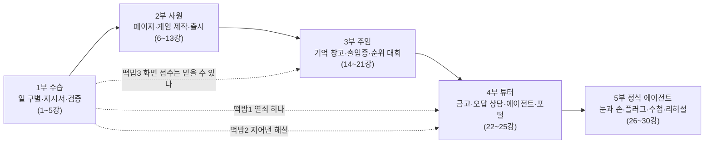

> **한 줄 요약: 학습자(팀장)가 아무것도 모르는 신입 AI '루키'를 30강 동안 가르쳐, 수습 사원에서 "실제 수업에 투입되는 정식 에이전트"로 키우는 이야기입니다. 강마다 루키가 실수하는 업무를 팀장이 직접 손으로 바로잡고(끌기·찾기·고르기), 능력 카드 1장을 얻고, 평가 3문제로 마무리합니다.**

# 3단계 · 루키 키우기 — 30강 이야기 지도 (초안)

- 작성: 교육기획팀 커리큘럼 설계자 / 2026-11-05
- 기준: 1강 시제품 `04_제품개발팀/시제품/2026-11-05_1강_C_루키키우기.html` (흐름 그대로), 결재 `00_캡틴/결재함/2026-11-05_3단계_결재1_방향확정_루키.md` (승인)
- 내용 근거: `00_캡틴/강의자료/강의대본_텍스트.md` (아래 '대본 근거 줄'은 이 파일의 줄 번호). 대본에 없는 사실은 넣지 않았습니다. 장소·직급·사건 같은 **이야기 포장만** 새로 만들었습니다.
- 문항 연결: `03_교육기획팀/문항은행/questions_part1-3.json`, `questions_part4-6.json`, `questions_easy.json`, 개념 카드 `concept_cards.json`(강 번호와 같음)
- 상태: 캡틴 검토 전 초안 (결재2 묶음에 들어갈 예정)

---

## 0. 한 강의 공통 흐름 (1강 시제품 그대로)

| 순서 | 장면 | 시간 | 비고 |
|---|---|---|---|
| ① 출근 | 루키가 인사하며 지난 강의 떡밥 한 줄을 꺼냄 | 20초 | 대본 '완성 장면'(0:00~0:20)을 루키 대사로 |
| ② 업무 2~3개 | 루키가 일을 하다 **실수** → 팀장이 손으로 바로잡음 | 업무당 1~2분 | 대본 '화면 실습 1~4'가 재료. 아래 표의 '조작' |
| ③ 능력 카드 | 레벨업 연출 + 카드 1장 (카드 뒷면 = 대본 핵심 문장 3줄) | 20초 | 1강만 튜토리얼이라 업무마다 1장씩 총 5장 |
| ④ 업무 평가 | 공통 문항 3문제 (연습용 쉬운 문항 E1은 '복습 길'로) | 1~2분 | 교훈노트 규칙: 연습과 평가 분리 |
| ⑤ 퇴근 | 루키 카드 · 30강 지도 불 켜짐 · 오늘의 미션(대본 미션) · 다음 강 예고 | 30초 | 대본 '오늘의 미션' 마지막 문장이 곧 다음 강 예고 |

한 강 전체 약 6~8분. 조작 유형은 8가지(분류 끌기 / 짝 맞추기 / 순서 맞추기 / 틀린 곳 찾기 / 고르기 / 빈칸 채우기 / 대화 선택 / 만들기 미션)만 씁니다.

---

## 1. 큰 줄거리 — 5부

시제품 마지막 화면에 이미 보이는 5부 구분을 그대로 씁니다. (대본은 6부지만, 학습자에게는 이미 이 5부 지도가 보이므로 바꾸지 않았습니다. 대본 부와의 대응은 오른쪽 칸 참고.)

| 부 | 강 | 이야기 제목 | 루키의 직급 | 장소 | 루키의 성장 단계 (이 부가 끝나면) | 대본 부 |
|---|---|---|---|---|---|---|
| 1부 | 1~5 | 입사 첫 주 — 루키에게 일 맡기는 법 | **수습** (Lv 시작) | 교육팀 사무실, 루키 책상 | 일을 구별하고, 지시서를 알아듣고, 자기 답을 근거로 검사받을 줄 안다 | 1부 |
| 2부 | 6~13 | 첫 프로젝트 — 루키와 퀴즈게임 만들기 | **사원** | 제작실(작업대) → 출시 무대 | 말로 지시받아 페이지·게임을 만들고, 고장 나면 진단서를 쓰고, 세이브하고, 세상에 내놓는다 | 2부 + 3부 앞쪽(11~13) |
| 3부 | 14~21 | 기억 창고와 출입증 — 기록과 권한 주기 | **주임** | 기록 창고, 출입 게이트, 순위 대회장 | 기록을 알맞은 곳에 남기고, 누가 무엇을 열 수 있는지 지키며, 공정한 순위를 연다 | 3부 뒤쪽(14~15) + 4부 + 5부 첫 강(21) |
| 4부 | 22~25 | 튜터로 승진 — 학생을 돕는 루키 | **튜터** | 학습 상담실 → 교육 포털 로비 | 비밀 키를 금고에 두고, 근거 안에서만 설명하고, 허락된 도구로 다음 문제를 고른다 | 5부 |
| 5부 | 26~30 | 도구 가방 채우기 — 정식 에이전트로 | **정식 에이전트** (30강에 발령) | 장비실 → 이웃 회사 견학 → 개강 리허설 무대 | 눈과 손(브라우저), 플러그(MCP), 업무 수첩(스킬)을 갖추고, 수업 투입 전 점검을 통과한다 | 6부 |

---

## 2. 30강 표

- **조작**: 위 8가지 유형 중 2~3개. 괄호 안이 화면에서 실제로 하는 일.
- **문항**: 평가는 `Q` 문항에서 3개를 고르고, `E1`은 쉬운 복습 길. (예: `Q1~Q4` = L01-Q1, Q2, Q3, Q4)
- **대본 근거 줄**: `강의대본_텍스트.md` 줄 번호. 개념 카드는 `concept_cards.json`의 같은 강.

### 1부 · 입사 첫 주 — 루키에게 일 맡기는 법 (수습)

| 강 | 루키의 업무 (장면 한 줄) | 학습자 조작 2~3개 | 얻는 능력 카드 | 핵심 개념 | 대본 근거 줄 | 연결 문항 |
|---|---|---|---|---|---|---|
| 1 | 입사 첫날. 규칙표로 문의를 나누다 놓치고, 문제 초안에 없는 말을 지어내고, 열쇠를 달라 함 (**시제품 그대로**) | 틀린 곳 찾기(오분류 1건, 지어낸 해설 1줄) / 고르기(열쇠 3개 중 '학습 기록 보기 도구'만) / 분류 끌기(업무 카드 → 분류·생성·도구 실행) | 일 구별하기 (튜토리얼로 규칙 따르기·패턴 찾기·초안 쓰기·도구 쓰기 포함 5장) | 규칙→머신러닝→딥러닝→생성형→도구, 옛 기술도 함께 씀, 생성≠검증, 모델은 자료 창고가 아님 | 147-152, 158-161, 168-171, 182-186, 193-197, 203-206 | L01-Q1~Q4, E1 |
| 2 | 루키가 문항 10개를 뚝딱 만들고 "일 끝!" — 팀장이 "학생이 풀어야 끝"이라고 가르침 | 순서 맞추기(입력→처리→검토→활용) / 틀린 곳 찾기(3문항 중 메모 밖 내용을 묻는 2번) / 고르기(성과 기록 3가지 고르기, '답변 글자 수' 함정) | 끝까지 잇기 | AI의 가치는 답변 길이가 아니라 업무 변화, 4단계 흐름, 측정 안 했으면 '절반으로 줄었다' 못 함 | 241-243, 249-254, 270-274, 294-298, 304-307 | L02-Q1~Q5, E1 |
| 3 | "퀴즈 만들어"라고만 했더니 루키가 엉뚱한 어려운 사례 문제를 가져옴 | 분류 끌기(요청문 조각 → 목표·자료·제약·완료 기준 상자) / 빈칸 채우기(4줄 지시서 완성) / 고르기(근거 빠진 3번 문항만 고치는 후속 요청) | 지시서 읽기 | 요청문 4항목, 길게가 아니라 빈칸 줄이기, 빠진 부분만 짚어 수정, 좋은 요청도 정확성 보장은 아님 | 341-343, 349-354, 360-364, 384-388, 394-398, 404-407 | L03-Q1~Q5, E1 |
| 4 | 루키가 매끄러운 해설을 들고 와 "자신 있어요!" — 한 문장은 근거가 없음 | 대화 선택("자신 있어?" 다시 묻기는 함정) / 짝 맞추기(주장 3개 ↔ 원문 근거, 하나는 짝 없음) / 분류 끌기(문항 3개 → 통과·수정·보류) | 근거 대조 | 사실·해석·제안, 다시 묻는 것만으론 검증 끝 아님, 근거 없으면 보류, 최종 판단은 교수자 | 441-443, 449-454, 460-464, 470-474, 484-488, 504-507 | L04-Q1~Q4, E1 |
| 5 | 루키의 연습 게임에 민원 3건(버튼이 작다 / 점수가 안 오른다 / 새로고침하면 사라진다) | 분류 끌기(민원 → 화면·처리·저장) / 고르기(점수 안 오를 때 먼저 볼 곳) / 대화 선택(루키 "화면 숫자를 바꾸면 공식 기록도 바뀌죠?" → 아니) | 세 칸 지도 | 화면·처리·저장, 브라우저도 일부 처리, 공정한 순위는 믿을 수 있는 곳에서 채점, 개념은 요청·검증을 정확히 하려고 배움 | 542-544, 550-556, 562-566, 572-576, 586-590, 596-600, 606-609 | L05-Q1~Q5, E1 |

> 1부 끝 연출: "수습 딱지 떼기" — 사원증 발급, 장소가 제작실로 바뀜.

### 2부 · 첫 프로젝트 — 루키와 퀴즈게임 만들기 (사원)

| 강 | 루키의 업무 (장면 한 줄) | 학습자 조작 2~3개 | 얻는 능력 카드 | 핵심 개념 | 대본 근거 줄 | 연결 문항 |
|---|---|---|---|---|---|---|
| 6 | 제작실 첫날, 언어 셋(자바·파이썬·자바스크립트)이 지원서를 냄. 루키는 자바와 자바스크립트를 같은 지원자로 착각 | 짝 맞추기(언어 ↔ 공개 연도·쓰임) / 분류 끌기(작업 3개: 웹 버튼·설문 파일 정리·자바 서버 수정 → 언어) / 틀린 곳 찾기(루키 메모 "자바를 깔아야 버튼이 돼요") | 언어 고르기 | 파이썬 1991, 자바 1995(이식성), 자바스크립트 1995(웹 동작, 별개 언어), 언어는 목적과 실행 환경으로 고름 | 644-646, 652-658, 664-668, 688-692, 698-702, 708-712 | L06-Q1~Q4, E1 |
| 7 | 루키가 팀장의 '수업 안내판'(강의 소개 페이지)을 처음 만듦 | 짝 맞추기(h1·p·a ↔ 화면의 제목·문단·링크) / 틀린 곳 찾기(글자만 바뀌고 주소는 옛날인 링크, `index.html.txt` 파일) / 만들기 미션(내 강의 이름·소개·자료 링크로 바꾸기) | 뼈대 세우기 | HTML은 구조와 의미, 내 컴퓨터 파일 보기≠배포, 저장했는지·같은 파일인지 먼저, 보이는 문구≠이동 주소 | 754-759, 765-769, 775-778, 788-791, 798-802, 808-810 | L07-Q1~Q5, E1 |
| 8 | 안내판에 '정답 보기' 버튼을 꾸미고 움직이게 함. 루키는 한 번 눌러 보고 "완성!" | 분류 끌기(요청 → HTML 구조·CSS 표현·JS 동작) / 고르기(버튼 이름만 바꾸고 코드 대상은 그대로 두면?) / 틀린 곳 찾기(두 번 눌렀더니 안 닫히는 버튼) | 옷 입히고 움직이기 | 구조·표현·동작 구분, 같은 이름으로 연결, 두 번 눌러 열고 닫히는지, 좁은 화면에서도 읽히는지 | 852-857, 863-866, 872-875, 885-889, 895-899, 905-908 | L08-Q1~Q5, E1 |
| 9 | 팀장이 말로 시키고 루키가 코드를 고치는 첫 협업. 루키의 말버릇 "완료했습니다!" 시작 | 순서 맞추기(요청→실행→확인→수정) / 대화 선택(긴 선택지가 잘림 → "다시 예쁘게" vs "긴 문장 줄바꿈이 안 돼 오른쪽이 잘려") / 고르기(완료 근거가 아닌 것 = 'AI가 완료했다고 말함') | 말로 만들기 | 바이브코딩 정의, 느낌만 전하고 끝내지 않기, 기능 하나씩, 실제 파일 반영 확인, 실패 조건을 구체적으로 되돌려 주기 | 950-955, 961-965, 971-975, 985-989, 995-999, 1005-1008 | L09-Q1~Q5, E1 |
| 10 | **루키의 첫 작품 '세 문항 퀴즈 게임기' 완성.** 팀장이 일부러 이상하게 눌러 보며 시험 | 틀린 곳 찾기(연타하면 점수가 계속 오름, 다시 시작했는데 점수가 남음) / 고르기(가능한 점수 범위 0~3점) / 만들기 미션(내 수업 문항 3개 넣고 전부 정답·전부 오답 시험) | 게임기 조립 | 상태(몇 번째·고른 답·점수), 문항 ID(q01~q03), 미선택 제출 안내, 한 문항 한 번 채점, 다시 시작 초기화, 브라우저 채점은 연습용 | 1041-1043, 1049-1053, 1059-1063, 1069-1073, 1083-1087, 1093-1097, 1103-1106 | L10-Q1~Q4, E1 |
| 11 | 게임기 고장! 정답 보기 버튼이 먹통. 루키 "전부 새로 만들까요?" | 대화 선택(전체 재작성 vs 네 항목 보고) / 빈칸 채우기(기대 동작·실제 동작·재현 순서·오류 메시지 4줄 진단서) / 고르기(오류 메시지 보내기 전 확인할 것 = 비밀 키·개인정보) | 고장 진단서 | 디버깅, 4항목, 메시지는 단서지만 비밀 키 확인 먼저, 관련 부분만 최소 수정, 회귀 점검 | 1140-1142, 1148-1153, 1169-1173, 1183-1187, 1193-1197, 1203-1206 | L11-Q1~Q4, E1 |
| 12 | 루키가 고치다 더 망가뜨림. "어제 잘 되던 때로 돌아가고 싶어요" → 세이브 포인트 | 고르기(기록할 파일 고르기, 비밀 파일 빼기) / 고르기(좋은 커밋 메시지 = '세 문항 퀴즈 정상 동작') / 대화 선택(전체 폴더 강제 초기화 vs 지정 파일만 복원) | 세이브 포인트 | Git·커밋, Git≠GitHub, 커밋≠다른 컴퓨터 백업, 복원 전 미커밋 수정 판단, Git은 DB 기록을 되돌리지 않음 | 1239-1241, 1247-1252, 1258-1262, 1268-1272, 1283-1286, 1292-1295, 1301-1304 | L12-Q1~Q4, E1 |
| 13 | **첫 출시!** 게임기를 인터넷에 올려 휴대폰으로 연다. 루키 "배포 완료! 다들 새 화면 보고 있어요" | 분류 끌기(배포 폴더에 넣을 것 / 뺄 것: 비밀 설정 파일·연구 자료) / 대화 선택(완료 메시지만 믿기 vs 다른 기기에서 직접 열기) / 순서 맞추기(새 제목이 안 보일 때: 배포 프로젝트→파일 위치→캐시) | 출시하기 | 호스팅(제공 환경)과 배포(올려 적용하는 작업), `--only hosting`은 웹 파일만, 완료 메시지≠방문자 화면, 주소를 안다고 권한 생기지 않음 | 1338-1340, 1346-1351, 1357-1361, 1368-1370, 1382-1386, 1392-1396, 1402-1405 | L13-Q1~Q5, E1 |

> 2부 끝 연출: 출시 축하 → 주임 승진. **다음 날 아침 민원 "새로고침하니 점수가 0점이에요"** (3부 시작 사건, 5강 떡밥 재등장).

### 3부 · 기억 창고와 출입증 — 기록과 권한 주기 (주임)

| 강 | 루키의 업무 (장면 한 줄) | 학습자 조작 2~3개 | 얻는 능력 카드 | 핵심 개념 | 대본 근거 줄 | 연결 문항 |
|---|---|---|---|---|---|---|
| 14 | 민원 두 건: "새로고침하면 0점", "다른 브라우저엔 기록이 없어요". 루키 "창고가 고장 났어요!" | 틀린 곳 찾기(고장이 아니라 저장 위치가 다른 것) / 분류 끌기(글자 크기 설정·여러 기기 개인 이력·학생 간 순위 → 임시 상태·로컬 저장·공유 DB) / 고르기(localStorage 설명 맞는 것) | 기억 세 칸 | 변수 값은 새로고침에 초기화, localStorage는 그 브라우저에만, 공유 DB도 누가 볼지는 권한으로, 누가 읽고 쓸지 함께 정함 | 1439-1441, 1447-1452, 1458-1462, 1468-1472, 1482-1486, 1492-1496, 1502-1505 | L14-Q1~Q4, E1 |
| 15 | Firebase 건물 견학. 방 3개(출입 확인실·매장·창고). 루키 "창고가 안 열리니 문을 활짝 열어 둘까요?" | 짝 맞추기(요구 3개 ↔ Authentication·Hosting·Realtime Database) / 짝 맞추기(Firestore=문서와 컬렉션, Realtime Database=JSON 트리) / 대화 선택(공개 규칙으로 바꾸기 → 거절, 이름 입력≠인증) | 건물 안내도 | 서비스 세 가지 역할, 둘 다 실시간 동기화, 이번 선택은 교육 목적(Google은 신규 고객에게 Firestore부터 안내), 웹 파일 올려도 DB 자동 연결 아님 | 1540-1542, 1549-1554, 1560-1564, 1570-1574, 1584-1588, 1594-1598, 1604-1607 | L15-Q1~Q4, E1 |
| 16 | 출입증 발급(Google 로그인). 같은 이름 '민지'가 두 명 등록됨 | 고르기(이름이 같은 두 학생을 구분하는 것 = UID) / 순서 맞추기(로그인 → 새로고침 중 로딩 안내 → 로그아웃 시 개인 화면 비우기) / 틀린 곳 찾기(로그아웃했는데 앞사람 이름이 남은 화면) | 출입증 읽기 | UID는 프로젝트 안 사용자 식별자(화면 이름과 다름), 인증 상태로 화면 변화, 로그인≠모든 데이터 권한, 버튼을 숨겨도 데이터는 보호 안 됨 | 1641-1643, 1649-1654, 1684-1688, 1694-1698, 1704-1708 | L16-Q1~Q4, E1 |
| 17 | 사물함 자물쇠 달기. 출입증만 있으면 남의 사물함도 열리는 구멍 발견 (1강 '마스터키' 떡밥 회수) | 분류 끌기(요청 4개: 본인·타인·비로그인·잘못된 점수 값 → 허용·거부) / 틀린 곳 찾기(규칙표에 '로그인만 하면 허용' 줄, 위쪽 경로 전체 공개 줄) / 대화 선택(권한 오류가 나면 전체 공개? → 아니) | 내 칸만 열기 | 인증=누구인가, 권한=무엇을 할 수 있나, Security Rules, practice/UID 경로, 소유자 조건, 거부 사례도 시험, 숫자 범위가 맞아도 정답 증거는 아님 | 1741-1743, 1749-1754, 1760-1764, 1770-1774, 1784-1788, 1794-1798, 1804-1807 | L17-Q1~Q4, E1 |
| 18 | 창고와 무전 연결. 기록이 안 보이자 루키가 인터넷 예제 설정값을 그대로 붙여 넣음 | 짝 맞추기(API·SDK·프로젝트 설정·데이터베이스 URL ↔ 설명) / 순서 맞추기(읽기 실패 점검: 설정→로그인→경로→규칙) / 분류 끌기(화면 두 개 → '데이터 없음' vs '권한 없음') | 무전 연결 | API=호출 약속, SDK=도구 묶음(경쟁 관계 아님), 다른 프로젝트 값 섞지 않기, Firebase 웹 API 키 ≠ AI 비밀 키 (22강 떡밥) | 1841-1843, 1849-1854, 1860-1864, 1870-1874, 1884-1888, 1894-1898, 1904-1907 | L18-Q1~Q4, E1 |
| 19 | 연습 일지 한 장 남기기. 루키가 같은 칸에 덮어써서 첫 기록이 사라짐, 누르자마자 "저장 완료" | 고르기(일지에 넣을 칸: 문항 ID·선택 답·숫자 점수·서버 시각 / 뺄 칸: 이메일) / 틀린 곳 찾기(덮어써서 1건만 남은 기록, 서버 확인 전에 뜬 '저장 완료') / 고르기(숫자 3과 글자 '3'은 다름) | 일지 쓰기 | UID 아래 응시 식별자, 같은 경로에 쓰면 덮어씀 → push로 새 키, 서버 완료 뒤에만 완료 표시, 서버 타임스탬프, 연습 점수는 공식 순위에 그대로 안 씀 | 1941-1943, 1949-1954, 1960-1964, 1970-1974, 1984-1988, 1994-1998, 2004-2007 | L19-Q1~Q4, E1 |
| 20 | 회의실 화면과 루키 책상 화면(같은 계정 두 화면)의 메모판을 동시에 바꾸기 | 고르기(한 번 읽기 vs 변경 구독 — 왼쪽을 바꾸면 오른쪽은?) / 순서 맞추기(구독 시작→변경 반영→구독 해제→다시 연결하면 현재 값) / 틀린 곳 찾기(인터넷이 끊겼는데 옛날 값을 최신처럼 표시, 구독이 두 번 붙어 두 번 처리) | 실시간 귀 | 한 번 읽기 vs 변경 구독(onValue), 처음 연결 때 현재 값, 실시간에도 지연, 연결 상태 표시, 작은 필드만 구독, 시작과 해제는 한 쌍 | 2041-2043, 2049-2054, 2060-2064, 2070-2074, 2086-2088, 2095-2099, 2105-2108 | L20-Q1~Q4, E1 |
| 21 | **3부 결승: 실시간 순위 대회.** 두 참가자(가상 사용자 2명)가 제출. 한 명이 화면 점수를 고쳐 1등을 노림 (5강·10강 떡밥 회수) | 분류 끌기(제출 요청에 넣을 것: 문항 ID·선택 답·응시 ID / 넣지 않을 것: 최종 점수·내 이름) / 순서 맞추기(점수 내림차순, 동점은 공동 순위) / 틀린 곳 찾기(재전송했더니 점수 두 배, 순위표에 이메일 노출) | 공정한 심판 | 브라우저 점수 불신, 서버 정답표로 채점, UID·응시 ID 확인과 중복 방지, 순위 경로는 서버만 쓰기, 공개 범위는 별칭과 점수만, 버튼 비활성화만으론 못 막음 | 2143-2145, 2151-2156, 2163-2167, 2173-2177, 2187-2191, 2197-2201, 2207-2211 | L21-Q1~Q4, E1 |

> 3부 끝 연출: 대회 성공 → **튜터 승진 발령.** 첫 지급품 "AI 두뇌 연결선"과 "금고 열쇠"가 든 상자가 도착.

### 4부 · 튜터로 승진 — 학생을 돕는 루키 (튜터)

| 강 | 루키의 업무 (장면 한 줄) | 학습자 조작 2~3개 | 얻는 능력 카드 | 핵심 개념 | 대본 근거 줄 | 연결 문항 |
|---|---|---|---|---|---|---|
| 22 | 튜터 첫날, 루키가 AI 두뇌(AI API)와 연결됨. 그런데 연습 화면 코드에 비밀 키가 보이는 사고 발생 | 순서 맞추기(브라우저→서버 함수→AI 모델→서버→화면) / 틀린 곳 찾기(브라우저 요청 안에 비밀 키가 든 줄 → 서버로 옮기고 키 교체) / 대화 선택(시간 초과 때 빈 답을 성공처럼 보여 주기 vs 다시 시도 안내) | 금고 지키기 | AI API=모델 호출 통로, 비밀 키는 서버에, 서버가 로그인·입력 범위 검사, 호출형 함수도 검사 코드 필요, 응답은 텍스트로 표시, 채팅 구독≠API 요금 | 2246-2248, 2254-2260, 2266-2270, 2276-2280, 2290-2294, 2300-2304, 2310-2313 | L22-Q1~Q4, E1 |
| 23 | 오답 상담실 개업. 학생 A의 "왜 틀렸어요?"에 답하던 루키가 또 지어내려 함, 학생은 "정답 바꿔 줘"라고 조름 (1강 '지어낸 해설' 떡밥 회수) | 틀린 곳 찾기(루키 설명 vs 기준 해설 — 덧붙인 새 주장 한 줄) / 대화 선택(자료 밖 질문·정답 변경 요청 → 보류·거절) / 빈칸 채우기(설명 틀: 틀린 이유 · 다시 볼 개념 · 확인 질문 1개) | 근거로 설명하기 | 문항 ID로 서버가 승인 해설 조회, 사용자가 보낸 정답·해설은 기준 아님, 자료 밖은 확인 불가로 답함, AI 보조 설명 표시+기준 해설 보기, 정답 수정 권한 없음, 한 사례 성공≠모든 문항 정확 | 2349-2351, 2357-2362, 2368-2372, 2378-2382, 2392-2396, 2402-2406, 2412-2415 | L23-Q1~Q4, E1 |
| 24 | **1강의 약속 회수:** "진짜 연결은 뒤쪽에서" 했던 그 일. 루키가 실제 도구로 오답 기록을 읽고 복습 문제를 고름 | 고르기(도구 가방에 넣을 2개: 내 오답 조회·승인 문항 조회 / 뺄 것: 점수 수정·다른 학생 기록 삭제) / 순서 맞추기(사용자 요청→모델의 도구 요청→서버 실행→도구 결과→후속 답변) / 틀린 곳 찾기(로그에 없는데 "기록 읽었어요", 목록에 없는 문항 번호, 세 번째 도구 호출) | 작은 에이전트 | 모델은 도구 호출을 '제안', 서버가 허용 범위·입력 확인 후 실행, API 1회 호출과의 차이, 다른 UID 적어도 서버는 인증 사용자 기준, 최대 2회 제한, 기록 없으면 진단 문제 안내 | 2450-2452, 2459-2464, 2470-2474, 2480-2484, 2494-2498, 2504-2508, 2514-2517 | L24-Q1~Q4, E1 |
| 25 | 루키 사무실에 로비를 연다 = 교육 포털. 퀴즈·용어카드·학습도우미 문 3개 | 짝 맞추기(카드 3장 ↔ 학습 목적 한 문장 ↔ 경로 /quiz·/cards·/tutor) / 틀린 곳 찾기(주소가 빈 버튼, 홈으로 못 돌아오는 화면, 개발 용어로 가득한 안내문) / 고르기(링크를 모으면 로그인·데이터도 자동 통합? → 아니) | 공통 입구 | 포털=공통 입구, 링크 모음≠데이터 통합, 같은 Hosting 출처·같은 인증, 다른 도메인은 인증 공유 따로 검토, 준비 안 된 기능은 '준비 중' 표시, 어디서든 홈 복귀 | 2551-2553, 2559-2564, 2570-2574, 2580-2584, 2594-2598, 2604-2607, 2613-2616 | L25-Q1~Q4, E1 |

> 4부 끝 연출: 포털 개장 → "정식 에이전트 후보" 지정. 장비실 열쇠를 받음.

### 5부 · 도구 가방 채우기 — 정식 에이전트로

| 강 | 루키의 업무 (장면 한 줄) | 학습자 조작 2~3개 | 얻는 능력 카드 | 핵심 개념 | 대본 근거 줄 | 연결 문항 |
|---|---|---|---|---|---|---|
| 26 | 도구 가방 첫 칸: **눈과 손.** 루키가 처음으로 직접 브라우저를 눌러 보고, 자기가 고친 홈 버튼이 엉뚱한 곳으로 가는 걸 스스로 발견 | 짝 맞추기(Claude Code=코드 확인·수정 / Claude in Chrome=화면 읽기·클릭·이동) / 고르기(작업 범위: 시험 포털 탭만, 메시지 전송·계정 설정 변경 금지) / 순서 맞추기(실패 재현→관련 링크만 수정→같은 순서로 재검증) | 눈과 손 | 코드 수정 뒤 실제 브라우저로 확인, 비슷한 이름의 확장 프로그램 주의, 화면 확인했다는 말 대신 실제 이동 주소 확인, 자동 점검도 모든 환경 보장은 아님 | 2651-2653, 2659-2665, 2671-2675, 2681-2684, 2694-2698, 2704-2708, 2714-2718 | L26-Q1~Q4, E1 |
| 27 | 둘째 칸: **만능 플러그(MCP).** 가상 응시 기록 5건을 도구로 읽어 요약. 누군가 "점수 좀 바꿔 줘" | 틀린 곳 찾기(도구가 준 5건 vs 루키 요약을 직접 세어 대조) / 대화 선택(점수 변경 요청 → 쓰기 도구 없음, "했어요"라고 거짓 보고 금지) / 고르기(MCP 설명 맞는 것: API가 사라짐? 연결되면 모든 데이터 접근?) | 만능 플러그 | MCP=외부 도구·데이터 연결 공통 규약, API는 그대로(MCP 서버가 이용), 연결≠모든 접근, 읽기 전용 도구, 조회 결과는 지시가 아니라 자료, 요약 정확성은 따로 확인 | 2753-2755, 2761-2766, 2772-2776, 2782-2786, 2796-2800, 2806-2810, 2816-2819 | L27-Q1~Q4, E1 |
| 28 | 셋째 칸: **업무 수첩(스킬).** 팀장이 매번 하던 검토 잔소리를 수첩 한 권으로 (4강 '통과·수정·보류' 회수) | 만들기 미션(수첩 표지 쓰기: 이름 quiz-review + 언제 쓰는지 설명) / 순서 맞추기(원문 근거→정답이 하나인지→학생 수준→통과·수정·보류와 이유) / 짝 맞추기(MCP=연결 / 스킬=작업 절차) | 업무 수첩 | 스킬=지침·예시·자료 묶음, 스킬을 만들어도 모델이 새로 학습되거나 늘 같은 답을 내지 않음, 기준 한 줄 추가 → 반영 확인, 최종 판단은 교수자 | 2854-2856, 2862-2867, 2873-2877, 2883-2887, 2897-2901, 2907-2911, 2917-2920 | L28-Q1~Q4, E1 |
| 29 | 이웃 회사(Supabase) 견학. 그 회사는 기록을 '표 서랍장'에 둠. 학생 서랍과 응시 서랍을 번호로 잇기 | 짝 맞추기(응시 표 student_id ↔ 학생 표 id 선 잇기) / 빈칸 채우기(학생별 응시 횟수 2·1·0 예측 → 한 건 추가 뒤 셋째 학생은?) / 틀린 곳 찾기(관리자 SQL 화면에서 보인다고 학생 브라우저에도 같은 권한·관리자 키를 넣은 설정) | 표 잇기 | PostgreSQL 기반, 관계형 DB는 행을 ID로 연결, 이름 복사 대신 ID, JSON 트리와 표현 방식 차이, 응시 없는 학생도 0으로(LEFT JOIN·응시 ID 세기), RLS, 갈아타기가 아니라 관계를 읽는 눈 | 2955-2957, 2963-2968, 2974-2978, 2984-2988, 2999-3003, 3009-3013, 3019-3022 | L29-Q1~Q4, E1 |
| 30 | **개강 전날 최종 리허설 → 정식 발령.** 1강에서 잠깐 보였던 '완성 포털'을 처음부터 끝까지 점검 | 분류 끌기(점검 사례 → 작동·권한·내용·운영) / 순서 맞추기(미해결 항목 우선순위: 권한 오류·잘못된 정답 먼저, 버튼 색은 시범 뒤) / 만들기 미션(소규모 시범 사용 계획: 어떤 수업·누구와·몇 분·무엇을 확인) | 정식 발령장 | 네 범주 점검, 가상 데이터로·소수 시험 사용자 먼저, 서버 요청 자체 거부 확인, AI 실패 때 기준 해설로, 예산 알림은 자동 상한 아님, 코드 복원≠데이터 백업 복구 | 3058-3060, 3066-3071, 3077-3081, 3087-3091, 3101-3105, 3111-3115, 3121-3125, 3131-3134 | L30-Q1~Q4, E1 |

> 30강 끝 연출: 루키가 정식 에이전트 배지를 받고, 30개 능력 카드가 모인 '루키 도감' 완성. 마지막 대사는 대본 3133-3134줄("다음 기능도 오늘처럼 작은 목표 하나와 분명한 성공 기준에서 시작해 보시기 바랍니다")을 루키 말투로.

---

## 3. 강과 강 사이를 잇는 떡밥 · 반전 5개

| # | 떡밥 (처음 깔리는 곳) | 중간 등장 | 회수 · 반전 | 학습 효과 (대본 근거) |
|---|---|---|---|---|
| 1 | **"열쇠는 딱 하나만"** — 1강 업무 4에서 마스터키·성적 고치기 권한을 거절하고 '학습 기록 보기 도구'만 줌. 루키 "진짜 연결은 뒤쪽 강의에서" | 17강 로그인만 확인하는 규칙이 사실상 마스터키였음 / 22강 비밀 키는 금고(서버)에 | **24강**: 1강과 똑같은 장면이 이번엔 진짜로. 도구 가방에 넣을 도구를 다시 고름 → 27강 쓰기 도구 없는 플러그, 29강 관리자 화면 권한 ≠ 학생 권한으로 이어짐 | 모델은 자료 창고가 아니라 허락된 도구로 정보를 받음(194-197), 소유자 조건(1753-1754), 서버가 실행 권한 통제(2463-2464) |
| 2 | **루키의 지어내기 버릇** — 1강 업무 3 "첫 AI 로봇이 완성됐어요"(메모에 없음) | 4강 매끄러운 해설 속 근거 없는 문장 / 27강 5건 요약도 직접 세어 봐야 함 | **23강 반전**: 튜터가 된 루키가 학생 앞에서 다시 지어낼 뻔함 + 학생이 "정답 바꿔 줘" → 루키가 처음으로 스스로 "확인할 근거가 부족해요"라고 멈춤. **28강**에서 그 멈춤을 업무 수첩으로 굳힘 | 생성≠검증(184-186), 근거 없으면 보류(453, 506), 자료 밖 질문 보류·정답 수정 권한 없음(2402-2406) |
| 3 | **"화면 숫자는 믿을 수 있을까?"** — 5강 루키 "화면 숫자를 바꾸면 공식 기록도 바뀌죠?" | 10강 게임기는 브라우저 채점 연습용 / 14강 새로고침하면 0점 / 17강 숫자 범위가 맞아도 정답 증거 아님 / 19강 연습 점수는 그대로 안 씀 | **21강 결승 반전**: 한 참가자가 화면 점수를 고쳐 1등을 노림 → 서버 심판이 정답표로 다시 채점, 재전송해도 점수 안 늘어남 | 공정한 순위는 믿을 수 있는 곳에서 채점(596-600), 연습용 브라우저 채점(1104-1105), 브라우저 점수 불신(2151-2153) |
| 4 | **루키의 말버릇 "완료했습니다!"** — 9강 처음 등장 | 13강 "배포 완료!"인데 휴대폰엔 옛 화면 / 19강 누르자마자 "저장 완료" / 24강 "기록 읽었어요"인데 로그 없음 | **26강 성장 반전**: 눈과 손을 얻은 루키가 처음으로 "완료" 전에 스스로 눌러 보고 자기 실수를 찾아냄 → 팀장이 할 일을 루키가 하기 시작 | AI가 완료했다 해도 실제 확인(955), 완료 메시지≠방문자 화면(1394-1396), 서버 완료 뒤 안내(1970-1974), 실행 로그 확인(2482-2484), 완료 보고에 실제 동작 확인(2717-2718) |
| 5 | **1강 첫 화면의 '완성 포털'** — 1강 0:00 "지금 보이는 퀴즈와 학습 기록 화면은 앞으로 함께 만들 결과물" | 10강 게임기 → 13강 출시 → 21강 순위표 → 23강 상담실 → 25강 로비 | **30강**: 1강에서 스쳐 지나갔던 바로 그 화면을 루키와 함께 처음부터 끝까지 점검하고 발령. 지도 30칸이 모두 불 켜짐 | 완성 장면 예고(138-140), 포털까지 왔음(3058-3060) |

---

## 4. 실습 강에서 "실제로 만든 결과물"을 루키 세계에 잇는 방법

### 4-1. 원칙
1. **만든 것이 루키 세계의 건물·물건이 된다.** 학습자가 수업 실습(영상 외 회당 10~20분, 대본 33줄)에서 만든 결과물을 앱에 '납품'하면, 30강 지도의 해당 칸에 그 물건이 생깁니다.
2. **납품 확인은 대본의 '성공 기준' 체크리스트로 합니다.** 앱이 학습자의 실제 배포 주소나 코드를 직접 검사하지는 않습니다(앱 기능을 작게 유지). 학습자가 성공 기준 2~3줄에 스스로 체크하고, 원하면 한 줄 메모나 화면 사진을 붙입니다.
3. **납품 화면에는 항상 경고 한 줄**: "실제 학생 정보, 비밀 키, 이메일은 넣지 마세요" (대본 1113, 1151-1152, 1259줄 그대로).
4. **만든 것은 다음 강의 아이템이 된다.** 앞에서 만든 요청문·진단서·수첩을 뒤 강의 업무에서 루키에게 다시 건네는 장면을 넣어, "내가 만든 게 쓸모 있다"는 느낌을 줍니다.

### 4-2. 강별 연결

| 강 | 실제 결과물 (대본 미션·성공 기준) | 루키 세계에서 생기는 것 | 다음에 다시 쓰이는 곳 |
|---|---|---|---|
| 1 | 내 업무 3가지 + 분류·생성·도구 실행 표시 (212-214) | 루키 책상 위 **'팀장 업무 메모'** | 2강 출근 때 루키가 그중 하나를 골라 "이 일을 끝까지 이어 볼까요?" |
| 3 | 4줄 요청문(목표·자료·제약·완료 기준) (413-414) | **'팀장 지시서' 양식** (팀장 공구함 1호) | 9강 바이브코딩에서 이 지시서를 불러와 루키에게 줌 |
| 5 | 만들고 싶은 도구를 화면·처리·저장 3줄로 (615-616) | 제작실 벽의 **'설계 메모'** | 14강 저장 위치 고르기에서 내 '저장' 줄을 다시 봄 |
| 7·8 | 내 강의 소개 페이지 + 열고 닫히는 버튼 (817-818, 914-915) | 사무실 입구의 **'수업 안내판'** | 25강 포털 로비에 안내판이 걸림 |
| 10 | 내 수업 문항 3개 넣은 퀴즈 게임 (1112-1113) | 제작실 진열대의 **'루키 게임기 1호'** | 11강(고장)·12강(세이브)·13강(출시) 내내 이 게임기를 다룸 |
| 11 | 오류 1개를 4줄로 기록 (1212-1213) | **'고장 진단서' 양식** (공구함 2호) | 26강 브라우저 점검 때 재현 순서를 그대로 씀(대본 2683-2684) |
| 12 | 연습 파일 바꾸고 정상 버전으로 돌아가기 (1310-1311) | 게임기 옆 **'세이브 포인트 깃발'** | 30강 운영 점검 '코드 복원' 칸 |
| 13 | 내 휴대폰에서 배포 주소 열기 (1411-1412) | 지도에 **'출시 간판'** 점등 (주소는 본인만 보이게, 학생 전체 안내는 아직 하지 않음 — 대본 1412) | 21강 대회장, 25강 포털이 이 간판 자리에 세워짐 |
| 14 | 내 도구 데이터 3가지 + 저장 위치 (1511-1512) | 기록 창고의 **'선반 배치도'** | 19강 일지 칸 고르기 |
| 17 | 본인 요청·타인 요청 짝 시험 (1813-1814) | 사물함 **'자물쇠 시험 기록'** | 30강 권한 점검 |
| 21 | 두 시험 계정으로 순위·동점 확인 (2217-2218) | **'순위 대회장'** 개장 | 친구 기능(게임화 기획자 담당)과 연결할 자리 |
| 23 | 오답 하나 + 자료 밖 질문 하나 시험 (2421-2422) | **'오답 상담실'** 문패 | 30강 내용 점검 |
| 24 | 오답 있는 계정·없는 계정으로 에이전트 시험 (2523-2524) | 루키 허리에 **'도구 가방'** (도구 2개) | 26~28강에서 가방 칸이 늘어남 |
| 25 | 학생 입장에서 포털 처음 들어가 보기 (2622-2623) | **'포털 로비'** 개장 — 안내판·게임기·상담실이 한 지도로 묶임 | 26강 점검 대상, 30강 리허설 무대 |
| 28 | 내 검토 조건 한 줄 추가한 스킬 (2926-2927) | **'루키 업무 수첩'** (공구함 3호, 1·4강 검증 습관의 완성본) | 30강 내용 점검 때 수첩으로 문항 검토 |
| 30 | 소규모 시범 사용 계획 (3131-3132) | **'정식 발령장'** — 계획 문장이 발령장에 새겨짐 | 과정 끝. 실제 수업 투입 |

> 개념 위주 강(2, 4, 6, 9, 15, 16, 18~20, 22, 26, 27, 29)은 대본 미션이 "확인해 보기" 수준이라 별도 납품 없이 체크리스트만 둡니다. 26·27강은 Claude Code·Chrome·MCP 환경이 있어야 하므로 납품을 **선택**으로 둡니다.

### 4-3. 우리 앱과 수업 결과물의 겹침 (참고)
대본의 최종 결과물(퀴즈·용어카드·AI 학습도우미가 있는 포털, 2544-2545줄)과 루키 앱의 구조(문항·개념 카드·AI 튜터·지도)가 같습니다. 25강에서 루키가 "우리 사무실 로비도 사실 이렇게 생겼어요"라고 말하게 하면, 학습자는 **지금 쓰는 앱 자체를 자기 결과물의 완성 예시**로 보게 됩니다.

---

## 5. 다른 직원과 맞춰야 할 것

| 상대 | 맞출 것 |
|---|---|
| 게임화 기획자 | 직급 5단계와 레벨 숫자의 관계, 1강만 카드 5장인 것을 유지할지, 친구 루키가 등장하는 강(제안: 21강 순위 대회, 25강 포털 로비 방문) |
| 맞춤학습 설계자 | 강마다 '쉬운 길'(E1 + 힌트)과 '도전 길'(Q 3문항) 갈림, 업무 중 틀렸을 때 힌트 수준 |
| UX/UI 디자이너 | 조작 8유형의 공통 부품화(시제품의 끌기·누르기 부품 재사용), 직급별 루키 모습 |
| 서비스 기획자 | 4-1의 '납품'(자기 체크 + 선택 사진·메모) 저장 여부와 범위 |
| 학습과학 연구원 | 업무 2~3개 + 평가 3문항 분량이 6~8분 안에 들어가는지, 떡밥 간격(최장 1강→24강)이 너무 긴지 |
