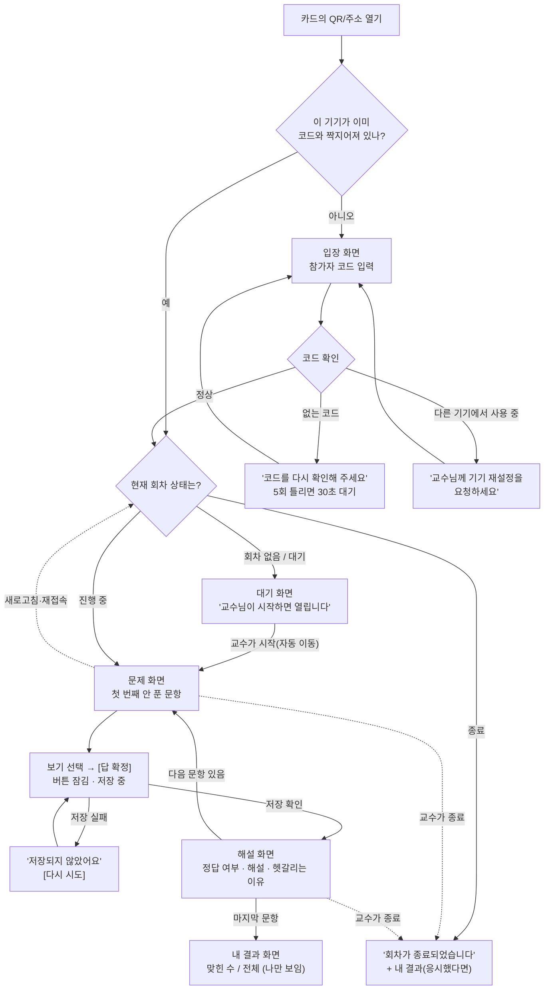
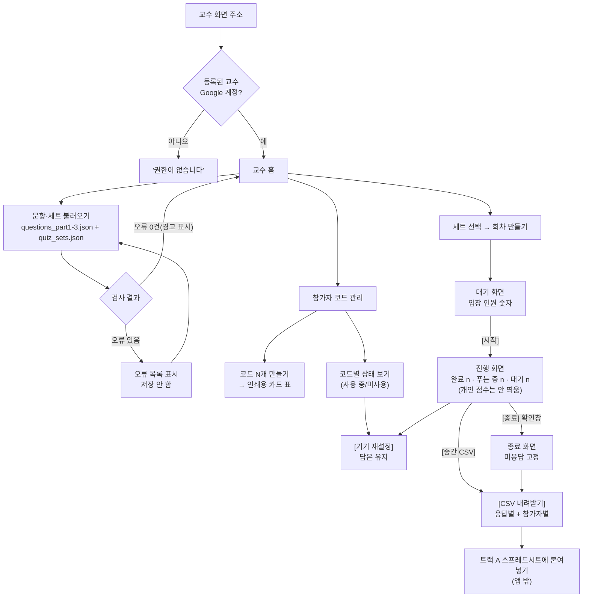

# 기능 명세서(PRD) v0.1 — "AI Agent 실무역량 팀 챌린지" 웹앱 (트랙 B)

> **한 줄 요약**: 트랙 B 웹앱 첫 버전은 **참가자 코드 입장 · 공통 퀴즈 · 자동 채점과 해설 · CSV 결과 저장** 4개 기능만 만듭니다. 정답은 답을 확정하기 전에는 브라우저(휴대폰 화면 쪽)에 보내지 않고, 한 문항은 한 번만 저장되게 합니다. 일정은 약 3주(11/2~11/22)이고, 기술은 **강의와 같은 Firebase를 추천**합니다.

| 항목 | 내용 |
|---|---|
| 작성 | 제품개발팀 서비스 기획자 (product-planner) |
| 날짜 | 2026-11-01 |
| 용도 | 🔴 결재2(설계 확정)의 핵심 첨부 |
| 근거 | `00_캡틴/결재함/2026-11-01_결재1_앱방향확정.md`(✅ 승인), `09_외부자문/2026-11-01_GPT_답변_결재1방향.md`(약점 ③, 놓친 위험 ②③), `00_캡틴/나의상황.md`, `01_비서실/교훈노트.md`, `03_교육기획팀/문항은행/questions_part1-3.json` |
| 상태 | 초안 — 결재2 전에 전략기획실장(ChatGPT) 교차검토. 무료 한도는 사실검증 결과(`09_외부자문/2026-11-01_GPT_답변_결재1방향.md` 끝 "사실검증 결과") 반영 |

---

## 0. 캡틴이 결정할 것 (결재2에서 고를 것)

### ① 어떤 도구로 만들까요? (가장 중요)
- [ ] **추천: Firebase** (Realtime Database + 익명 로그인 + Hosting) — 강의 15~21강에서 수강생이 배우는 도구와 같아서, 이 앱이 그대로 "수업의 완성 예시"가 됩니다. 동시 접속 100개(늘릴 수 없음)는 50명 반에 충분합니다.
  - ⚠️ **함정 1개**: 같은 와이파이(인터넷 주소 1개)에서는 **1시간에 새 계정 100개까지만** 만들어집니다. 수업 1회(50명)는 괜찮지만, 같은 강의실에서 모의 테스트를 반복하면 걸릴 수 있습니다 → 대책은 5장 ⑥에 넣었습니다.
- [ ] Supabase — 채점을 서버 안에서 처리하기가 더 쉽지만, 강의에서는 29강에서만 다루고, **1주일 동안 사용이 적으면 자동으로 잠듭니다(일시정지)**. 수업 사이가 1주 이상 벌어지면 수업 직전에 깨어 있는지 확인해야 합니다.
- 자세한 비교: [6장 기술 선택지 비교표](#6-기술-선택지-비교표--캡틴이-결재2에서-고를-것). 무료 한도 숫자는 **확인됨**(공식 페이지 발췌 기준, 실제 설정 때 콘솔에서 재확인 필요).

### ② 문제는 어떤 속도로 풀까요?
- [ ] **추천: 각자 자기 속도로** — 교수님이 "시작"을 누르면 각자 1번부터 끝까지 풉니다. 늦게 들어온 분도 그냥 1번부터 풀면 되고, 속도 경쟁도 생기지 않습니다(결재1의 "속도 보너스 없음"과 맞음).
- [ ] 교수님이 한 문항씩 넘기기 — 다 함께 같은 문제를 보지만, 늦게 온 분·느린 분 처리가 복잡해지고 만들 것이 늘어납니다. (v0.1 비추천)

### ③ 정답과 해설은 언제 보여 줄까요?
- [ ] **추천: 한 문항 답을 확정하면 바로 그 문항의 정답·해설** — "퀴즈로 떠올리기 + 바로 해설" 효과(결재1 근거 2).
- [ ] 퀴즈가 모두 끝난 뒤 한꺼번에 — 평가용 세트에서 문제 유출이 걱정될 때 선택. (세트마다 고를 수 있게 하면 만들 것이 늘어나므로 v0.1은 하나만 고릅니다)

### ④ 참가자 코드는 어떻게 나눠 드릴까요?
- [ ] **추천: 종이 카드(인쇄용 표)로 무작위 배부** — 교수님도 누가 어떤 코드를 받았는지 모르게 섞어서 나눠 드립니다. 참가자는 학기 내내 같은 카드를 씁니다(향상점수 계산에 필요).
- [ ] 교수님이 명단과 코드를 짝지어 따로 보관 — 카드를 잃어버려도 복구 가능하지만, "실명 없음" 원칙이 약해집니다.

> 위 4개를 모두 추천대로 하시려면 결재2에서 "PRD 추천안 승인"이라고만 적어 주시면 됩니다.

---

## 1. 이번 버전의 목표와 범위

### 목표 (한 문장)
**"교수님 수업 한 반(20~50명)이 휴대폰으로 같은 퀴즈를 풀고, 그 결과가 빠짐없이·중복 없이·정확하게 스프레드시트로 넘어가는가"**를 확인한다.

### 이 버전에서 만드는 것 (딱 4개)
| 번호 | 기능 | 우선순위 | 캡틴의 꿈 중 어디에 해당? |
|---|---|---|---|
| F1 | 무작위 참가자 코드로 입장 (실명 없음) | 필수 | 📱 모바일 · 🎓 대학생(성인 학습자 정보 보호) |
| F2 | 공통 퀴즈 응시 (교수가 세트 선택·시작) | 필수 | 🎮 게임 · 👥 친구(팀 챌린지의 공통 평가 바탕) |
| F3 | 자동 채점 + 문항별 해설 | 필수 | 🎯 맞춤(틀린 이유를 바로 알려 줌) |
| F4 | 결과 저장 + 교수용 CSV 내려받기 | 필수 | 👥 친구(팀 향상점수는 스프레드시트에서) · 🎯 맞춤(겨울방학 수준 조절의 재료 데이터) |

### 이번 버전에서 만들지 않는 것 (다음 버전으로)
| 기능 | 언제 | 이유 |
|---|---|---|
| 자동 난이도 조절, 수준별 연습 | 겨울방학 | 결재1에서 연기 확정 |
| 실시간 순위표, 팀 점수 화면 | 겨울방학 | 결재1: 순위는 활동 후에만, 이번 학기는 스프레드시트로 |
| 팀 편성 기능 | 겨울방학 | 교수님이 직접 짜고 스프레드시트에서 관리 |
| 향상점수 계산 | 겨울방학 | 트랙 A 스프레드시트 수식이 맡음 |
| XP·배지·레벨, 친구 응원 | 2027년 1학기 | 재미 요소는 안정성 확인 뒤 |
| 반 전체 문항별 정답률 화면 | 나중 | CSV를 스프레드시트에서 보면 대신 가능 |
| AI 튜터 | 나중 | 예산 0원 |
| 앱 안 "전체 기록 삭제" 버튼 | 나중 | v0.1은 관리 화면에서 손으로 삭제 (9장 절차) |

---

## 2. 사용자와 하루 이야기 (사용자 시나리오)

### 등장인물
- **참가자 "K7P-3QX"님**: 캡틴 수업을 듣는 교수자·교육 실무자(성인). 휴대폰 브라우저로 접속. 다른 동료에게 자기 점수가 보이는 것을 꺼림.
- **캡틴(교수님)**: 노트북으로 교수 화면을 띄우고 수업 진행. 코딩 초보.

### 참가자의 하루
1. 수업 시작 전, 교수님이 섞어서 나눠 준 카드를 받는다. 카드에는 주소(QR)와 코드 `K7P-3QX`가 적혀 있다.
2. QR을 찍으면 휴대폰 브라우저에 입장 화면이 뜬다. 코드를 넣으면 "입장 완료. 교수님이 시작하면 문제가 열립니다" 대기 화면이 나온다.
3. 교수님이 "시작"을 누르면 1번 문제가 자동으로 열린다. 답을 고르고 **[답 확정]**을 누른다. "확정하면 바꿀 수 없어요" 안내가 이미 보였다.
4. 저장이 끝나면 정답 여부와 해설, "많이 헷갈리는 이유"가 뜬다. **[다음 문제]**.
5. 3번 문제에서 지하철 와이파이 같은 강의실 와이파이가 끊겨 화면이 멈췄다. 새로고침하니 **3번 문제부터 다시** 열린다. 1·2번 답은 그대로다.
6. 마지막 문제를 풀면 "내 결과: 8문항 중 6문항 정답" 화면. 이 점수는 **나만** 본다. 다른 사람 점수나 순위는 나오지 않는다.
7. 다음 주에도 같은 카드로 들어간다.

### 교수님의 하루
1. 수업 전날, 교수 화면에 Google 계정으로 로그인. 교육기획팀이 준 문항 파일과 세트 파일을 올리면 "67문항, 세트 7개 확인됨, 오류 0건"이 뜬다.
2. 처음 한 번만, "참가자 코드 60개 만들기"를 누르고 인쇄용 표를 출력해 카드로 자른다.
3. 수업 시간(2회차 수업), "세트 선택 → 공통 평가 B(EVAL-B, 8문항) → 회차 만들기". 화면에 "입장 23명"이 실시간으로 올라간다.
4. 대부분 들어오면 **[시작]**. 진행 화면에는 "완료 18명 / 푸는 중 9명 / 대기 0명"처럼 **숫자만** 나온다(개인 점수는 수업 중 화면에 안 띄움, 스크린에 띄워도 안전).
5. 한 분이 "제 코드가 다른 기기에서 사용 중이래요"라고 한다. 휴대폰을 바꿨다고 해서 그 코드만 **[기기 재설정]**. 그분은 새 휴대폰으로 이어서 푼다.
6. **[종료]** → 아직 안 푼 문항은 "미응답"으로 고정된다. **[CSV 내려받기]** → 트랙 A 스프레드시트에 붙여넣기 → 향상점수·팀 점수가 수식으로 계산된다.

---

## 3. 기능 명세

> 각 기능의 "완료 기준"은 8장의 테스트 체크리스트 번호(T-xx)와 연결됩니다.

### F1. 무작위 참가자 코드로 입장 — 필수 (📱 모바일, 🎓 대학생/성인 정보 보호)
- **목적**: 실명·학번·연락처 없이 "같은 사람"을 회차가 바뀌어도 알아보기 위해. 별명은 서로 짐작될 수 있으므로 쓰지 않는다(GPT 놓친 위험 ②, 결재1 ⑤).
- **사용자**: 참가자(입장), 교수(코드 만들기·기기 재설정)
- **동작 설명**
  1. 교수가 "코드 N개 만들기"를 누르면 앱이 무작위 코드를 만든다.
     - 모양: `K7P-3QX`처럼 6글자 + 가운데 줄표. 헷갈리는 글자(0/O, 1/I/L)는 빼서 휴대폰에서 잘못 치는 일을 줄인다.
     - 반 인원 + 여유분 10개를 권장(예: 50명 반 → 60개).
     - 인쇄용 표(카드 모양)로 보여 준다. 코드와 사람을 연결한 명단은 **앱이 만들지 않는다**.
  2. 참가자가 주소에 들어와 코드를 넣으면, 앱이 그 휴대폰에 "보이지 않는 이용권"(익명 로그인: 이름 없이 기기마다 번호표를 하나 주는 기능)을 만들고, **코드와 이 기기를 짝지어 둔다**.
  3. 같은 기기는 다음에 들어와도 코드를 다시 안 쳐도 된다(브라우저가 기억). 브라우저 기록을 지웠다면 코드를 다시 넣으면 된다 — 이때 **같은 기기라도 이용권 번호가 바뀌므로** "다른 기기 사용 중"으로 보일 수 있고, 교수가 재설정해 준다.
  4. 이미 다른 기기와 짝지어진 코드를 넣으면: "이 코드는 다른 기기에서 사용 중입니다. 교수님께 '기기 재설정'을 요청하세요." → 몰래 남의 코드로 대신 푸는 것을 막는다.
  5. 교수 화면의 **[기기 재설정]**: 해당 코드와 기기의 짝을 풀어 준다. **이미 확정한 답은 지워지지 않는다**. 재설정 기록(언제, 어떤 코드)이 남는다.
  6. 없는 코드를 넣으면: "코드를 다시 확인해 주세요." 5번 연속 틀리면 30초 기다리게 한다(코드 맞히기 장난 방지).
- **저장하지 않는 것**: 이름, 학번, 이메일, 전화번호, 사진, 위치. 입력칸 자체가 없다.
- **완료 기준**: T-01 ~ T-08

### F2. 공통 퀴즈 응시 — 필수 (🎮 게임, 👥 친구)
- **목적**: 모두가 **같은 문항**을 풀어, 향상점수를 공정하게 비교할 수 있게 한다(교훈노트: 연습과 평가 분리, 향상점수는 공통 문항으로만).
- **사용자**: 교수(세트 선택·회차 만들기·시작·종료), 참가자(풀기)
- **동작 설명**
  1. **문항 불러오기**: 교수가 `questions_part1-3.json`을 **고치지 않고 그대로** 올린다. 앱은 4장의 검사 규칙으로 확인한 뒤 저장한다.
  2. **세트**: 어떤 문항을 어떤 순서로 묶어 한 회차로 낼지는 세트 파일(`quiz_sets.json`, 교육기획팀 작성 완료)로 정한다. 문항마다 용도(`pool`: 진단/평가/연습)가 적혀 있고, 앱은 두 파일이 서로 맞는지 검사한다(4장 참고).
  3. **회차 만들기**: 교수가 세트를 고르면 "회차"(앱 안의 한 판)가 하나 생긴다. 한 판 = 세트 1개. 상태는 `대기 → 진행 중 → 종료` 세 가지뿐이다. 한 번에 진행 중인 판은 1개만. 1회차 수업처럼 세트 2개(진단 + 평가 A)를 쓰는 날은 **판 2개를 차례로** 연다(4장 수업 회차표).
  4. **대기**: 참가자는 입장 후 대기 화면. 교수 화면엔 입장 인원 숫자.
  5. **시작**: 교수가 [시작]을 누르면 모든 참가자 화면에 1번 문제가 자동으로 열린다(새로고침 불필요).
  6. **풀기**: 한 화면에 한 문항. 객관식(mcq)은 보기 4개, OX(ox)는 보기 2개 — 둘 다 `choices`를 그대로 버튼으로 그린다. 보기 순서는 앱이 섞지 않는다(정답 번호 `answer_index`와 어긋나는 실수를 막기 위해, 10강 L10-Q2 해설과 같은 이유). 정답 위치 쏠림은 이미 문항 파일에서 세트별로 고르게 맞춰져 있다(평가 세트마다 정답 위치 1·2·3·4번이 각 2개).
  7. **문항 순서**: 세트에 적힌 순서대로. 모두 같은 순서.
  8. **시간 제한 없음**, 속도 점수 없음. 교수가 [종료]를 누르면 끝.
  9. **늦게 들어온 참가자**: 회차가 "진행 중"이면 언제든 들어와 1번부터 푼다. "종료" 후에 들어오면 "이번 회차는 끝났습니다" 안내만 보인다(답 입력 불가).
  10. **종료**: 교수가 [종료]를 누르면 더 이상 답을 받지 않는다. 그때까지 안 푼 문항은 CSV에 "미응답"으로 나온다. 참가자 화면은 "회차가 종료되었습니다 + 지금까지 내 결과"로 바뀐다.
  11. **1회 응시**: 한 회차에서 한 코드는 한 번만 푼다. 다시 풀기 버튼은 없다.
- **완료 기준**: T-09 ~ T-18

### F3. 자동 채점 + 문항별 해설 — 필수 (🎯 맞춤)
- **목적**: 답을 확정한 즉시 정답 여부와 이유를 알려 줘 "떠올리기 + 바로 해설" 효과를 얻는다. 동시에 점수 조작을 막는다.
- **사용자**: 참가자(결과 보기), 교수(CSV에서 채점 결과 확인)
- **동작 설명**
  1. 참가자가 보기를 고르고 **[답 확정]**을 누르면, 버튼이 바로 "저장 중…"으로 바뀌고 다시 눌리지 않는다.
  2. 서버(인터넷 건너편의 데이터 보관소)가 "이 코드의 이 문항 답이 아직 없을 때만" 저장한다. **처음 한 번만 저장되고, 그다음 시도는 모두 거절**된다.
  3. 저장이 확인된 뒤에야 그 문항의 **정답 번호·해설·자주 틀리는 이유**(`answer_index`, `explanation`, `common_wrong_reason`)를 열어 보여 준다.
     - 화면: "정답입니다 / 아쉬워요, 정답은 ②번" + 해설.
     - 내가 고른 답이 `common_wrong_index`와 같으면 `common_wrong_reason`을 "이렇게 헷갈리기 쉬워요"로 함께 보여 준다.
  4. 마지막 문항 뒤 "내 결과" 화면: 맞힌 개수 / 전체 문항 수. **본인에게만** 보인다.
  5. **공식 점수는 참가자 휴대폰이 아니라 서버에 저장된 답과 정답표로 다시 계산**한다(교수 화면의 CSV 만들기 단계). 휴대폰 화면에 뜨는 "정답입니다"는 안내일 뿐, 그 값을 점수로 믿지 않는다.
  6. 문항 1개가 잘못 만들어진 것으로 나중에 밝혀지면(예: 정답 번호 오류): v0.1에서는 문항 파일을 고쳐 다시 올리고 CSV를 다시 내려받으면 **새 정답표로 다시 채점**된다(참가자의 원래 선택은 그대로 남아 있으므로 가능).
- **완료 기준**: T-19 ~ T-27

### F4. 결과 저장 + CSV 내려받기 — 필수 (👥 친구, 🎯 맞춤)
- **목적**: 트랙 A 스프레드시트(향상점수·팀 점수 계산)에 그대로 붙여넣을 수 있는 결과를 만든다.
- **사용자**: 교수
- **동작 설명**
  1. 모든 답은 확정 순간 서버에 저장된다(F3). 종료 후 따로 "저장" 버튼을 누를 필요가 없다.
  2. 교수 화면의 **[CSV 내려받기]**는 두 가지 파일을 준다.
     - **응답별 CSV** (한 줄 = 참가자 1명 × 문항 1개): 회차, 세트, 참가자코드, 문항ID, 문항 순서, 고른 보기 번호, 정답 번호, 정답여부(1/0/빈칸), 상태(응답/미응답), 확정 시각
     - **참가자별 CSV** (한 줄 = 참가자 1명): 회차, 세트, 참가자코드, 맞힌 수, 응답 수, 전체 문항 수, 정답률(%), 완료 여부
  3. 회차에 **입장한 모든 코드 × 세트의 모든 문항**이 빠짐없이 한 줄씩 나온다. 안 푼 문항은 "미응답"으로 표시해 "기록 누락"과 "안 풂"을 구분한다.
  4. 한글이 엑셀·구글 시트에서 깨지지 않게 저장한다(UTF-8 BOM: 엑셀이 한글 파일임을 알아보는 표시).
  5. 보기 번호는 사람이 읽기 쉽게 **1부터** 센다(파일 안의 `answer_index`는 0부터 세므로 +1 해서 보여 줌). CSV 맨 위 설명 줄에 이 규칙을 적지 않고, 열 이름을 "고른 보기(1~4)"처럼 적는다.
  6. 진행 중에도 내려받을 수 있다(중간 백업용). 이때 파일 이름에 "진행중"이 붙는다.
  7. 실명 칸은 없다. 스프레드시트에서 팀은 참가자코드로 묶는다.
- **완료 기준**: T-28 ~ T-35

---

## 4. 문항 데이터 — `questions_part1-3.json`을 그대로 읽기

### 파일 구조 (교육기획팀 파일 그대로, 67문항 = 객관식 59 + OX 8)
| 칸 이름 | 뜻 | 앱에서 쓰는 곳 | 참가자에게 언제 보이나 |
|---|---|---|---|
| `id` | 문항 번호 (예: `L01-Q1`) | 모든 기록의 기준 | 안 보임 |
| `part`, `lecture`, `difficulty` | 부·강·난이도(1~3) | CSV·나중 분석 | 안 보임 |
| `type` | `mcq`(객관식) / `ox` | 보기 버튼 개수 | — |
| `question` | 문제 | 문제 화면 | 문제 열릴 때 |
| `choices` | 보기 목록 | 보기 버튼 | 문제 열릴 때 |
| `answer_index` | 정답 위치(0부터) | 채점 | **답 확정 뒤에만** |
| `explanation` | 해설 | 해설 화면 | **답 확정 뒤에만** |
| `common_wrong_index`, `common_wrong_reason` | 자주 고르는 오답과 이유 | 해설 화면 | **답 확정 뒤에만** |
| `source_lectures`, `source_section` | 근거 강의 위치 | 해설 화면 아래 "근거: 01강 핵심 개념" | 답 확정 뒤 |
| `status`, `review_note` | 검토 상태 (`reviewed` 3개: L01-Q1·L06-Q2·L15-Q3 / 나머지 64개 `draft`)와 검토 메모 | 불러오기 검사 | 안 보임 |
| `pool` | 용도: `diagnostic`(진단 12) / `assessment`(평가 24) / `practice`(연습 31) | 세트 검사, CSV | 안 보임 |
| `set`, `slot` | 평가 문항만: 어느 평가 세트(`A`/`B`/`C`)의 몇 번째 자리(`S1`~`S8`)인지. 나머지는 빈 값(null) | 세트 검사 | 안 보임 |

### 불러올 때 앱이 반드시 나누는 것
- 앱은 파일을 받으면 **두 칸으로 나눠 저장**한다.
  - **"문제지" 칸** (`id`, `type`, `question`, `choices`) — 회차 진행 중 참가자가 읽을 수 있음
  - **"정답지" 칸** (`answer_index`, `explanation`, `common_wrong_*`, `source_*`) — 참가자는 **그 문항 답을 확정한 뒤, 그 문항 것만** 읽을 수 있음
- 즉, 휴대폰으로 미리 받아 두는 데이터에는 정답이 **아예 들어 있지 않다**(5장 ③).

### 불러오기 검사 규칙 (하나라도 걸리면 저장하지 않고 오류 목록을 보여 줌)
1. `id`가 겹치지 않는다.
2. `type`이 `mcq` 또는 `ox`이다. `ox`는 보기가 정확히 2개, `mcq`는 2개 이상.
3. `answer_index`, `common_wrong_index`가 보기 범위 안(0 ~ 보기 수-1)에 있다.
4. `question`, `explanation`이 비어 있지 않다.
5. `status`가 `draft`인 문항이 있으면 **경고**만 띄운다("교수 검토 전 문항 64개 — 모의 테스트에만 사용하세요"). 실제 수업 전에 교수 검토가 끝나면 교육기획팀이 `status`를 `reviewed`로 바꾼다.
6. `pool`이 `diagnostic`/`assessment`/`practice` 중 하나다.
7. 결과 요약: "67문항(객관식 59, OX 8), 오류 0건, 경고 N건".

### 세트 파일 `03_교육기획팀/문항은행/quiz_sets.json` (작성 완료)
칸 모양은 `set_id`·`title`·`purpose`·`question_ids`(이 순서대로 출제)이고, 이 PRD 형식 그대로입니다. 앱은 이 파일도 고치지 않고 그대로 읽습니다.

| set_id | 용도(`purpose`) | 문항 수 | 문항 종류 | 비고 |
|---|---|---|---|---|
| `DIAG` | 진단 (`diagnostic`) | 12 | 객관식 10 + OX 2 | 팀 구성 참고용만, 경쟁 점수와 연결하지 않음 |
| `EVAL-A` | 공통 평가 (`assessment`) | 8 | **4지선다만** | 기준점수. 정답 위치 1·2·3·4번 각 2개 |
| `EVAL-B` | 공통 평가 | 8 | 4지선다만 | 정답 위치 각 2개 |
| `EVAL-C` | 공통 평가 | 8 | 4지선다만 | 정답 위치 각 2개 |
| `PRACTICE-P1` | 연습 (`practice`) | 10 | 객관식·OX | 1부 01~05강 |
| `PRACTICE-P2` | 연습 | 10 | 객관식·OX | 2부 06~10강 |
| `PRACTICE-P3` | 연습 | 11 | 객관식·OX | 3부 11~15강 |
| 합계 | | **67** | | 진단·평가·연습 사이에 겹치는 문항 0개 |

**수업 회차표 (3회 확정)** — 향상점수는 평가 A·B·C(공통 문항)로만 계산합니다(교훈노트).
| 수업 | 앱에서 여는 판 | 메모 |
|---|---|---|
| 1회차 | ① `DIAG`(12) → ② `EVAL-A`(8) | 판 2개를 차례로. 팀 대결 없음(결재1 ②). EVAL-A가 기준점수 |
| 2회차 | `EVAL-B`(8) | 혼합 수준 팀 시작, 팀 점수 = 향상점수 평균(스프레드시트) |
| 3회차 | `EVAL-C`(8) | 활동 후 팀 결과 공개 + 익명 설문 |
| (선택) 수업 밖 | `PRACTICE-P1~P3` | 각자 연습용. v0.1 필수 범위 아님 |

**세트 검사 규칙 (오류면 저장하지 않음)**
1. 세트에 적힌 문항 번호가 모두 문항 파일에 있다.
2. 세트의 `purpose`와 그 문항들의 `pool`이 같다(진단 세트에 평가 문항이 섞이면 오류).
3. 평가 문항의 `set`·`slot`이 세트 파일의 위치와 맞는다(예: `EVAL-B`의 2번째 = `set: "B"`, `slot: "S2"`인 문항). 두 파일이 서로 다르면 오류 — 같은 내용을 두 곳에 적어 둔 만큼 어긋남을 반드시 잡습니다.
4. 평가 세트끼리, 그리고 진단·연습과 평가 사이에 같은 문항이 겹치지 않는다.
5. (경고) 평가 세트의 정답 위치가 한쪽에 몰려 있으면 알림 — 지금 파일은 세트마다 고르게 맞춰져 있음.
- 보기 순서를 바꿔 정답 위치를 맞춘 만큼, 교육기획팀은 `common_wrong_index`도 함께 옮겨졌는지 확인합니다(앱은 범위만 검사 가능, 뜻은 사람이 확인). 표본 확인(L01-Q1, L01-Q3)에서는 맞게 옮겨져 있었습니다.
- 평가 문항은 수업 전에 노출하지 않는다(GPT 약점 ②). 평가 A·B·C는 서로 다른 문항이므로, 한 판에서 답 확정 직후 해설을 보여 줘도 다음 회차 평가가 새지 않습니다(0장 ③ 추천안과 맞음).

---

## 5. 신뢰성 설계 — "누락 0, 중복 0, 채점 100% 일치"를 위한 규칙

### ① 한 문항은 한 번만 확정
- 답은 "회차 / 참가자코드 / 문항ID" 자리에 하나만 저장된다. 같은 자리에 두 번째 답은 **서버가 거절**한다(빈 자리일 때만 쓰기 허용).
- 화면에서도 [답 확정]을 누르면 바로 잠긴다(두 번 누르기 방지). 화면이 막지 못해도 서버가 막는다 — **두 겹 잠금**.
- 확정 시각은 휴대폰 시계가 아니라 **서버 시계**로 찍는다(휴대폰 시각 조작 무시).

### ② 새로고침 · 재접속 · 인터넷 끊김
| 상황 | 앱의 행동 |
|---|---|
| 풀다가 새로고침 | 서버에 저장된 내 답을 읽어 **첫 번째 안 푼 문항**부터 연다. 이미 확정한 문항은 해설 보기만 가능 |
| 브라우저를 닫았다 다시 염 | 같은 기기면 코드 없이 바로 이어 풀기 |
| [답 확정] 중 인터넷 끊김 | "저장되지 않았어요. 다시 시도" 버튼. **저장 확인 전에는 해설·다음 문제를 보여 주지 않음** |
| 다시 시도했는데 사실 첫 번째가 이미 저장돼 있었음 | 서버에 있는 답을 그대로 보여 주고 성공 처리(같은 답이 두 번 쌓이지 않음) |
| 교수가 [시작]/[종료]를 눌렀는데 참가자 화면이 꺼져 있었음 | 화면이 다시 켜지면 서버의 현재 회차 상태를 읽어 맞는 화면으로 이동 |
| 교수 노트북이 꺼짐 | 회차는 서버에 그대로 진행 중. 다시 로그인하면 이어서 관리 |

### ③ 점수 조작 방지 (쉬운 말 설명)
비유: **시험지는 미리 나눠 주되, 정답지는 각자 답안을 걷은 다음에 그 문항 것만 보여 준다.**
1. **정답을 휴대폰에 미리 보내지 않는다.** 휴대폰이 받는 "문제지"에는 정답 칸이 없다. 그래서 브라우저 개발자 도구(웹페이지 속을 들여다보는 기능)로 열어 봐도 정답이 안 나온다.
2. **답을 확정해야 그 문항 정답지만 열린다.** 서버 규칙이 "이 사람의 이 문항 답이 저장돼 있으면 그 문항 정답만 읽기 허용"으로 되어 있다. 아직 안 푼 문항 정답은 열리지 않는다.
3. **확정한 답은 못 바꾼다.** 정답을 본 뒤 앞 문항 답을 고치려 해도 서버가 거절한다(①).
4. **점수는 휴대폰이 보낸 숫자를 믿지 않는다.** 휴대폰은 "몇 번을 골랐다"만 보낸다. 맞았는지·몇 점인지는 서버에 있는 정답표로 교수 쪽에서 다시 계산한다. 휴대폰이 "100점"이라고 보내는 길이 아예 없다.
5. **남의 자리에 못 쓴다.** 각 참가자는 자기 코드와 짝지어진 자리에만 쓸 수 있다.
6. **코드 목록을 훔쳐볼 수 없다.** 참가자는 자기가 입력한 코드 한 개만 확인할 수 있고, 전체 코드 목록은 교수만 본다.
7. **교수 화면은 교수 계정만.** 교수용 기능(문항 올리기, 시작·종료, CSV, 기기 재설정)은 미리 등록한 교수님 Google 계정으로만 열린다.
8. **진행 중이 아닌 회차에는 못 쓴다.** "대기"나 "종료" 상태에서는 서버가 답을 받지 않는다.

> 남는 위험(솔직하게): 옆 사람 휴대폰을 보거나, 먼저 푼 사람이 정답을 알려 주는 것은 기술로 막지 못합니다. 성적에 반영하지 않으므로(결재1 ③) v0.1에서는 받아들일 수 있는 수준입니다.

### ④ 중복 기기 · 대리 응시
- 한 코드 = 한 기기(F1-4). 두 번째 기기는 "사용 중" 안내.
- 기기를 바꿔야 하면 교수가 [기기 재설정] → 이전 답은 유지, 새 기기에서 이어 풀기.
- 한 사람이 코드 두 장으로 두 번 푸는 것은 막을 수 없음 → 카드는 1인 1장만 배부하고, 남은 카드는 교수가 보관.

### ⑤ 늦게 들어온 참가자
- "진행 중" 회차에는 언제든 입장해 1번부터 푼다. 시간 제한이 없으므로 손해가 없다.
- 교수가 [종료]를 누를 때까지 못 푼 문항은 "미응답" → 스프레드시트에서 "완료 여부"로 걸러 낼 수 있다.
- "종료" 뒤 입장 → 안내만 표시, 기록 없음.

### ⑥ Firebase 새 계정 만들기 제한 (같은 와이파이에서 1시간 100개)
- **사실**(확인됨, 공식 페이지 발췌 기준 — 콘솔에서 재확인 필요): Firebase는 새 계정(이름 없는 익명 계정 포함)을 **인터넷 주소(IP) 1개당 1시간에 100개**까지만 만들어 줍니다. 강의실 와이파이는 보통 모든 휴대폰이 바깥으로는 **같은 인터넷 주소 1개**로 보입니다. 출처: [Auth 한도](https://firebase.google.com/docs/auth/limits)
- **언제 걸리나**: 실제 수업 1회(50명 + 여유)는 100개 안이라 괜찮습니다. 위험한 때는 ① 같은 강의실에서 모의 테스트를 여러 번 하면서 브라우저 기록을 지우거나 시크릿 창을 쓸 때(매번 새 계정이 생김) ② 가짜 참가자 50명 자동 시험을 진짜 프로젝트에 돌릴 때 ③ 모의 테스트 직후 같은 시간대에 실제 수업이 이어질 때.
- **대책 (v0.1에 넣는 것, 위에서부터 우선)**
  1. **한 번 만든 계정을 학기 내내 다시 쓴다.** 익명 계정은 그 휴대폰 브라우저에 남아 있으므로, 참가자는 첫 회차에만 새 계정이 생기고 이후 회차에는 새로 만들지 않습니다. 앱은 입장 때 "이미 이 기기에 계정이 있으면 새로 만들지 않기"를 반드시 지킵니다. 안내 문구: "시크릿 창 말고 평소 브라우저로 열어 주세요."
  2. **자동 시험(가짜 50명)은 진짜 프로젝트가 아니라 에뮬레이터(내 컴퓨터 안의 가짜 Firebase)에서만** 돌립니다. 에뮬레이터에는 이 제한이 없습니다. 진짜 프로젝트에서는 실제 휴대폰 10~20대만 씁니다.
  3. **모의 테스트용 기기는 같은 기기·같은 브라우저를 계속 사용**하고, 테스트 사이에 기록을 지우지 않습니다. 기기 재설정 시험(T-06)도 새 계정을 만드는 횟수를 기록합니다.
  4. **실제 수업·시연 1주 전, 콘솔(관리 화면)에서 한도 일시 상향을 신청**합니다(공식 안내상 신청 가능). 비서실 일정에 넣습니다.
  5. **실제 수업은 모의 테스트와 같은 시간대(1시간 안)에 이어 붙이지 않습니다.**
  6. **막혔을 때의 화면**: 계정 만들기가 거절되면 "접속이 몰려 잠시 막혔어요. 1~2분 뒤 다시 누르거나, 와이파이를 끄고 휴대폰 데이터로 접속해 주세요" 안내 + [다시 시도]. (휴대폰 데이터는 대개 인터넷 주소가 달라 제한을 피할 수 있으나 통신사마다 다를 수 있음 — 미확인)
- **비상 대안(만들지 않고 설계만 남겨 둠)**: 익명 로그인 없이 **앱이 참가자 코드를 직접 확인**하는 방식 — 참가자 코드 자체를 "열쇠"로 쓰고, 첫 입장 때 휴대폰에 무작위 기기표를 저장해 코드와 짝짓습니다. 계정을 만들지 않으므로 이 제한이 아예 없습니다. 다만 서버 규칙이 "누가 읽는지"를 알기 어려워 **정답지 공개 제한(5장 ③-2)이 약해집니다**(코드를 2장 가진 사람이 한 장으로 먼저 풀고 정답을 엿볼 수 있음). 그래서 기본안이 아니라, 위 대책 1~6으로도 모의 수업에서 막히면 결재3 전에 다시 결정합니다.
- 참고: Identity Platform(업그레이드형 로그인)을 켜면 무료에서 하루 활성 사용자 3,000명 상한이 생깁니다 — **v0.1은 켜지 않습니다.**

### ⑦ Realtime Database 동시 연결 100개 (늘릴 수 없음)
- **사실**(확인됨, 공식 페이지 발췌 기준 — 콘솔에서 재확인 필요): 무료는 동시 연결 100개, 늘릴 수 없음. **브라우저 탭 1개 = 연결 1개**. 100개가 차면 새 접속은 거절되고, 이미 들어온 사람은 계속 사용. 출처: [RTDB 한도](https://firebase.google.com/docs/database/usage/limits)
- 50명 반: 참가자 50 + 교수 노트북·프로젝터 2~3 = 약 55개 → **여유 있음**. 단 참가자가 탭을 여러 개 열면 그만큼 늘어나므로 안내 문구에 "탭 하나만 열어 주세요".
- 교수 화면에 **현재 연결 수**(입장 인원과 별도)를 작게 표시해 80개를 넘으면 노란 경고.
- 한 회차에 90명 이상이 필요한 날이 오면 v0.1로는 운영하지 않습니다(겨울방학에 다시 결정).

### ⑧ 누락 · 중복의 정의 (테스트에서 이렇게 셉니다)
- **누락**: 참가자가 [답 확정] 후 "저장됨"을 본 답인데 CSV에 없거나 다른 값으로 나옴 → 0건이어야 함
- **중복**: CSV에서 "회차 + 참가자코드 + 문항ID"가 같은 줄이 2개 이상 → 0건이어야 함
- **채점 불일치**: CSV의 정답여부가, 문항 파일의 `answer_index`로 따로 계산한 정답 표와 다른 줄 → 0건이어야 함

---

## 6. 기술 선택지 비교표 — 캡틴이 결재2에서 고를 것

> 무료 한도는 사실검증관의 확인 결과입니다(`09_외부자문/2026-11-01_GPT_답변_결재1방향.md` 끝 "사실검증 결과", 2026-11-01). **"확인됨"은 공식 페이지 발췌 기준**이며(검증 환경에서 공식 페이지를 직접 열지 못함), 실제 설정 때 **콘솔(관리 화면)에서 한 번 더 확인**해야 합니다. 검증 대상이 아니었던 항목은 "(미확인)"으로 표시했습니다.

| 비교 기준 | **Firebase** (추천) | Supabase |
|---|---|---|
| 한마디로 | 구글의 앱 뒷방 서비스. 데이터를 **나뭇가지 모양**(JSON 트리)으로 저장 | 데이터를 **엑셀 같은 표**(관계형 DB)로 저장하는 서비스 |
| 강의와의 관계 | **15~21강에서 수강생이 직접 쓰는 도구** (Auth·Hosting·Realtime Database, 19강 응시 기록 저장과 거의 같은 구조) | 29강에서 한 번 다룸 |
| "수업의 완성 예시"로 보여 주기 | 매우 좋음 — "여러분이 배운 그 도구로 만들었습니다" | 보통 — 새 도구 설명이 필요 |
| 정답 숨기기·1회 확정 (5장 ③①) | **보안 규칙**(누가 어디를 읽고 쓸 수 있는지 적는 규칙 파일)으로 구현. 채점은 교수 화면에서 서버 데이터로 계산 | 데이터베이스 안의 작은 함수(RPC)로 "확정+채점+해설 돌려주기"를 한 번에 처리 — **서버 채점이 더 자연스러움** |
| 서버에서 코드 돌리기 | Cloud Functions는 유료 요금제(카드 등록)가 필요하다고 알려져 있음 (미확인) → v0.1은 Functions 없이 설계 | 무료에서도 DB 함수 사용 가능 (미확인) |
| 이름 없는 입장(익명 로그인) | 있음. 단 **새 계정은 인터넷 주소(IP) 1개당 1시간 100개까지**(익명 포함), 콘솔에서 일시 상향 신청 가능 — **확인됨**(공식 페이지 발췌 기준, 콘솔에서 재확인 필요) → 대책 5장 ⑥ | 있음. 계정 만들기 횟수 제한 여부 (미확인) |
| 화면 자동 갱신(시작·종료 알림) | 기본 기능 | 있음(Realtime 기능) |
| 무료 한도: 동시 접속 | Realtime Database **100개, 늘릴 수 없음**. 탭 1개 = 연결 1개, 다 차면 새 접속만 거절 — **확인됨**(공식 페이지 발췌 기준, 콘솔에서 재확인 필요) → 50명 반에 여유, 대책 5장 ⑦ | 실시간 연결 **200개**(채널 참가 초당 100회, 메시지 월 200만 건) — **확인됨**(공식 페이지 발췌 기준, 콘솔에서 재확인 필요) |
| 무료 한도: 저장·읽기·쓰기 | (참고: 우리는 Realtime Database를 씀) Firestore는 하루 읽기 5만·쓰기 2만, 한국 시간 오후 4~5시 초기화, 프로젝트당 DB 1개에만 무료 — **확인됨**(공식 페이지 발췌 기준, 콘솔에서 재확인 필요). Realtime Database 저장 용량 (미확인) | DB **500MB**, 무료 프로젝트 2개까지 — **확인됨**(공식 페이지 발췌 기준, 콘솔에서 재확인 필요) |
| 무료의 함정 | ① 같은 와이파이에서 새 계정 1시간 100개 제한(위) ② 한도 초과 시 "그 달 중단"인지 "하루 뒤 초기화"인지 공식 문서끼리 표현이 다름 — 부분 확인 | **1주일 동안 사용이 적으면 자동 일시정지**. 미리 이메일 경고, 데이터는 보존되고 다시 켤 수 있음 — **확인됨**(공식 페이지 발췌 기준, 콘솔에서 재확인 필요). → 회차 사이가 1주 이상 벌어지거나 시험기간·방학이 끼면 **수업 당일 앱이 잠들어 있을 위험** |
| 화면 올리기(호스팅) | Firebase Hosting (13·15강). 저장 10GB·전송 하루 360MB(옛 문서는 "월 10GB"로 달라 부분 확인) — 우리 앱(수 MB)엔 어느 기준이든 충분 | 별도로 Vercel 등 필요(나의상황.md에 Vercel 언급), Vercel 무료 한도 (미확인) |
| 50명 수업 규모에 충분한가 | **충분** — 연결 약 55개/100개, 첫 회차 새 계정 약 50개/100개. 사용량도 매우 작음(가장 많은 1회차도 50명 × 20문항 = 답 1,000건). 단 같은 강의실에서 테스트를 반복하면 계정 제한에 주의 | **충분** — 연결 200개. 단 일시정지 관리가 필요 |
| 코딩 초보에게 어려운 점 | 보안 규칙 문법이 낯섦 → 규칙을 **테스트 도구(에뮬레이터: 내 컴퓨터 안의 가짜 Firebase)**로 미리 시험 | SQL(표에 명령하는 말)과 권한 규칙(RLS)을 새로 배워야 함 |
| 돈 | 0원 (무료 요금제 안에서) | 0원 (무료 요금제 안에서) |

### 추천: Firebase — 이유 3가지
1. **이 앱이 곧 교재가 됩니다.** 수강생이 15~21강에서 Firebase로 만드는 것과 같은 도구라서, 마지막 회차 시연 때 "배운 방법 그대로"를 보여 줄 수 있습니다(결재1에서 트랙 B를 유지한 이유).
2. **4개 기능에는 서버 함수가 필요 없습니다.** 정답 숨기기·1회 확정·남의 자리 쓰기 금지는 보안 규칙으로, 공식 채점은 교수 화면에서 서버 데이터로 계산하는 방식으로 해결됩니다. 그래서 유료 기능(카드 등록) 없이 갈 수 있습니다.
3. **화면 올리기까지 한 곳에서 되고, 잠들지 않습니다.** Hosting·로그인·데이터가 한 프로젝트 안에 있어 설정할 곳이 적고, Supabase처럼 1주일 쉬면 일시정지되는 일이 없어 수업 간격이 벌어지는 일정에 더 안전합니다.

> **Firebase를 고를 때 꼭 지킬 것**: 5장 ⑥의 계정 제한 대책(학기 내내 같은 계정 재사용, 자동 시험은 에뮬레이터에서만, 시연 1주 전 한도 상향 신청). 이것을 일정(10장)과 테스트(T-36~T-38)에 넣었습니다.

### 이럴 때는 Supabase로 바꾸세요
- 모의 수업에서 대책 5장 ⑥을 다 써도 계정 만들기 제한에 걸릴 때 (Supabase를 고르면 수업 전날 "깨어 있는지 확인"을 비서실 일정에 넣어야 함)
- 한 회차에 90명 이상이 동시에 들어와야 할 때 (Firebase 무료 100개는 늘릴 수 없음)
- 보안 규칙 테스트(T-19~T-24)가 1주차 안에 통과되지 않을 때 → 서버 함수로 채점하는 Supabase 방식이 더 단순할 수 있음
- 겨울방학 버전에서 학생·응시·문항을 표로 엮어 분석할 일이 많아질 때(29강 내용과 연결)

---

## 7. 화면 흐름도

### 참가자 화면 (휴대폰)

### 교수 화면 (노트북)

---

## 8. 완료 기준 — 테스트 체크리스트 (QA 테스터가 그대로 사용)

> 모든 테스트는 **가짜 참가자 코드·가짜 데이터**로만 합니다(사칙 7장). "기대 결과"와 다르면 실패로 기록하고 재현 순서를 적습니다.

### F1 입장
| 번호 | 해 볼 일 | 기대 결과 |
|---|---|---|
| T-01 | 교수가 코드 60개 만들기 | 60개 모두 서로 다르고 0/O/1/I/L 글자가 없음, 인쇄용 표가 나옴 |
| T-02 | 정상 코드로 휴대폰 입장 | 대기 화면(또는 진행 중이면 문제 화면) |
| T-03 | 없는 코드 입력 | "코드를 다시 확인" 안내, 입장 안 됨 |
| T-04 | 없는 코드 5번 연속 입력 | 30초 대기 안내 |
| T-05 | 휴대폰 A로 입장한 코드를 휴대폰 B에서 입력 | B에 "다른 기기에서 사용 중", A는 정상 |
| T-06 | 교수가 그 코드 [기기 재설정] 후 B에서 입력 | B로 입장, A에서 확정했던 답이 B에도 그대로 보임 |
| T-07 | 입장 화면·데이터 저장소 전체 확인 | 이름·학번·연락처 입력칸과 저장 칸이 없음 |
| T-08 | 참가자 기기에서 전체 코드 목록 읽기 시도(테스트 도구) | 거절됨 |

### F2 응시
| 번호 | 해 볼 일 | 기대 결과 |
|---|---|---|
| T-09 | 문항 파일·세트 파일 원본을 그대로 올리기 | "67문항(객관식 59, OX 8), 세트 7개, 오류 0건, 경고(draft) 64건" |
| T-10 | `id`가 겹치게, `answer_index`가 범위 밖이게 고친 가짜 파일 올리기 | 오류 목록이 나오고 저장되지 않음 |
| T-11 | 가짜 세트 파일로 ① 없는 문항 번호 ② 평가 세트에 연습 문항 섞기 ③ `EVAL-A`의 순서를 `slot`과 다르게 바꾸기 | 세 경우 모두 오류로 표시, 저장 안 됨 |
| T-12 | 세트 선택 → 회차 만들기 → 입장 인원 확인 | 휴대폰 입장 수와 숫자가 일치 |
| T-13 | [시작] 누르기 | 대기 중인 모든 휴대폰이 새로고침 없이 1번 문제로 이동 |
| T-14 | OX 문항, 객관식 문항 표시 | OX는 버튼 2개, 객관식은 4개, 보기 순서가 파일과 같음 |
| T-15 | 진행 중에 새 휴대폰으로 늦게 입장 | 1번부터 풀 수 있음 |
| T-16 | [종료] 뒤 새 코드로 입장 | "회차가 종료되었습니다", 답 입력 불가 |
| T-17 | [종료] 순간 풀던 참가자 | 화면이 종료 안내로 바뀌고, 그 뒤 확정 시도는 거절됨 |
| T-18 | 대기 상태에서 답 저장 시도(테스트 도구) | 거절됨 |

### F3 채점·해설·조작 방지
| 번호 | 해 볼 일 | 기대 결과 |
|---|---|---|
| T-19 | 문제 화면에서 브라우저 개발자 도구로 받은 데이터 확인 | `answer_index`·`explanation`이 **없음** |
| T-20 | 아직 안 푼 문항의 정답지 읽기 시도(테스트 도구) | 거절됨 |
| T-21 | [답 확정] 빠르게 5번 연타 | 저장 1건, 화면 정상 |
| T-22 | 확정한 문항에 다른 답 쓰기 시도(테스트 도구) | 거절됨, 원래 답 유지 |
| T-23 | 다른 참가자 자리에 답 쓰기 시도(테스트 도구) | 거절됨 |
| T-24 | 교수 기능(시작·CSV·재설정)을 교수 아닌 계정으로 시도 | 거절됨 |
| T-25 | 정답 고르기 / 오답 고르기 / `common_wrong_index` 오답 고르기 | 각각 "정답", "정답은 n번"+해설, 해설+"헷갈리는 이유"가 뜸 |
| T-26 | 확정 중 비행기 모드 켜기 → 끄고 [다시 시도] | 저장 1건, 해설 정상, 중복 없음 |
| T-27 | 풀던 중 새로고침 / 브라우저 닫고 다시 열기 | 첫 번째 안 푼 문항부터, 이전 답 유지 |

### F4 결과·CSV
| 번호 | 해 볼 일 | 기대 결과 |
|---|---|---|
| T-28 | 종료 후 CSV 2종 내려받기 | 응답별·참가자별 파일이 둘 다 내려받아짐 |
| T-29 | 엑셀과 구글 시트에서 각각 열기 | 한글 깨짐 없음 |
| T-30 | 응답별 CSV 줄 수 | 입장한 코드 수 × 세트 문항 수와 정확히 같음 |
| T-31 | "회차+코드+문항ID" 중복 검사(스프레드시트 COUNTIFS) | 중복 0건 |
| T-32 | 안 푼 문항 | 상태 "미응답", 정답여부 빈칸 |
| T-33 | 보기 번호 | 1부터 셈(파일의 0번 = CSV의 1번) |
| T-34 | 진행 중 CSV | 파일 이름에 "진행중", 그때까지의 답이 들어 있음 |
| T-35 | 문항 파일의 정답 하나를 고쳐 다시 올린 뒤 CSV | 그 문항 정답여부가 새 정답 기준으로 바뀜 |

### 무료 한도 대비 (5장 ⑥⑦)
| 번호 | 해 볼 일 | 기대 결과 |
|---|---|---|
| T-36 | 이미 입장했던 기기로 다음 회차에 다시 입장 | **새 계정이 만들어지지 않음**(관리 화면의 사용자 수가 늘지 않음) |
| T-37 | 에뮬레이터에서 계정 만들기 거절 상황을 흉내 냄 | "접속이 몰려 잠시 막혔어요… 휴대폰 데이터로 접속" 안내 + [다시 시도], 화면이 멈추지 않음 |
| T-38 | 교수 화면의 연결 수 표시 / 80개 초과 흉내 | 현재 연결 수가 보이고, 80개 넘으면 노란 경고 |

### 합격 기준 (결재3 판단용)
| 항목 | 기준 | 확인 방법 |
|---|---|---|
| 응답 기록 누락 | **0건** | 가짜 참가자 시나리오표(누가 몇 번 문항에 몇 번을 골랐는지 미리 적은 표)와 CSV를 한 줄씩 대조 |
| 응답 기록 중복 | **0건** | T-31 |
| 채점 일치 | **100%** | 문항 파일 `answer_index`로 스프레드시트에서 따로 계산한 정답여부와 CSV 비교, 불일치 0줄 |
| 테스트 체크리스트 | T-01 ~ T-38 **전부 통과** | QA 보고서 (`04_제품개발팀/테스트보고서/`) |
| 모의 수업 | 실제 휴대폰 **10대 이상** + 가능하면 강의실 Wi-Fi에서 동시 응시, 새로고침·기기 교체·늦은 입장을 일부러 섞어서 위 3개 기준 충족. 새로 만든 계정 수를 기록(1시간 100개 제한 대비) | 모의 수업 기록 |
| 동시 접속 | 50명 규모 동시 응시에서 멈춤 없음 | 가짜 참가자 50명 자동 시험은 **에뮬레이터에서만**(계정 제한 회피), 진짜 프로젝트에서는 실제 기기 10~20대 |

> 이 합격 기준을 넘어야 마지막 회차 수업 시연을 결재3에 올립니다. 하나라도 못 넘으면 시연하지 않고 트랙 A(Socrative)로만 진행합니다.

---

## 9. 데이터 목록 (앱이 저장하는 정보)

| 이름 | 담는 내용 | 누가 읽나 | 누가 쓰나 |
|---|---|---|---|
| 교수 목록 | 교수 Google 계정 1개 | 서버 규칙만 | 처음 설정 때 1회 |
| 문제지 | 문항 `id`, `type`, `question`, `choices` | 진행 중 회차 참가자, 교수 | 교수(불러오기) |
| 정답지 | `answer_index`, `explanation`, `common_wrong_*`, `source_*`, `difficulty`, `status` | 교수 / 참가자는 **답 확정한 그 문항만** | 교수(불러오기) |
| 세트 | `set_id`, 제목, 용도(연습/평가), 문항 순서 | 교수 | 교수(불러오기) |
| 참가자 코드 | 코드, 짝지어진 기기 이용권 번호, 처음 입장 시각, 재설정 기록 | 참가자는 **자기 코드 1개만** / 교수는 전체 | 참가자(첫 짝짓기 1회), 교수(만들기·재설정) |
| 회차 | 회차 번호, 세트, 상태(대기/진행 중/종료), 시작·종료 시각 | 모두 | 교수 |
| 입장 기록 | 회차별로 입장한 코드 | 교수 | 참가자(자기 것만) |
| 응답 | 회차 / 코드 / 문항ID → 고른 보기, 서버 시각 | 교수 / 참가자는 자기 것만 | 참가자(자기 자리에 **1회만**, 진행 중일 때만) |

- 저장하지 않는 것: 실명, 학번, 연락처, 사진, 위치, 휴대폰 기종, 점수(점수는 저장하지 않고 **응답 + 정답지로 매번 계산**)
- **학기 후 삭제 절차(v0.1)**: 종강 후 교수님이 마지막 CSV를 내려받아 보관 여부를 정한 뒤, 비서실 안내에 따라 관리 화면에서 회차·응답·참가자 코드 데이터를 삭제하고 삭제 날짜를 업무일지에 적습니다.
- 개인정보·응답 데이터는 외부 AI에 보내지 않습니다(사칙 6장).

---

## 10. 개발 일정 — 약 3주 (설계 → 제작 → 테스트 → 모의 수업)

| 기간 | 단계 | 할 일 | 끝났다는 표시 |
|---|---|---|---|
| 11/2(월) ~ 11/4(수) | **설계** | 이 PRD 교차검토(ChatGPT), 무료 한도 콘솔 재확인(사실검증은 완료), UX/UI 디자이너 화면 시안 → 🔴**결재2** | 결재2 승인 |
| 11/5(목) ~ 11/8(일) | **제작 1** | 프로젝트 만들기, 교수 로그인, 문항·세트 불러오기와 검사(F2-1·2), 코드 만들기와 입장(F1), **보안 규칙 + 규칙 테스트 먼저** | T-01~T-11, T-19~T-24 통과 |
| 11/9(월) ~ 11/13(금) | **제작 2** | 회차 대기·시작·종료(F2), 답 확정·해설(F3), CSV(F4), 화면 올리기(Hosting) | 캡틴이 휴대폰으로 처음부터 끝까지 한 번 풀어 봄 |
| 11/14(토) ~ 11/18(수) | **테스트** | QA 테스터가 T-01~T-38 전부, 새로고침·재접속·비행기 모드·기기 교체, 가짜 50명 자동 시험(**에뮬레이터에서만**) | 테스트 보고서, 실패 0건(고친 뒤 재시험) |
| 11/19(목) ~ 11/22(일) | **모의 수업** | 비서실 직원·지인 등 **실제 휴대폰 10대 이상**으로 수업처럼 1회 진행, 가능하면 강의실 Wi-Fi에서(같은 기기·같은 브라우저 사용, 기록 지우지 않기). 합격 기준 점검 → 품질검수 → 🔴**결재3** | 합격 기준 충족 |
| 시연 1주 전 | **한도 상향 신청** | 콘솔에서 새 계정 만들기 한도(IP당 1시간 100개) 일시 상향 신청, 시연은 모의 테스트와 같은 시간대에 붙이지 않기 | 신청 완료 기록 |

- 결재1 6주 일정과의 관계: 위 3주는 결재1 일정표의 트랙 B 1~5주 칸을 앞당겨 묶은 것입니다. 남는 주는 고칠 시간(여유)으로 둡니다. 시연은 결재3 승인 후 마지막 회차.
- 일정이 밀리면 줄이는 순서: ① 중간 CSV(T-34) ② 오답 5회 제한(T-04) ③ 참가자별 CSV(응답별 CSV만 있어도 스프레드시트로 계산 가능). **신뢰성 항목(5장)은 줄이지 않습니다.**

---

## 11. 아직 정해지지 않았거나 확인 중인 것
| 항목 | 상태 | 담당 |
|---|---|---|
| Firebase·Supabase 무료 한도, 계정 생성 제한, Supabase 일시정지 조건 | 확인됨(공식 페이지 발췌 기준) — 실제 설정 때 콘솔에서 재확인 | 앱 개발자(설정 시) |
| Cloud Functions 무료 사용 가능 여부, Realtime Database 저장 용량, Supabase 계정 생성 제한, 휴대폰 데이터 접속 시 IP 분리 여부 | (미확인) — v0.1 설계는 이 값에 기대지 않음 | 사실검증관(필요 시) |
| `quiz_sets.json` 세트 구성 | 완료(진단 12, 평가 A·B·C 각 8, 연습 P1~P3), `title` 회차 표기도 1·2·3회차로 수정 완료(비서실장, 2026-11-01) | 교육기획팀 |
| L01-Q1·L06-Q2·L15-Q3 교수 검토 | 파일에는 `reviewed` 반영됨 — 메모대로 결재함(결재1 ④) 기록 갱신 필요 | 비서실 |
| 나머지 64문항 `draft` → 실제 수업 전 교수 검토 | 대기 | 캡틴 → 교육기획팀 |
| 이 PRD 교차검토 | 결재2 전 진행 | 전략기획실장(ChatGPT) |
| 화면 시안(글자 크기, 성인 대상 "전문적" 느낌 — GPT "유치하다" 위험 대응) | 다음 단계 | UX/UI 디자이너 |
