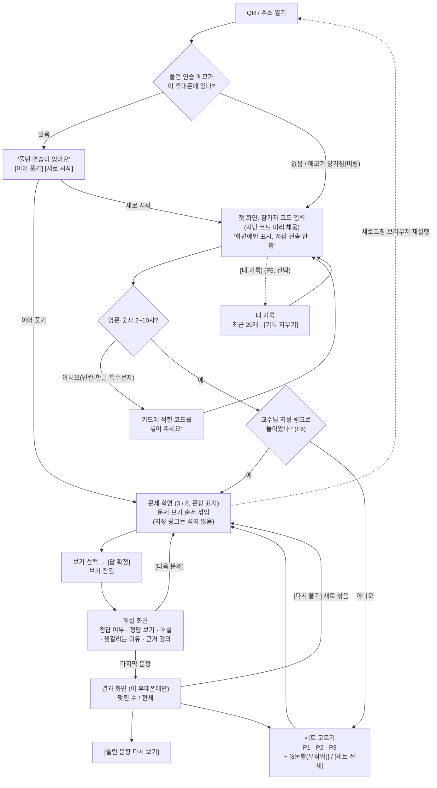

# 기능 명세서(PRD) v0.3 — "AI Agent 실무역량 팀 챌린지" 연습용 웹앱 (트랙 B)

> **한 줄 요약**: 트랙 B 웹앱 첫 버전(v0.3)은 **데이터베이스(인터넷 건너편 저장소)가 없는 연습용 웹페이지**입니다. 참가자 코드 넣기 → 연습 세트 고르기 → 한 문제씩 풀고 바로 채점·해설 → 결과는 그 휴대폰 화면에만. 연습 31문항만 앱에 넣고, 진단·평가 문항은 **앱 파일에 단 1개도 넣지 않습니다**(빌드 검사로 확인). 강의 10강 퀴즈게임 + 13강 배포와 같은 수준이라 11/13까지 만들고 시험할 수 있습니다. 응답 저장·교사용 CSV는 일정에 여유가 있을 때만 v0.4(부록 A)로 만듭니다.

| 항목 | 내용 |
|---|---|
| 버전 | **v0.3** (파일 이름은 v0.1 그대로 유지 — 결재2 첨부 경로가 바뀌지 않게) |
| 작성 | 제품개발팀 서비스 기획자 (product-planner) |
| 날짜 | 2026-11-02 |
| 용도 | 🔴 결재2(설계 확정)의 핵심 첨부 |
| 근거 | `09_외부자문/2026-11-02_GPT_답변_결재2설계.md`(4·5·6장, 8장 "트랙 B 축소 진행"), `00_캡틴/결재함/2026-11-01_결재1_앱방향확정.md`(✅ 승인), `00_캡틴/결재함/2026-11-02_결재2_설계확정.md`, `00_캡틴/나의상황.md`, `01_비서실/교훈노트.md`, `03_교육기획팀/문항은행/questions_part1-3.json`, `03_교육기획팀/문항은행/quiz_sets.json`, `03_교육기획팀/2026-11-01_팀챌린지_운영설계.md`(팀 연습 6문항 진행 방식) |
| 상태 | ChatGPT 교차검토 "웹앱 범위 축소" 반영본 — 결재2 재상정용 |

### 변경 이력
| 버전 | 날짜 | 바뀐 것 |
|---|---|---|
| v0.1 | 2026-11-01 | 첫 작성 (Firebase 데이터베이스·익명 로그인 기반 4개 기능) |
| v0.2 | 2026-11-01 | 품질검수 반영 (해설 공개 시점, 4자리 코드 통일, 시연은 연습 세트만). **v0.3에서 범위 밖으로 이동** |
| **v0.3** | 2026-11-02 | ChatGPT 결재2 교차검토 수용. ① **데이터베이스 없는 연습용 정적 웹앱**으로 축소(서버·로그인·응답 저장·CSV·교수 화면·회차 관리·팀 점수·순위표 모두 삭제) ② 앱 파일에는 **연습 문항(`pool: practice`)만**, 빌드 검사 규칙 신설(4장) ③ 문제·보기 순서 섞기 추가 ④ 화면 올리기는 무료 정적 호스팅(Firebase Hosting 추천), 외부 공개는 결재3 승인 후 ⑤ 테스트를 범주별로 다시 짬(**총 36개**, 8장) ⑥ 일정: v0.3 제작·테스트 11/13까지, 실제 휴대폰 10대 시연 점검, 여유 시 v0.4 ⑦ v0.2의 보안 설계는 ChatGPT 지적을 반영해 **부록 A(v0.4)**로 이동. v0.2 전문은 git 기록에 남아 있음 |

---

## 0. 캡틴이 결정할 것 (결재2에서 고를 것)

### ① v0.3 범위를 "연습용 정적 웹앱"으로 줄이는 것을 승인하시나요? (가장 중요)
- [ ] **추천: 승인** — 이번 학기 웹앱은 **연습 도구**로만 씁니다. 저장하는 곳(서버)이 없으니 "기록 누락·중복·해킹" 걱정 자체가 없고, 캡틴이 강의 10강·13강에서 만든 것과 같은 수준이라 직접 고쳐 볼 수도 있습니다.
  - 만드는 것 4개 + 선택 1개: 참가자 코드 입력(화면 표시용) / 연습 세트 고르기 / 바로 채점·해설 / 결과 화면 / (선택) 이 휴대폰에만 남는 '내 기록'
  - 만들지 않는 것: 서버, 로그인, 응답 저장, CSV, 교수 화면, 회차 관리, 팀 점수, 순위표
  - **v0.4(응답 저장 + 교사용 CSV 1개)는 일정에 여유가 있을 때만**, 시작 전에 비서실장이 따로 보고합니다(부록 A).
- [ ] v0.2 설계(Firebase 저장·교수 화면·CSV 2종·테스트 40개) 유지 — **비추천**: ChatGPT가 "3주 안 전체 구현은 확실하지 않다"고 판정, 코딩 초보에게 보안 규칙 부담이 큼

### ② 웹페이지를 어디에 올릴까요? (실제로 올리는 것은 결재3 승인 후)
- [ ] **추천: Firebase Hosting** — 강의 13·15강에서 쓰는 도구와 같아 "배운 대로 올렸다"고 보여 줄 수 있습니다. 무료, 카드 등록 없이 사용, 우리 앱(1MB 이하)에는 무료 한도가 충분합니다. 나중에 v0.4로 넘어가도 같은 프로젝트에 저장 기능만 더하면 됩니다.
- [ ] GitHub Pages — 역시 무료. 다만 무료 계정은 **공개 저장소**(누구나 코드를 볼 수 있는 폴더)에서만 쓸 수 있는 것으로 알려져 있어(미확인), 그 저장소에 원본 문항 파일이 실수로 들어가면 진단·평가 문항이 공개됩니다. 고르시면 "올릴 파일만 담은 별도 저장소"를 씁니다.
- 결재3 전까지의 시연 점검은 **노트북을 같은 와이파이 안에서만 열리는 임시 서버로** 띄워 휴대폰으로 접속합니다(외부 공개 아님, 5장).

### ③ 결재3 승인 후 2·3회차 '팀 연습' 시간에 이 웹앱을 쓸까요?
- [ ] **추천: 연습 도구로 쓰되, 문제가 생기면 즉시 종이 연습지로 바꾼다** — 점수와 전혀 관계없고(연습 문항만, 기록 저장 없음), 팀이 상의한 뒤 각자 휴대폰으로 답을 확정하면 바로 해설이 나옵니다(운영설계의 "상의 → 각자 제출 → 바로 해설"과 같은 흐름). 교육기획팀이 종이 연습지를 늘 함께 준비합니다.
  - 이 경우 F6 **"교수님 지정 링크"**(팀 전원이 같은 6문항을 같은 순서·같은 보기 순서로 푸는 주소)를 함께 만듭니다. 섞기가 켜져 있으면 팀원끼리 "②번이 답 같아요"라고 말할 때 서로 다른 보기를 가리키게 되기 때문입니다.
  - ⚠️ 일정상 2회차(11/14~11/22 사이)가 결재3보다 먼저 열리면 2회차는 종이 연습지로 하고 **3회차부터** 앱을 씁니다.
- [ ] 3회차에만 한 번 써 본다 — 부담이 가장 적음
- [ ] 수업 시간에는 쓰지 않고, 수업 뒤 개인 복습 링크로만 나눠 드린다

> 세 개를 모두 추천대로 하시려면 결재2에서 "PRD v0.3 추천안 승인"이라고만 적어 주시면 됩니다.

---

## 1. 이번 버전의 목표와 범위

### 목표 (한 문장)
**"AI로 만든 연습용 웹앱이 실제 휴대폰 10대에서 멈춤·오채점 없이 돌아가고, 진단·평가 문항은 한 개도 새어 나가지 않는가"**를 확인한다. (ChatGPT 8장의 11/22 목표 ②와 같음)

### 이번 학기 수업에서 앱의 역할 (선을 분명히)
- 공식 진단·평가 A·B·C, 향상점수, 팀 점수는 **모두 트랙 A(Socrative + 스프레드시트)**가 맡습니다.
- 웹앱은 **점수와 무관한 연습 도구**입니다. 무엇을 풀었는지, 몇 개 맞혔는지 어디에도 저장·전송하지 않습니다.
- 그래서 휴대폰 10대 시연 점검은 "앱이 안정적으로 돌아가는가"의 근거일 뿐, 50명 동시 운영이나 학습 효과의 근거로 쓰지 않습니다(ChatGPT 5장).

### 기술 수준 (캡틴이 직접 만져 볼 수 있게)
- HTML(화면 뼈대) + CSS(꾸미기) + 자바스크립트(동작) 파일 몇 개뿐. 따로 설치하는 틀(프레임워크)이나 서버가 없습니다 — **강의 10강 퀴즈게임과 같은 구조**.
- 문항은 "빌드"(원본 문항 파일에서 연습 문항만 골라 앱용 파일을 만드는 작은 자동 작업) 한 번으로 앱에 들어갑니다(4장).

### 이 버전에서 만드는 것
| 번호 | 기능 | 우선순위 | 캡틴의 꿈 중 어디에 해당? |
|---|---|---|---|
| F1 | 참가자 코드 입력 (기록·검증 없음, 화면 표시용) | 필수 | 📱 모바일 · 🎓 대학생/성인(실명 없이 참여) |
| F2 | 연습 세트 고르기 + 문제·보기 순서 섞기 | 필수 | 🎮 게임(매번 다른 판) · 🎯 맞춤(부·문항 수를 골라 연습) |
| F3 | 답 확정 즉시 채점 + 해설 | 필수 | 🎯 맞춤(틀린 이유를 바로 알려 줌) |
| F4 | 결과 화면 (그 기기에만) + 이어 풀기 | 필수 | 📱 모바일(새로고침·끊김에 강함) · 🎓 성인(점수를 남에게 안 보임) |
| F5 | '내 기록' (이 휴대폰 브라우저에만 저장) | 나중(선택) — 일정 여유 시 | 🎮 게임(지난번보다 나아졌나 보기) |
| F6 | 교수님 지정 링크 (같은 문항·같은 순서) | 중요 — **0장 ③에서 '팀 연습에 사용'을 고르면 필수** | 👥 친구(팀이 같은 문제를 함께 상의) |

### 이번 버전에서 만들지 않는 것
| 기능 | 언제 | 이유 |
|---|---|---|
| 응답 저장, 교사용 CSV 1개 | v0.4 (선택 목표) | ChatGPT 권고, 부록 A |
| 로그인(익명 포함), 코드 확인·기기 짝짓기 | v0.4 이후 검토 | 저장할 것이 없으니 확인할 필요도 없음 |
| 교수 화면, 회차 시작·종료, 진행 현황 | 겨울방학 이후 | ChatGPT "복수 회차 관리·교수 대시보드 삭제" |
| 진단·평가 세트 응시 | 웹앱에서는 하지 않음 | 공식 평가는 Socrative. 평가 정답은 앱·서버 어디에도 넣지 않음 |
| 팀 점수, 실시간 순위표 | 겨울방학 이후 | 결재1·ChatGPT: 앱 안 팀 점수·순위표 삭제 |
| 자동 난이도 조절, XP·배지, AI 튜터 | 겨울방학~2027년 | 결재1에서 연기 확정 |

---

## 2. 사용자와 하루 이야기 (사용자 시나리오)

### 등장인물
- **참가자 "K7M2"님**: 캡틴 수업을 듣는 교수자·교육 실무자(성인). 휴대폰 브라우저로 접속. 동료에게 자기 점수가 보이는 것을 꺼림.
- **캡틴(교수님)**: 노트북·프로젝터로 수업 진행. 코딩 초보.
- 배경: 결재3 승인 후 **3회차 팀 연습 시간**(0장 ③ 추천안). 같은 날 공식 평가 C는 Socrative로 따로 봅니다.

### 참가자의 하루
1. 슬라이드의 QR을 찍자 휴대폰에 "AI Agent 실무역량 연습" 첫 화면이 뜬다. 1회차에 고른 카드의 `K7M2`를 넣는다. "이 코드는 화면에만 표시되고 어디에도 저장·전송되지 않아요" 안내가 보인다.
2. 교수님이 준 **지정 링크**로 들어왔기 때문에 세트 고르기 없이 바로 "팀 연습 · 6문항" 1번 문제가 열린다. 화면 구석에 작은 문항 표지(`L11-Q1`)가 있어 팀원과 같은 문제인지 확인한다.
3. 팀원 셋이 1분쯤 상의한 뒤, 각자 보기를 고르고 **[답 확정]**. 바로 "아쉬워요, 정답은 ③ ○○○" + 해설 + "이렇게 헷갈리기 쉬워요"가 뜬다. 팀에서 "왜 그럴듯해 보였나"를 한마디씩 나눈다.
4. 4번 문제에서 강의실 와이파이가 끊겼다. 화면은 그대로 움직인다(문항이 이미 휴대폰 안에 있음). 실수로 새로고침도 했지만 "풀던 연습이 있어요 → [이어 풀기]"로 4번부터 이어서 푼다.
5. 마지막 문제 뒤 "K7M2님 결과: 6문항 중 4문항 정답 + 틀린 문항 다시 보기". 이 점수는 **이 휴대폰에만** 있고, 교수님도 모른다.
6. 집에서 같은 주소로 다시 들어가 "3부 연습 · 8문항(무작위)"를 한 번 더 푼다. 이번엔 문제와 보기 순서가 달라서 외운 위치로는 못 맞힌다.

### 교수님의 하루
1. 수업 전날, 비서실이 준 지정 링크 2개(3회차 팀 연습 6문항, 예비용 3부 전체)를 슬라이드에 QR로 붙인다. 교육기획팀이 같은 6문항으로 만든 **종이 연습지**도 인쇄해 둔다.
2. 수업 시작 전 노트북·자기 휴대폰으로 링크를 한 번 열어 1번 문제가 뜨는지 확인한다.
3. 팀 연습 시간, "QR로 들어와 카드 코드를 넣고 팀이 상의한 뒤 각자 확정하세요"라고 안내한다. 앱에는 교수 화면이 없으므로 진행 상황은 돌아다니며 본다.
4. 한 팀의 휴대폰 1대에서 페이지가 안 열린다. 그 팀원은 옆 사람 화면을 같이 보거나 **종이 연습지**로 푼다. 반 전체가 안 열리면 바로 종이 연습지로 바꾼다(점수와 무관하니 손해 없음).
5. 팀 연습이 끝나면 공식 평가 C는 Socrative로 진행한다. 웹앱에서 내려받을 결과는 없다(v0.3은 아무것도 저장하지 않음).

---

## 3. 기능 명세

> 각 기능의 "완료 기준"은 8장 테스트 번호와 연결됩니다.

### F1. 참가자 코드 입력 — 필수 (📱 모바일, 🎓 성인 정보 보호)
- **목적**: 트랙 A와 같은 종이 카드 코드로 "내 화면"이라는 느낌을 주고, 결과 화면에 코드를 표시한다. **확인·기록은 하지 않는다**.
- **사용자**: 참가자
- **동작 설명**
  1. 첫 화면에 코드 칸 1개. 안내: "카드에 적힌 코드를 넣어 주세요. 이름·학번은 넣지 마세요. 이 코드는 화면에만 표시되고 어디에도 저장·전송되지 않습니다."
  2. 받는 글자: **영문·숫자 2~10자**(소문자는 대문자로 바꿈, 앞뒤 빈칸은 지움). 트랙 A 카드(`K7M2`, 비경쟁 `K7M2-N`)도 그대로 넣을 수 있게 `-`는 허용. 그 밖의 글자(한글, 특수문자, 이모지)나 빈칸이면 "카드에 적힌 영문·숫자 코드를 넣어 주세요" 안내. 한글을 막는 이유: 실명을 넣는 일을 줄이기 위해서.
  3. 코드가 실제 카드 목록에 있는지 **확인하지 않는다**(목록 자체가 앱에 없음). `-N`도 특별한 뜻이 없다(저장할 기록이 없으므로).
  4. 다음에 같은 휴대폰으로 오면 코드가 미리 채워져 있다(F4의 브라우저 저장소 사용, 저장소가 막힌 브라우저면 매번 입력).
  5. 코드는 화면에 **글자 그대로** 표시만 한다(입력한 글이 프로그램으로 실행되지 않게 — 테스트 B-03).
- **저장·전송하지 않는 것**: 이름, 학번, 연락처, 사진, 위치. 입력칸 자체가 없다. 방문 통계·광고 추적 도구도 넣지 않는다.
- **완료 기준**: A-01, B-01 ~ B-03, E-05

### F2. 연습 세트 고르기 + 순서 섞기 — 필수 (🎮 게임, 🎯 맞춤)
- **목적**: 참가자가 부(강의 범위)와 분량을 골라 연습하고, 풀 때마다 순서가 달라 "위치 외우기"가 아니라 내용으로 풀게 한다(ChatGPT 6장 "문제·보기 순서 섞기").
- **사용자**: 참가자
- **동작 설명**
  1. 세트 고르기 화면: 연습 세트 3개만 보인다.
     | 세트 | 범위 | 문항 수 |
     |---|---|---|
     | `PRACTICE-P1` | 1부 01~05강 | 10 |
     | `PRACTICE-P2` | 2부 06~10강 | 10 |
     | `PRACTICE-P3` | 3부 11~15강 | 11 |
  2. 분량 고르기: **[8문항(무작위)]** = 그 세트에서 겹치지 않게 8개를 뽑음 / **[세트 전체]** = 10~11개 모두.
  3. **문제 순서 섞기**: 시작할 때마다 뽑힌 문항의 순서를 무작위로 섞는다.
  4. **보기 순서 섞기**: 객관식(`mcq`)은 보기 순서를 섞는다. 채점은 **보기 번호가 아니라 원래 보기(원본 `answer_index`가 가리키는 그 보기)**를 기준으로 한다. 자주 고르는 오답(`common_wrong_index`)도 같은 방식으로 따라간다. OX(`ox`)는 O·X 순서를 고정한다(섞으면 오히려 헷갈림).
  5. 한 화면에 한 문항. 화면 위 "3 / 8" 진행 표시와 작은 문항 표지(예: `L11-Q1`, 팀원끼리 같은 문제인지 확인용).
  6. 시간 제한·속도 점수 없음(결재1 "속도 보너스 없음").
- **완료 기준**: A-02 ~ A-04, A-08

### F3. 답 확정 즉시 채점 + 해설 — 필수 (🎯 맞춤)
- **목적**: "퀴즈로 떠올리기 + 바로 해설"(결재1 근거 2). 연습 문항이므로 바로 정답을 보여 줘도 된다.
- **사용자**: 참가자
- **동작 설명**
  1. 보기를 고르기 전에는 **[답 확정]**이 눌리지 않는다. 확정하면 즉시 보기가 잠기고 버튼이 사라진다(두 번 눌러도 한 번만 채점).
  2. 결과 표시: "정답입니다" / "아쉬워요, 정답은 ③ ○○○" — 섞인 뒤의 **화면 번호 + 보기 내용**을 함께 보여 준다.
  3. 해설(`explanation`) + 근거 강의(`source_section`, 예: "근거: 11강 핵심 개념").
  4. 내가 고른 답이 자주 고르는 오답이면 `common_wrong_reason`을 "이렇게 헷갈리기 쉬워요"로 함께 보여 준다.
  5. **[다음 문제]** — 한 번 누르면 한 문항만 넘어간다(연타해도 건너뛰지 않음). 이미 확정한 문항으로 돌아가 답을 바꾸는 기능은 없다.
- **알아 둘 한계(솔직하게)**: 연습 문항의 정답은 앱 파일 안에 들어 있어, 웹페이지 속을 들여다보는 기능(개발자 도구)으로 볼 수 있다. 점수와 무관한 연습이라 받아들이고, **그래서 진단·평가 문항은 절대 넣지 않는다**(4장, ChatGPT 4장 "연습 정답 수집은 막을 수 없음").
- **완료 기준**: A-05 ~ A-07, B-04 ~ B-07

### F4. 결과 화면 + 이어 풀기 — 필수 (📱 모바일, 🎓 성인)
- **목적**: 끝까지 푼 뒤 자기 결과를 보고 틀린 문항을 다시 보게 한다. 강의실의 새로고침·와이파이 끊김에도 처음부터 다시 풀지 않게 한다.
- **사용자**: 참가자
- **동작 설명**
  1. 결과 화면: "K7M2님 결과: 8문항 중 6문항 정답" + **[틀린 문항 다시 보기]**(내 답·정답·해설) + **[다시 풀기]**(같은 세트, 새로 섞음) + **[다른 세트]**.
  2. 결과는 **그 휴대폰 화면에만** 보인다. 다른 사람 점수·순위·공유 버튼은 없다.
  3. **이어 풀기**: 답을 확정할 때마다 "지금 풀던 판"(세트, 섞인 순서, 확정한 답)을 그 휴대폰 브라우저 저장소(브라우저 안의 작은 메모장, localStorage)에 적어 둔다. 새로고침·브라우저 재실행 시 "풀던 연습이 있어요 [이어 풀기] [새로 시작]". 결과 화면까지 가면 이 메모는 지운다.
  4. **인터넷이 끊겨도 계속 풀 수 있다**: 문항이 첫 화면을 열 때 이미 모두 휴대폰에 들어오므로, 열린 뒤에는 서버와 주고받는 것이 없다. (처음 주소를 여는 순간에는 인터넷이 필요하다.)
  5. 브라우저 저장소가 막힌 환경(일부 시크릿 창 등)에서는 풀기·채점은 정상, 이어 풀기만 꺼진다는 안내를 한 줄 보여 준다. 저장소 메모가 망가져 있으면 앱이 멈추지 않고 그 메모를 버린 뒤 첫 화면으로 간다.
- **완료 기준**: A-09, C-01 ~ C-05, D-07

### F5. '내 기록' — 나중(선택, 일정 여유 시) (🎮 게임)
- **목적**: "지난번 3부 연습보다 나아졌나"를 본인이 확인.
- **동작 설명**: 결과 화면에 도달할 때마다 그 휴대폰 브라우저 저장소에 한 줄(날짜, 세트, 분량, 맞힌 수/전체)을 추가. 첫 화면 **[내 기록]**에서 최근 20개만 보여 줌. **[기록 지우기]** 버튼(확인창). 같은 결과 화면을 새로고침해도 두 번 쌓이지 않음. 서버로 보내지 않음.
- **주의 안내**: "공용 컴퓨터·남의 휴대폰에서는 다 푼 뒤 [기록 지우기]를 눌러 주세요."
- **완료 기준**: A-10 (만들지 않으면 이 테스트는 "해당 없음")

### F6. 교수님 지정 링크 — 중요(0장 ③에서 팀 연습 사용 시 필수) (👥 친구)
- **목적**: 팀 연습에서 팀원 모두가 **같은 문항을 같은 순서·같은 보기 순서로** 보며 상의하게 한다(운영설계: 팀 연습 6문항, 상의 후 각자 제출, 바로 해설).
- **동작 설명**
  1. 주소 뒤에 문항 목록을 붙인 링크(예: `…/?ids=L11-Q1,L12-Q2,…`)로 들어오면 세트 고르기를 건너뛰고 **그 문항들을 적힌 순서대로, 보기 섞기 없이** 낸다. 제목은 "팀 연습 · 6문항".
  2. 링크에 연습 문항이 아닌 번호가 있으면 그 문항은 **앱 안에 없으므로** "이 링크에 없는 문항이 있어요. 교수님께 알려 주세요"를 띄우고, 있는 문항만 진행한다(진단·평가 문항은 애초에 앱 파일에 없음).
  3. 링크는 비서실(또는 앱 개발자)이 교육기획팀의 팀 연습 문항표를 보고 만들어 캡틴께 드린다. 서버 없이 주소만으로 동작한다.
- **완료 기준**: A-11, B-08

---

## 4. 문항 데이터와 빌드 검사 규칙

### 원본 파일 (교육기획팀, 고치지 않고 그대로 읽음)
- `03_교육기획팀/문항은행/questions_part1-3.json` — 67문항(진단 12 · 평가 24 · 연습 31)
- `03_교육기획팀/문항은행/quiz_sets.json` — 세트 7개(`DIAG`, `EVAL-A/B/C`, `PRACTICE-P1/P2/P3`)

### 빌드 = "연습 문항만 골라 앱용 파일 만들기"
- 앱 개발자가 작은 자동 작업(빌드 스크립트)을 만들어, 원본 두 파일을 읽고 **`pool`이 `practice`인 문항과 `purpose`가 `practice`인 세트만** 골라 앱용 문항 파일 1개(예: `public/practice_data.js`)를 만든다.
- 앱용 파일에 넣는 칸: `id`, `type`, `question`, `choices`, `answer_index`, `explanation`, `common_wrong_index`, `common_wrong_reason`, `source_section`, 세트의 `set_id`·`title`·`question_ids`.
- 넣지 않는 칸: `status`, `review_note`, `difficulty`, `pool`, `set`, `slot` 등 화면에 필요 없는 것 전부(검토 메모가 새어 나가지 않게).
- 빌드 스크립트와 원본 파일은 **화면에 올리는 폴더(`public/`) 바깥**에 둔다.

### 빌드 검사 규칙 — 하나라도 걸리면 빌드 실패(앱용 파일을 만들지 않음)
| 번호 | 검사 | 실패 조건 |
|---|---|---|
| ★1 | **진단·평가 문항 0개 포함** | 앱용 파일 안 문항 중 `pool`이 `practice`가 아닌 것이 1개라도 있음 |
| ★2 | **진단·평가 문항 번호 0건** | 진단·평가 문항 36개의 `id`(예: `L01-Q2`)를 앱용 파일 **글자 전체에서 찾아** 1건이라도 나옴 |
| ★3 | **진단·평가 세트 0개** | `DIAG`, `EVAL-A`, `EVAL-B`, `EVAL-C` 글자가 앱용 파일에 나옴 |
| ★4 | **올릴 폴더에 원본 없음** | `public/` 폴더 안에 `questions_part1-3.json`, `quiz_sets.json` 또는 그 복사본이 있음 |
| 5 | 세트·문항 짝 | 연습 세트에 적힌 문항 번호가 문항 파일에 없거나, 그 문항의 `pool`이 `practice`가 아님 |
| 6 | 문항 모양 | `id` 겹침 / `type`이 `mcq`·`ox` 외 / `ox`인데 보기가 2개가 아님 / `answer_index`·`common_wrong_index`가 보기 범위 밖 / `question`·`explanation`이 빔 |
| 7 | 개수 요약 | 결과 요약이 "연습 31문항(P1 10 · P2 10 · P3 11), 세트 3개, 진단·평가 0개"와 다름 → 원본이 바뀌었으면 사람이 확인 후 기준을 고침 |
| 경고 | 보기 섞기 위험 | 연습 문항의 해설·오답 이유에 "1번", "2번과 4번", "첫 번째 보기"처럼 **보기 위치를 가리키는 말**이 있으면 경고(섞으면 틀린 말이 됨) → 교육기획팀이 문장을 고침. 현재 연습 31문항에서는 발견 안 됨(평가 문항 `L01-Q2`에만 있음 — 트랙 A에서 Socrative 보기 섞기를 켤 경우 참고) |
| 경고 | 검토 상태 | `draft` 문항 수 표시(점수와 무관한 연습이라 사용은 가능, 교수 검토가 끝나는 대로 교육기획팀이 `reviewed`로 바꿈) |

- ★ 표시 4개는 **화면에 올리기 직전에도 한 번 더** 돌린다(올리는 사람 체크리스트 1번 항목).

---

## 5. 화면 올리기(호스팅)와 공개 규칙

| 단계 | 어디서 | 누가 볼 수 있나 | 승인 |
|---|---|---|---|
| 만들기·테스트 | 개발자 컴퓨터에서 열기 | 그 컴퓨터만 | 필요 없음 |
| 휴대폰 10대 시연 점검 | 노트북에서 **같은 와이파이 안에서만 열리는 임시 서버**를 띄우고 휴대폰으로 그 주소 접속 | 같은 와이파이에 연결된 기기만 | 필요 없음(외부 공개 아님) |
| 실제 사용 | **Firebase Hosting**(추천) 또는 GitHub Pages에 올림 → 인터넷 주소 + QR | 주소를 아는 누구나 | 🔴 **결재3 캡틴 승인 후** |

- 강의실·학교 와이파이는 기기끼리 서로 접속을 막아 두는 경우가 있습니다(미확인). 그러면 시연 점검은 집 와이파이나 휴대폰 핫스팟에서 합니다.
- Firebase Hosting의 "미리보기 주소"(preview channel)도 주소만 알면 누구나 열 수 있으므로 **외부 공개로 취급**합니다 — 쓰려면 캡틴의 별도 승인이 필요합니다.
- 무료 한도: Firebase Hosting 저장 10GB · 전송 하루 360MB(옛 문서와 표현이 달라 부분 확인, 설정 때 관리 화면에서 재확인). 우리 앱은 1MB 이하라 50명이 하루 여러 번 열어도 충분합니다. GitHub Pages 무료 조건·한도는 (미확인).
- 호스팅 회사는 접속 기록(접속한 인터넷 주소 등)을 자체적으로 남길 수 있습니다(미확인). 앱이 따로 모으는 정보는 없습니다.
- **올리는 사람 체크리스트**: ① 빌드 검사 ★1~★4 통과 ② `public/` 폴더 목록을 눈으로 확인(원본 문항 파일 없음) ③ 올린 뒤 휴대폰으로 열어 세트 3개만 보이는지 확인 ④ 업무현황판에 올린 날짜·주소 기록.

---

## 6. 화면 흐름도

> 교수 화면은 없습니다(v0.3). 교수님은 참가자와 같은 주소·지정 링크만 씁니다.

---

## 7. 데이터 목록 (앱이 저장하는 정보)

v0.3은 **서버에 저장하는 정보가 0개**입니다. 저장은 모두 참가자 휴대폰 브라우저 안에서만 일어나고, 그 휴대폰 밖으로 나가지 않습니다.

| 이름 | 어디에 | 담는 내용 | 언제 지워지나 |
|---|---|---|---|
| 앱용 문항 파일 | 호스팅(앱 파일의 일부) | 연습 31문항(문제·보기·정답·해설·오답 이유·근거 강의), 연습 세트 3개 | 다시 빌드해 올릴 때 바뀜 |
| 마지막 코드 | 휴대폰 브라우저 저장소 | 참가자가 넣은 코드 1개 | 브라우저 기록 삭제 시 |
| 풀던 판 메모 (F4) | 휴대폰 브라우저 저장소 | 세트, 뽑힌 문항과 섞인 순서, 보기 순서, 확정한 답 | 결과 화면 도달, [새로 시작], 브라우저 기록 삭제 시 |
| 내 기록 (F5, 선택) | 휴대폰 브라우저 저장소 | 날짜, 세트, 분량, 맞힌 수/전체 (최근 20개) | [기록 지우기], 브라우저 기록 삭제 시 |

- 저장하지 않는 것: 실명, 학번, 연락처, 사진, 위치, 휴대폰 기종. 방문 통계·광고 도구 없음.
- 학생·과목·친구·팀·배지 데이터는 이번 버전에 없습니다(겨울방학 이후).
- 응답 데이터가 없으므로 학기 후 삭제 절차도 필요 없습니다(v0.4를 만들면 부록 A-5 절차 적용).

---

## 8. 완료 기준 — 테스트 체크리스트 (QA 테스터가 그대로 사용)

> 모든 테스트는 가짜 코드(예: `TEST1`)로만 합니다(사칙 7장). "기대 결과"와 다르면 실패로 기록하고 재현 순서를 적습니다. **총 36개** (A 11 · B 8 · C 5 · D 7 · E 5). F5·F6을 만들지 않으면 해당 테스트는 "해당 없음"으로 표시합니다.

### A. 정상 흐름 (11개)
| 번호 | 해 볼 일 | 기대 결과 |
|---|---|---|
| A-01 | 코드 `k7m2` 입력 → 시작 | `K7M2`로 바뀌어 표시, 세트 고르기 화면 |
| A-02 | 세트 고르기 화면 확인 | P1·P2·P3 세 개만 보임(진단·평가 세트 없음) |
| A-03 | P1·P2·P3 각각 [세트 전체] | 10 · 10 · 11문항, 같은 문항이 두 번 나오지 않음 |
| A-04 | P3 [8문항(무작위)] 3번 시작 | 매번 P3 안의 서로 다른 8문항, 판마다 뽑힘·순서가 다름 |
| A-05 | 정답 고르기 | "정답입니다" + 해설 + 근거 강의 |
| A-06 | 일반 오답 고르기 | "정답은 n번 ○○○" (화면 번호와 보기 내용이 실제 정답 보기와 일치) + 해설 |
| A-07 | 자주 고르는 오답(`common_wrong_index`의 보기) 고르기 | 해설 + "이렇게 헷갈리기 쉬워요" 이유. 보기가 섞인 뒤에도 **같은 내용의 보기**에 붙어 나옴 |
| A-08 | **채점 전수 대조**: 연습 31문항 모두에서 원본 정답 보기를 골랐을 때와 다른 보기를 골랐을 때(섞기 켠 상태, 2번 반복) | 정답 보기만 "정답", 나머지는 "오답" — 불일치 0건. OX는 O·X 순서 고정 |
| A-09 | 끝까지 풀기 → 결과 화면 → [틀린 문항 다시 보기] → [다시 풀기] | 맞힌 수가 실제와 일치, 틀린 문항만 다시 보임, 다시 풀기는 새로 섞임 |
| A-10 | (F5) 두 판을 끝낸 뒤 [내 기록] → [기록 지우기] | 2줄이 날짜·세트·점수와 함께 보이고, 지우기 후 0줄 |
| A-11 | (F6) 지정 링크(6문항)를 휴대폰 3대로 열기 | 3대 모두 같은 6문항·같은 순서·같은 보기 순서, 세트 고르기 건너뜀 |

### B. 이상 입력 · 중복 클릭 (8개)
| 번호 | 해 볼 일 | 기대 결과 |
|---|---|---|
| B-01 | 코드에 빈칸 / 공백만 / 1글자 / 11자 이상 | 안내 문구, 다음으로 안 넘어감 |
| B-02 | 코드에 한글 이름·특수문자·이모지 | "카드에 적힌 영문·숫자 코드" 안내, 진행 안 됨 |
| B-03 | 코드 칸에 `<b>X</b>` 같은 웹페이지 명령 글자를 넣으려 시도(글자 검사를 개발자 도구로 우회) | 글자 그대로 표시되고 실행·모양 변화 없음 |
| B-04 | 보기를 고르지 않고 [답 확정] | 버튼이 눌리지 않음 |
| B-05 | [답 확정] 빠르게 5번 연타 | 채점 1번, 다음 문항으로 저절로 넘어가지 않음 |
| B-06 | 확정 후 다른 보기 누르기 | 고른 답이 바뀌지 않음 |
| B-07 | [다음 문제] 빠르게 5번 연타 / 휴대폰 '뒤로 가기' | 한 문항만 넘어감(건너뛴 문항 없음) / 앱이 멈추거나 점수가 꼬이지 않음 |
| B-08 | (F6) 지정 링크에 없는 번호·평가 문항 번호(`L01-Q2`)·이상한 글자를 넣기 | "이 링크에 없는 문항이 있어요" 안내, 있는 문항만 진행, 평가 문항 내용은 나오지 않음 |

### C. 새로고침 · 끊김 (5개)
| 번호 | 해 볼 일 | 기대 결과 |
|---|---|---|
| C-01 | 4번 문항 해설 화면에서 새로고침 → [이어 풀기] | 5번(다음 안 푼 문항)부터, 섞인 순서·보기 순서·1~4번 답 그대로 |
| C-02 | 풀던 중 브라우저를 완전히 닫았다 다시 열기 → [새로 시작] | 첫 화면, 이전 메모 지워짐 |
| C-03 | 첫 화면이 열린 뒤 비행기 모드 → 끝까지 풀기 | 모든 문항·해설·결과 정상 |
| C-04 | 결과 화면에서 새로고침 | 앱이 멈추지 않음, '이어 풀기'가 다시 뜨지 않음, (F5) 내 기록이 두 번 쌓이지 않음 |
| C-05 | 개발자 도구로 풀던 판 메모를 망가뜨린 뒤 새로고침 | 앱이 멈추지 않고 메모를 버린 뒤 첫 화면 |

### D. 기기 호환 · 글자 크기 (7개)
| 번호 | 해 볼 일 | 기대 결과 |
|---|---|---|
| D-01 | 안드로이드 크롬 · 삼성 인터넷 | A-01~A-09 흐름 정상 |
| D-02 | 아이폰 사파리 | 같음 |
| D-03 | 카카오톡 안에서 링크 열기(인앱 브라우저) | 같음, 이어 풀기 작동 여부 기록 |
| D-04 | 노트북 크롬·엣지 + 프로젝터 화면 | 같음, 글자가 멀리서도 읽힘 |
| D-05 | 휴대폰 설정에서 **글자 크기 최대** | 문제·보기·해설 글자가 잘리거나 겹치지 않음, 옆으로 스크롤 생기지 않음, 버튼이 손가락으로 누를 만큼 큼 |
| D-06 | 작은 화면(폭 360px 정도) · 가로 모드 | 같음 |
| D-07 | 시크릿 창(저장소 막힘 상황) | 풀기·채점 정상, "이어 풀기는 꺼져 있어요" 안내 1줄 |

### E. 빌드 · 공개 안전 검사 (5개, ★ 필수)
| 번호 | 해 볼 일 | 기대 결과 |
|---|---|---|
| E-01 ★ | 원본 그대로 빌드 → 앱용 파일에서 진단·평가 문항 36개 `id`와 `DIAG`·`EVAL-` 글자 찾기 | **진단·평가 문항 0개 포함**, 찾은 결과 0건. 요약 "연습 31문항(P1 10·P2 10·P3 11), 세트 3개, 진단·평가 0개" |
| E-02 ★ | `public/` 폴더 목록 확인 + 휴대폰에서 받은 파일 전체 확인(개발자 도구) | 원본 문항·세트 파일 없음, `status`·`review_note` 칸 없음 |
| E-03 | 가짜 원본으로 빌드: ① 연습 세트에 평가 문항 1개 섞기 ② `answer_index` 범위 밖 ③ `id` 겹침 | 세 경우 모두 빌드 실패 + 이유 표시, 앱용 파일 안 만들어짐 |
| E-04 | 가짜 연습 문항 해설에 "2번과 4번은…" 넣고 빌드 | 보기 위치 표현 경고 |
| E-05 | 한 판 풀면서 네트워크 기록(개발자 도구) 확인 | 첫 화면 이후 바깥으로 보내는 요청 0건, 코드·답이 어디에도 전송되지 않음 |

### 합격 기준 (결재3 판단용)
| 항목 | 기준 | 확인 방법 |
|---|---|---|
| 테스트 체크리스트 | 36개 중 해당하는 것 **전부 통과**(실패는 고친 뒤 재시험) | QA 보고서 (`04_제품개발팀/테스트보고서/`) |
| 진단·평가 문항 노출 | **0개** | E-01·E-02, 올리기 직전 한 번 더 |
| 채점 일치 | **100%** | A-08 전수 대조 |
| 실제 휴대폰 시연 점검 | 실제 휴대폰 **10대**(안드로이드·아이폰 섞어서, 카카오톡으로 연 기기 포함)로 동시에 같은 세트를 끝까지 풀기 1회 + 지정 링크 1회. 새로고침·비행기 모드·글자 크기 최대를 일부러 섞음. 멈춤 0건, 오채점 0건 | 시연 점검 기록(기기 종류·브라우저·문제 발생 여부) |

> 이 기준을 넘으면 결재3에 "Firebase Hosting에 올리기 + 팀 연습 사용(0장 ③)"을 올립니다. 못 넘으면 올리지 않고 팀 연습은 종이 연습지로만 합니다. 10대 점검은 "앱이 안정적으로 돌아간다"의 근거일 뿐 50명 운영의 증명은 아닙니다 — 정적 웹앱은 서버 동시 접속 한도가 없어 인원 문제는 작지만, 첫 사용 때도 종이 연습지를 준비합니다.

---

## 9. 개발 일정 — 11/2~11/22 (설계 포함 약 3주)

| 기간 | 단계 | 할 일 | 끝났다는 표시 |
|---|---|---|---|
| 11/2(월) ~ 11/4(수) | **설계** | 이 PRD v0.3, UX/UI 디자이너 화면 시안(글자 크기 큰 성인용, 5개 화면) → 🔴**결재2** | 결재2 승인 |
| 11/5(목) ~ 11/8(일) | **제작 1** | 빌드 스크립트 + 검사 규칙(4장) **먼저**, 첫 화면·세트 고르기·문제·해설·결과 화면(F1~F3), 문제·보기 섞기 | E-01~E-04, A-01~A-08 통과 / 캡틴이 노트북에서 한 판 풀어 봄 |
| 11/9(월) ~ 11/13(금) | **제작 2 + 테스트** | 이어 풀기(F4), (③ 승인 시) 지정 링크(F6), QA 테스터 36개 전체, 고친 뒤 재시험 | **v0.3 완성**: 해당 테스트 전부 통과, 테스트 보고서 |
| 11/14(토) ~ 11/16(월) | **휴대폰 10대 시연 점검** | 같은 와이파이 임시 서버로 실제 휴대폰 10대 점검(8장 합격 기준), 발견 문제 수정 | 시연 점검 기록, 멈춤·오채점 0건 |
| 11/17(화) ~ 11/20(금) | **여유 → v0.4(선택)** | 남는 시간에만: (F5) 내 기록, 그다음 v0.4(부록 A). **v0.4 시작 전 비서실장 보고**, 끝내지 못하면 v0.3만 결재3에 올림 | v0.3 기준 유지 |
| 11/20(금) ~ 11/22(일) | **검수·결재3** | 품질검수관 검수 → 🔴**결재3**(호스팅에 올리기 + 팀 연습 사용 승인) | 결재3 결정 |
| 결재3 승인 후 | **올리기·사용** | Firebase Hosting에 올림(5장 체크리스트) → QR·지정 링크 준비 → 팀 연습에서 사용(2회차가 이미 지났으면 3회차부터), 종이 연습지 함께 준비 | 업무현황판에 주소·날짜 기록 |

- 결재1 6주 일정과의 관계: 위 일정은 결재1 트랙 B 칸을 앞당겨 줄인 것입니다. 시연·사용은 결재3 승인 후입니다.
- 일정이 밀리면 줄이는 순서: ① v0.4 ② F5 내 기록 ③ F6 지정 링크(→ 팀 연습은 종이 연습지) ④ D-03(카카오톡) 외 기기 일부는 "확인 못 함"으로 기록. **빌드 검사 ★1~★4와 채점 전수 대조(A-08)는 줄이지 않습니다.**

---

## 10. 아직 정해지지 않았거나 확인 중인 것
| 항목 | 상태 | 담당 |
|---|---|---|
| 팀 연습 6문항 목록(2·3회차, "지난 오답 개념" 포함) → 지정 링크로 변환 | 0장 ③ 승인 시, 각 회차 전날까지 | 교육기획팀 → 앱 개발자 |
| 2회차 날짜가 결재3보다 앞인지 | 확인 필요 — 앞이면 2회차는 종이 연습지 | 비서실 |
| 강의실 와이파이에서 기기끼리 접속이 막히는지(시연 점검 장소 결정) | (미확인) | 앱 개발자 |
| Firebase Hosting 무료 한도, GitHub Pages 무료 조건(공개 저장소만 가능 여부) | 부분 확인 / (미확인) — 설정 때 관리 화면에서 확인 | 앱 개발자, 필요 시 사실검증관 |
| 카카오톡 인앱 브라우저에서 저장소(이어 풀기) 작동 여부 | (미확인) — D-03에서 확인 | 품질테스터 |
| 연습 31문항 `draft` → 교수 검토 | 대기 (점수와 무관해 사용은 가능) | 캡틴 → 교육기획팀 |
| 평가 문항 `L01-Q2` 해설의 "1번은…, 2번과 4번은…" 표현 | Socrative 보기 섞기를 켜면 틀린 말이 됨 → 교육기획팀 확인 권장(웹앱과는 무관) | 교육기획팀 |
| 화면 시안(글자 크기, 성인 대상 "전문적" 느낌) | 설계 단계 | UX/UI 디자이너 |
| 이 PRD v0.3 재교차검토 | 비서실장 판단(범위 축소는 ChatGPT 권고 그대로라 생략 가능) | 비서실장 |

---

# 부록 A. v0.4 (선택 목표 — 일정 여유가 있을 때만)

> **이 부록은 v0.3 범위가 아닙니다.** v0.3이 8장 합격 기준을 넘고 시간이 남을 때만, 비서실장 보고 후 시작합니다. v0.2의 신뢰성·보안 설계(옛 5장)를 ChatGPT 지적에 맞게 고쳐 옮겨 둔 것입니다.

## A-1. v0.4 범위 (딱 2개 추가)
| 번호 | 기능 | 내용 |
|---|---|---|
| V1 | 응답 저장 | 연습 문항에 답을 확정하면 Firebase Realtime Database(구글의 인터넷 저장소)에 "코드 / 문항ID / 고른 보기 / 서버 시각" 한 줄 저장. **연습 문항만** |
| V2 | 교사용 CSV 1개 | 교수님 Google 계정으로만 열리는 **내려받기 버튼 하나**짜리 페이지. 한 줄 = 코드 × 문항 (코드, 문항ID, 고른 보기(1~4), 정답 보기(1~4), 정답여부, 시각). 한글 깨짐 방지(UTF-8 BOM) |
- 여전히 만들지 않는 것: 회차 시작·종료, 진행 현황, 교수 점수 대시보드, 팀 점수, 순위표, 진단·평가 세트, CSV 여러 종.
- 저장이 실패해도 v0.3처럼 풀기·해설은 계속된다(저장은 "덤"). 화면에 "기록 저장 안 됨" 작은 표시만.

## A-2. 보안 설계 (v0.2 옛 5장을 고쳐 옮김 — ChatGPT 지적 반영)
> 아래 수치·문서 내용은 ChatGPT 답변(`09_외부자문/2026-11-02_GPT_답변_결재2설계.md` 4장)과 v0.2 사실검증 기준이며, v0.4를 시작할 때 공식 문서로 다시 확인합니다.

1. **"교수 화면 재채점"은 서버 채점이 아니다.** v0.2는 "공식 점수는 서버 데이터로 다시 계산"이라고 썼지만, 실제로는 **교수님 노트북의 브라우저가 서버에서 응답을 내려받아 노트북 안에서 채점**한다. 정확한 표현: "참가자 휴대폰이 보내는 것은 '고른 보기 번호'뿐이고 점수 숫자는 받지 않는다. 채점은 교수 브라우저가 정답표로 한다." 서버 안에서 채점하려면 Cloud Functions(유료 요금제 필요로 알려짐, 미확인) 등이 필요하며 v0.4에서는 하지 않는다.
2. **정답지·교수 권한을 학생이 받는 자바스크립트에 넣지 않는다.** v0.4에서 저장소에 올리는 것은 응답뿐이다. 교수 계정 확인은 **서버 보안 규칙**(누가 어디를 읽고 쓸 수 있는지 서버가 직접 지키는 규칙 파일)에만 적고, 화면 코드의 "교수면 버튼 보이기"는 꾸밈일 뿐 권한으로 믿지 않는다. (v0.3의 연습 정답은 앱 파일에 들어 있음 — 연습 정답 수집은 원래 막을 수 없으므로 받아들임. **평가 정답은 앱에도 서버에도 넣지 않는 원칙 유지.**)
3. **상위 경로 읽기 허용 주의.** Realtime Database 보안 규칙은 위 칸에서 "읽기 허용"을 주면 그 아래 모든 칸이 열리고, 아래 칸에서 다시 막을 수 없다(공식 문서: [규칙은 위에서 아래로 이어짐](https://firebase.google.com/docs/database/security/core-syntax) — 링크 재확인 필요). 그래서 ① 맨 위(`/`)에는 읽기·쓰기 허용을 절대 주지 않고 ② 응답(`/responses`)과 교수 목록(`/admins`)을 **서로 다른 맨 위 칸**에 두고 ③ 참가자에게는 자기 응답 한 칸 쓰기만 허용한다.
4. **익명 로그인은 사람의 유일성을 보장하지 않는다.** 익명 로그인은 "브라우저마다 번호표 하나"일 뿐이라, 한 사람이 다른 브라우저·시크릿 창·다른 기기로 여러 번 들어올 수 있고 서로 다른 사람인지 알 수 없다. 그래서 v0.4 기록은 **"참여·완주 경향을 보는 참고 자료"**이며 개인별 정확한 기록이나 성적으로 쓰지 않는다.
5. **코드 추측.** 4자리 코드는 맞히기 쉽다. v0.4에서 코드를 기록 열쇠로 쓰려면 무작위 8자리 이상 + QR 배부를 검토한다(트랙 A 카드와 달라지므로 그때 다시 결재).
6. **한 문항 한 번 저장.** "코드 / 문항ID" 칸이 비어 있을 때만 쓰기 허용(두 번째는 서버가 거절), 시각은 서버 시계. 화면 잠금 + 서버 거절의 두 겹.
7. **무료 한도 함정(v0.2에서 옮김, 확인됨·관리 화면 재확인 필요)**: 익명 계정 포함 새 계정은 인터넷 주소 1개당 1시간 100개([Auth 한도](https://firebase.google.com/docs/auth/limits)) → 같은 와이파이에서 시크릿 창 반복 테스트 금지, 자동 시험은 에뮬레이터(내 컴퓨터 안의 가짜 Firebase)에서만. Realtime Database 동시 연결 100개, 늘릴 수 없음([RTDB 한도](https://firebase.google.com/docs/database/usage/limits)) → 50명 반은 여유, 탭 하나만 열기 안내.
8. **남는 위험(솔직하게)**: 대리 응시·여러 번 응시는 막지 못함(4), 연습 정답은 볼 수 있음(2). 점수와 무관한 연습 기록이므로 받아들이고, 결과 해석에서 이 한계를 함께 적는다.

## A-3. v0.4 추가 테스트 (v0.3의 36개와 별도, 8개)
| 번호 | 해 볼 일 | 기대 결과 |
|---|---|---|
| V-01 | 한 판 풀고 교수 CSV 내려받기 | 확정한 답 수와 CSV 줄 수 일치, 누락 0 |
| V-02 | [답 확정] 연타 / 같은 칸에 두 번째 쓰기 시도(테스트 도구) | 저장 1건, 두 번째 거절 |
| V-03 | 다른 코드 칸에 쓰기, 맨 위·응답 전체 읽기 시도(참가자 계정) | 모두 거절 |
| V-04 | 교수 아닌 계정으로 CSV 페이지 | 거절("권한이 없습니다") |
| V-05 | 엑셀·구글 시트에서 CSV 열기 | 한글 깨짐 없음, 보기 번호 1부터 |
| V-06 | 저장 중 비행기 모드 | 풀기·해설 계속, "기록 저장 안 됨" 표시, 앱 멈춤 없음 |
| V-07 | 저장소에 진단·평가 문항·정답 존재 여부 확인 | 0건 |
| V-08 | 같은 기기로 다시 입장 | 새 익명 계정이 만들어지지 않음 |

## A-4. v0.4 데이터 목록
| 이름 | 담는 내용 | 누가 읽나 | 누가 쓰나 |
|---|---|---|---|
| 교수 목록 `/admins` | 교수 Google 계정 1개 | 서버 규칙만 | 처음 설정 때 1회 |
| 응답 `/responses` | 코드 / 문항ID → 고른 보기, 서버 시각 | 교수만 | 참가자(자기 칸 1회만) |

## A-5. 학기 후 삭제 절차 (v0.4를 만든 경우만)
종강 후 교수님이 마지막 CSV 보관 여부를 정한 뒤, 비서실 안내에 따라 관리 화면에서 응답 데이터를 삭제하고 삭제 날짜를 업무일지에 적습니다. 응답 데이터는 외부 AI에 보내지 않습니다(사칙 6장).

## A-6. v0.2에서 폐기한 것 (참고)
회차(대기·진행 중·종료) 관리, 교수 진행 화면, 진단·평가 세트의 "회차 종료 뒤 해설", 4자리 코드 확인·기기 짝짓기·기기 재설정·카드 잠금, 응답별·참가자별 CSV 2종, 가짜 평가 세트 `TEST-EVAL`, 테스트 T-01~T-40, Firebase·Supabase 비교표. 겨울방학 이후 웹앱이 Socrative를 대신하는 버전을 설계할 때 git 기록의 v0.2를 참고합니다.
