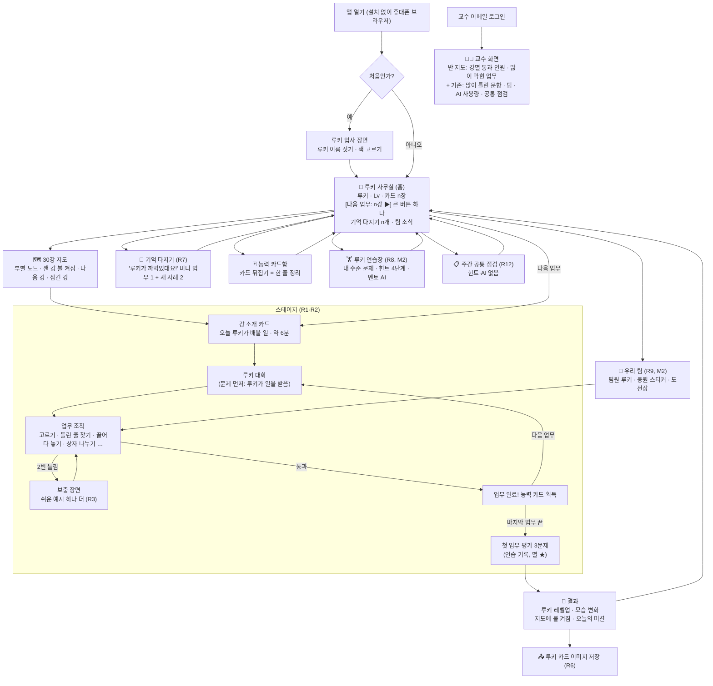

# 기능 명세서(PRD) v2.0 — "루키 키우기" (다음 기수용 30강 앱)

> **한 줄 요약**: 앱을 "문제은행"에서 **"팀장(학습자)이 신입 AI 루키에게 30강의 일을 가르쳐 키우는 게임"**으로 바꿉니다. 만드는 방식은 **"스테이지 엔진(조작 부품 묶음) 1개 + 강마다 데이터 파일 1개"**로, 엔진을 3주 만에 만들고 1~5강을 붙여 **11/30 주에 캡틴이 휴대폰으로 체험**, 이후 주 2~3강씩 넣어 **1/31까지 30강 완성, 2월은 시험·결재3, 3월 개강**입니다. 이미 만든 문항·힌트·AI 튜터·팀·교수 화면은 버리지 않고 루키 세계 안의 "복습·친구·교수" 기능으로 다시 씁니다.

- 작성: 제품개발팀 · 서비스 기획자 / 2026-11-05 · 상태: 🔴결재2(설계 확정) 첨부 초안
- 근거: 3단계 결재1(`00_캡틴/결재함/2026-11-05_3단계_결재1_방향확정_루키.md`), C 시제품(`04_제품개발팀/시제품/2026-11-05_1강_C_루키키우기.html`), 미션 점검 종합·서비스기획자·커리큘럼설계자·게임화기획자·학습과학연구원(`01_비서실/미션점검/`), PRD v1.0(`04_제품개발팀/2026-11-02_PRD_v1.0_2단계앱.md`), 기존 앱 설명서(`04_제품개발팀/app2/README.md`)
- 아직 없음(동시 작성 중): 이야기 지도·성장친구 시스템·스테이지 틀·학습효과 기준 → 이 문서는 **C 시제품 기준**으로 썼고, 그 문서들이 나오면 3장 표의 숫자·이름만 맞춰 고칩니다(구조는 그대로).
- 꿈 표시: 🎯 맞춤 · 🎮 게임 · 👥 친구 · 🎓 성인 학습자 · 📱 모바일 · 🧑‍🏫 교수자 도구
- **지난 PRD의 반성(교훈노트 11-05)**: v1.0은 핵심 기능 11개 중 강의를 배우는 기능이 0개였고, 순서를 위험(보안) 기준으로 정했습니다. v2.0은 **우선순위 1번 = 강의를 직접 해 보는 스테이지**, 완료 기준도 **재미·학습 효과를 먼저** 적고 기술 기준은 그다음에 둡니다.

---

## 0. 캡틴이 결재2에서 정할 것 (4개)

### ① 개강 전에 몇 강까지 완성할까
- [ ] **30강 전부 개강 전 완성 (추천)** — 1/31까지 30강, 2월 3주는 시험·고치기 여유. 학습자가 "30강 지도 전체"를 첫날부터 볼 수 있어 끝까지 갈 이유가 생김. 1/10에 16강 이후가 일정보다 2주 이상 늦으면 비서실장이 자동으로 아래 2번으로 바꾸고 보고
- [ ] 1~15강만 개강 전, 16~30강은 학기 중 매주 수업보다 1~2주 앞서 추가 — 일정은 가장 안전하지만 학기 중 제작이 계속되고, 지도 뒷부분이 "준비 중"으로 보임

### ② 친구 기능을 어디까지 (M2에서 만듦)
- [ ] **우리 팀(3~4명) 안: 친구 루키 구경 + 응원 스티커 + "도전장" (추천)** — 친구 루키의 모습·레벨·통과한 강만 보이고 점수·정답률은 안 보임. 도전장 = 내가 깬 미니게임 기록(예: 상자 나누기 23초)을 팀원에게 보내 "이 기록 깨 봐". 반 전체 순위 없음
- [ ] 위 + 반 전체 "루키 전시관"(모든 학습자의 루키를 점수 없이 구경) — 동기 부여는 커지지만 늦게 가는 사람이 드러남
- [ ] 위 + 수업 중 실시간 대결(교수님 버튼으로 반 전체가 동시에 한 판) — 가장 게임 같지만 **일정 +2주**, M3 뒤로 미루는 것을 권함

### ③ 강은 언제 열릴까
- [ ] **순서대로 자유롭게 + 교수님이 "여기까지 열기"로 상한만 정함 (추천)** — 앞 강을 깨면 다음 강이 열림. 수업보다 미리 해 보는 학습자는 막지 않되, 교수님이 정한 강 너머로는 못 감(기존 앱의 "열린 강" 설정 재사용)
- [ ] 수업에서 그 강을 한 다음에만 열림 — 수업 복습용으로 쓰기 좋지만 "다음 판" 재미가 줄어듦
- [ ] 처음부터 30강 전부 열림 — 가장 자유롭지만 이야기 순서가 깨질 수 있음

### ④ 강 내용 검토를 언제 할까 (교수님만 할 수 있는 일)
- [ ] **기능 묶음이 끝날 때 휴대폰으로 직접 체험하며 한 번에 (추천)** — 11/30 주(1~5강), 1/4 주(6~15강), 2/8 주(16~30강) 3번, 각 40~60분. 그 전에 사실검증관이 대본과 한 줄씩 대조해 둠. 캡틴은 "이 장면 이상해요"만 적어 주면 됨
- [ ] 강마다 대본(글)으로 받아 미리 검토 — 정확도는 가장 높지만 30번 × 20분, 캡틴 시간이 많이 듦

> 정하지 않아도 되는 것(직원이 정하고 결과만 보고): 루키 이름 짓기·색 고르기, 버튼 문구, 부품 디자인, 저장 방식(아래 6장), 테스트 방법, 능력 카드 문구.

---

## 1. 핵심 경험 한 문장

> **"출근길 5~8분, 내가 가르친 루키가 실수하는 걸 직접 잡아 주고 나면, 루키는 한 단계 자라 있고 나는 그 강에서 배운 일을 내 손으로 해 본 사람이 된다 — 그리고 그 루키 카드를 팀원에게 자랑한다."**

이 한 문장을 지키는 3가지 약속 (모든 기능은 이것으로 심사):
1. **글을 읽히지 않고 해 보게 한다** — 한 강에 손으로 조작하는 장면이 3번 이상, 글만 있는 화면이 2개 연속으로 나오지 않음. "문제 먼저 → 루키가 실수 → 내가 잡음 → 그래서 이 개념" 순서(학습과학: 문제 먼저·바로 반응)
2. **배운 만큼 눈에 보이게 자란다** — 강을 깨면 루키 모습이 바뀌고 능력 카드가 생기고 지도에 불이 켜짐(숫자만 오르지 않음)
3. **친구가 보인다** — 팀원 루키가 어디까지 왔는지 보이고, 응원·도전장이 오감(점수·등수는 안 보임)

---

## 2. 기능 목록 (우선순위 = 핵심 경험 순서)

| ID | 기능 | 우선순위 | 꿈 | 한 줄 설명 | 단계 |
|---|---|---|---|---|---|
| R1 | **스테이지 엔진 + 조작 부품** | 필수 | 🎮📱 | 강 데이터 파일을 읽어 "루키 대화 → 업무(조작) → 업무 완료 연출 → 평가 3문제 → 결과"를 자동으로 보여 줌 (4장) | M1 |
| R2 | **강별 스테이지 30개** | 필수 | 🎮🎓 | 강마다 업무 3~5개, 5~8분. 1강은 C 시제품 그대로 | M1 1~5 · M2 6~15 · M3 16~30 |
| R3 | **눈높이 갈림길** | 필수 | 🎯 | 업무에서 2번 틀리면 루키가 "쉬운 예시 하나 더" 보충 장면, 한 번에 맞히면 "도전 업무(보너스)" 추가. 평가 3문제 결과로 "기억 다지기" 추천 | M1 |
| R4 | **루키 사무실(홈) + 30강 지도** | 필수 | 🎮📱 | 홈 = 루키가 서 있는 사무실. "다음 업무: n강" 큰 버튼 하나, 지도에 깬 강은 불이 켜짐, 이어하기 | M1 |
| R5 | **루키 성장 + 능력 카드함** | 필수 | 🎮 | 강을 깨면 루키 레벨 +1·모습 변화, 업무마다 능력 카드 1장. 카드를 뒤집으면 "한 줄 정리"(기존 개념 카드 재사용) | M1 |
| R6 | **루키 카드 공유(이미지 저장)** | 중요 | 👥📱 | 결과 화면의 루키 카드를 그림 파일로 저장 → 학습자가 직접 단톡방에 올림 | M1 |
| R7 | **기억 다지기(복습)** | 필수 | 🎯 | 1·3·7·14일 뒤 "루키가 까먹었대요!" → 그 강의 미니 업무 1개 + 새 사례 문제 2개. 기존 복습 상자·문항·힌트 재사용 | M1 최소판 · M2 완성 |
| R8 | **루키 연습장 + 멘토 AI** | 중요 | 🎯 | 기존 수준 맞춤 문제(Elo)·힌트 4단계·AI 튜터를 "선배 에이전트 '멘토'에게 묻기"로 이름과 겉모습만 바꿔 연결. 연습에서만 | M2 |
| R9 | **팀 친구** | 필수 | 👥 | 팀원 루키 구경, 응원 스티커, 도전장 (0장 ②) | M2 |
| R10 | **교수 화면: 반 지도** | 중요 | 🧑‍🏫 | 기존 교수 화면에 "강별 통과 인원·가장 많이 막힌 업무" 추가 | M2 |
| R11 | **부 끝 승진식 + 보스 업무** | 중요 | 🎮 | 1부·2부… 끝마다 루키 직급이 오르는 연출과, 그 부를 섞은 긴 업무 1개 | M3 |
| R12 | **주간 공통 점검** | 필수(유지) | 🧑‍🏫 | 기존 그대로(힌트·AI 없음, 서버 채점). 향상 확인은 이것으로만(교훈노트 11-01) | 이미 있음, M2에서 루키 사무실에 연결 |
| R13 | 30강 완주 엔딩 "교육 포털 오픈" | 중요 | 🎮 | 30강을 깨면 루키가 팀장과 함께 포털을 여는 마지막 장면 + 수료 카드 | M3 |
| 나중 | 수업 중 실시간 보스전, 반 전체 전시관, 루키 꾸미기 아이템, 앱스토어 | 나중 | — | 결재3 뒤 학기 중 반응을 보고 | — |

**이름은 실제 의미와 일치 (교훈노트 11-02)**: "루키 레벨" = **통과한 강 수 + 1**(Lv.1 → 30강 완주 Lv.31). C 시제품처럼 한 강 안에서 레벨이 여러 번 오르면 30강 뒤 Lv.150이 되어 의미가 흐려지므로, 강 안의 연출은 **"업무 완료! 능력 카드 획득"**으로 바꾸고 레벨업은 강 끝에 한 번만 합니다. "평가 별 ★★★"은 "그 강 평가 3문제 중 맞힌 수"라는 뜻 그대로이며 연습 기록이고, 향상 점수에는 쓰지 않습니다.

---

## 3. 화면 흐름



### 사용자 시나리오 (짧게)
- **학습자 — 박서연(가명, 32세, 사내 교육 담당)**: 출근 지하철에서 앱을 여니 사무실에 자기 루키 "또롱이"(Lv.4, 하늘색)가 손을 흔든다. 큰 버튼 [다음 업무: 4강]. 루키가 만든 요약에서 "원문에 없는 해석"을 골라내다 두 번 틀리자 루키가 더 쉬운 예시를 하나 보여 주고, 세 번째에 잡아낸다. 6분 뒤 Lv.5, 루키 목에 출입증이 생겼다. 루키 카드를 저장해 팀 단톡방에 올리고, 팀원 민지가 보낸 도전장(상자 나누기 19초)에 도전해 17초로 깬다. 점심엔 "루키가 2강을 까먹었대요" 기억 다지기 1분.
- **교수님 — 캡틴**: 수업 전날 교수 화면 "반 지도"를 보니 4강 통과 21/30명, 가장 많이 막힌 곳은 "4강 업무 3: 사실·해석·제안 나누기". 내일 수업 첫 10분에 그 장면을 화면에 띄워 같이 풀기로 한다. "여기까지 열기"를 6강으로 올린다.

---

## 4. 기존 기능 재사용 표

> 원칙: **파일은 지우지 않습니다.** "버림" = 새 앱 화면에서 내림(코드는 `app2/`에 그대로 보관). 실서버(Supabase edu-gamify·Vercel)는 계속 씁니다.

| 기존 것 | 판정 | 루키 세계에서는 | 언제 |
|---|---|---|---|
| 문항 은행 221 (`questions_*.json`) | **그대로** | 강 끝 "첫 업무 평가 3문제"와 기억 다지기·연습장 문제로. 1강 시제품도 L01-Q1·Q3·Q4를 그대로 씀 | M1 |
| 힌트 76 (`hints_*.json`) | **그대로** | 루키 연습장 힌트 4단계 (말투만 "멘토" 목소리로) | M2 |
| 개념 카드 30 (`concept_cards.json`) | **그대로** | 능력 카드 뒷면 "한 줄 정리" | M1 |
| 수준 맞춤 배정(Elo, `logic.js`) | **그대로** | 루키 연습장의 "내 수준 문제" | M2 |
| 복습 상자 1·3·7·14일 | **그대로(규칙)** | 기억 다지기 날짜 계산 | M1(휴대폰 안) → M2(서버) |
| 6자리 코드 로그인·별명 | **바꿈(시점)** | 첫 화면에서 내림. M1은 로그인 없음, M2에서 "팀과 연결하기" 버튼을 누를 때만 코드 입력 | M2 |
| AI 튜터(`ai-tutor`, 4겹 한도) | **바꿈(겉모습)** | "선배 에이전트 '멘토'에게 묻기". 한도·안전 장치·연습에서만 규칙 그대로. 루키(내가 가르치는 쪽)와 역할이 섞이지 않게 다른 캐릭터로 | M2 |
| 팀(3~4명, `teams`, 팀 짜기 함수) | **바꿈** | 숫자 막대 대신 팀원 루키 얼굴·통과한 강·응원·도전장 | M2 |
| 교수 화면(`admin.html`) | **그대로 + 추가** | 기존 ①~⑤ 유지 + "반 지도"(강별 통과·막힌 업무) | M2 |
| 주간 공통 점검 | **그대로** | 사무실의 "이번 주 점검" 카드. 힌트·AI 없음, 서버 채점, 향상 확인은 이것만 | M2 연결 |
| 진단 12문항 | **바꿈(연출)** | "루키 입사 면접"으로 겉모습만 바꿔 M2에서 선택 사항으로(맞춤 출발점). M1에는 없음 | M2 |
| 경험치 "결과 무관 10" | **바꿈** | 숫자 대신 루키 레벨(통과한 강)·능력 카드로 보이게. 연습장 XP는 내부 기록으로만 | M1 |
| 홈의 숫자 상자·안내문 | **버림** | 루키 사무실로 대체 | M1 |
| 강의 보기(요약 글, `lectures.js`) | **바꿈** | 스테이지가 대신함. 요약 글은 결과 화면의 "강의 노트 다시 보기" 작은 링크로만 | M1 |
| 주간 팀 참여 목표(15문항 막대) | **버림** | 도전장·응원으로 대체 (문항 수 채우기 압박 없앰) | M2 |
| 해설 당번 | **보류** | 학기 중 반응 보고 재결정 | — |
| 보안 장치(RLS·키 서버 보관·평가 정답 안 내림) | **그대로** | 바꾸지 않음. 새 표에도 같은 규칙 | M2 |

---

## 5. 제작 방식 — "스테이지 엔진 1개 + 강별 데이터 30개"

### 5-1. 왜 이렇게 만드나
강마다 화면 코드를 새로 짜면 30번 개발해야 합니다. 대신 **"조작 부품"을 레고처럼 미리 만들어 두고**, 강마다 "어떤 부품을 어떤 순서로, 어떤 대사·문제로 쓸지"만 적은 **데이터 파일(JSON — 정해진 모양으로 적는 글 파일)**을 넣으면 엔진이 그 강을 자동으로 보여 줍니다. 그러면 30강 제작의 대부분이 **개발이 아니라 "대본 쓰기"**가 되어 여러 직원이 동시에 만들 수 있습니다.

### 5-2. 조작 부품 목록 (엔진이 가진 레고)
| # | 부품 | 학습자가 하는 일 | 1강 시제품의 예 | 쓸 강(예) | 언제 |
|---|---|---|---|---|---|
| P1 | 루키 대화 | 루키 말풍선 + 팀장 답 버튼(표정: 기쁨·헷갈림·생각) | 입사 인사 | 전부 | M1 |
| P2 | 고르기 | 보기 중 하나. 틀린 보기마다 루키가 다른 반응 | "루키가 왜 놓쳤을까?" | 전부 | M1 |
| P3 | 틀린 줄 찾기 | 루키 결과물에서 잘못된 한 줄을 눌러 잡기 | 오분류 1건, 지어낸 해설 | 4·9·11·23·28강 | M1 |
| P4 | 끌어다 놓기(열쇠 주기) | 알맞은 카드 하나를 루키에게 건넴(누르고-누르기도 됨) | 학습 기록 보기 도구 | 16·17·22·24·27강 | M1 |
| P5 | 상자 나누기(타이머) | 카드 여러 장을 2~4개 상자로 빨리 나눔 | 분류·생성·실행 | 4·5·6·14·15강 | M1 |
| P6 | 흘러나오는 장면 | 루키가 공부·실행하는 과정이 한 줄씩 나타남(조작 없음, 3초 안) | 예시 학습, 도구 실행 기록 | 전부 | M1 |
| P7 | 순서 맞추기 | 카드를 올바른 순서로 끌어 줄 세움 | — | 2(입력→처리→검토→활용)·9·12강 | M1 |
| P8 | 빈칸 채우기 | 루키의 요청문·코드에 빠진 조각 카드를 끼움 | — | 3(목표·자료·제약·완료 기준)·10·18강 | M1 |
| P9 | 평가 3문제 | 문항 은행의 문제 + 해설 + 자주 하는 실수 | 첫 업무 평가 | 전부 | M1 |
| P10 | 업무 완료·레벨업·결과 | 능력 카드 연출, 강 끝 레벨업, 지도·오늘의 미션 | 레벨업 화면 | 전부 | M1 |
| P11+ | 부마다 새 부품 1개까지 | 예) 2부 "미니 화면 미리보기"(코드 한 줄을 바꾸면 작은 화면이 바로 바뀜), 3부 "되감기"(Git 복원), 4부 "출입증 검사"(권한) | — | 그 부 | M2·M3 |

- **부품 규칙**: 새 부품은 **한 부(部)에 1개까지**. 데이터만으로 표현이 안 되면 커리큘럼 설계자가 기존 부품 조합안을 먼저 내고, 그래도 안 될 때만 개발자에게 요청합니다(제작이 느려지는 것을 막음).
- 휴대폰 손가락 조작은 모두 "누르고 → 놓을 곳 누르기"로도 되게(시제품 방식 유지), 화면 흔들림·빛남은 "움직임 줄이기" 설정을 따름.

### 5-3. 강별 데이터 파일 모양 (커리큘럼 설계자가 채움)
```json
{
  "lecture": 1, "part": 1, "title": "입사 첫날", "minutes": 6,
  "source": "00_캡틴/강의자료/강의대본_텍스트.md 147~214줄",
  "intro": [{"say": "안녕하세요, 팀장님!", "mood": "happy", "reply": "반가워, 루키!"}],
  "tasks": [
    {"id": "t1", "concept": "규칙 중심 AI", "part": "P3",
     "steps": [ "...부품별 대사·보기·정답·틀렸을 때 반응..." ],
     "easier": "...2번 틀렸을 때 보충 장면...",
     "card": {"name": "규칙 따르기", "points": ["...", "...", "..."]},
     "source_lines": "158~161"}
  ],
  "quiz": ["L01-Q1", "L01-Q4", "L01-Q3"],
  "mission": "내 업무 3가지를 분류·생성·도구 실행으로 나눠 보기",
  "review": {"mini_task": "t5", "new_cases": ["L01-Q2"]}
}
```
- 저장 위치(제안): `03_교육기획팀/스테이지/01강.json` … `30강.json` → 개발자가 앱으로 복사하는 도구를 만듦(지금 `build_data.py`와 같은 방식).
- 모든 업무에 **대본 줄 번호(근거)** 칸 필수. 근거 없는 대사는 넣지 않음(지어낸 내용 방지).

### 5-4. 누가 무엇을 만드나
| 직원 | 맡는 것 | 결과물 |
|---|---|---|
| 커리큘럼 설계자 | **강별 데이터**: 대본에서 재미 소재 3~5개 골라 업무 장면·대사·보충 장면·평가 문제 연결 | `03_교육기획팀/스테이지/NN강.json` |
| 게임화 기획자 | 루키 레벨·능력 카드·승진식·도전장·응원 규칙과 숫자, 카드 이름 | 성장친구 시스템 문서 → 데이터 칸에 반영 |
| 학습과학 연구원 | 강마다 **학습 효과 점검표**(문제 먼저? 바로 반응? 새 사례 적용 문제 1개 이상?) 통과 확인 | 강별 ✅/고침 표 |
| UX/UI 디자이너 | **부품 디자인**, 루키 성장 그림(부마다 모습 변화 6단계), 사무실·지도·카드함 화면 | 부품 시안 + 디자인 규칙 |
| 앱 개발자 | **스테이지 엔진**(데이터 읽기·부품·저장·이어하기), 홈·지도, M2 서버 연결 | `04_제품개발팀/app3_rookie/`(제안: 새 폴더, 기존 `app2/`는 그대로 두고 필요한 부분만 가져옴) |
| 사실검증관 | 강별 대사·카드가 대본과 맞는지 줄 번호로 대조 | 강별 대조표 |
| QA 테스터 | 가짜 학습자 3명(빠른 사람·헤매는 사람·중간에 나가는 사람)으로 강마다 끝까지, 휴대폰 360px | 묶음별 테스트 보고서 |
| 데이터 분석가 | 강별 완주율·막힌 업무·걸린 시간·평가 정답률 기록 방식 | 지표 정의(M2) |
| 성장 마케터 | 공유 카드 문구·그림, 도전장 문구 | 문구 표 |

**한 강이 만들어지는 순서** (주 단위로 2~3강씩 묶어 동시에): ① 커리큘럼 데이터 초안(0.5~1일) → ② 학습과학 점검 + 사실검증 대조(동시, 0.5일) → ③ 게임화·성장마케터 문구 손보기(0.5일) → ④ 개발자 넣기(새 부품 없으면 0.5시간) → ⑤ QA 가짜 학습자 플레이(0.5일). **한 강 약 2~3일, 여러 강을 겹쳐 진행하므로 주 2~3강(빠르면 4강)**.

### 5-5. 30강을 몇 주에?
| 일 | 기간 |
|---|---|
| 엔진 + 부품 P1~P10 + 홈·지도 + 1~5강 | **3주** (C 시제품이 이미 1강 엔진 역할을 하므로 "데이터를 읽게 바꾸는 일"이 대부분) |
| 6~15강(10강) + 친구 + 연습장 연결 | 5주 (주 2강 + 친구 기능) |
| 16~30강(15강) + 승진식·엔딩 | 5주 (주 3강) |
| **합계: 30강 완성까지 약 13주**(11/9 → 1/31) | + 시험·결재3 3주 = 16주, 3월 개강 전 끝 |

---

## 6. 저장·로그인 — "위험 크기만큼만" (교훈노트 11-02)

| 정보 | 위험 | 저장 방식 |
|---|---|---|
| 루키 이름·색·레벨, 능력 카드, 깬 강, 이어하기 위치, 기억 다지기 날짜 | 작음(점수·개인정보 아님) | **M1: 휴대폰 브라우저 안에만**(로그인 없음 → 캡틴이 링크만 열면 바로 체험). M2: "팀과 연결하기"를 누른 사람만 서버로 옮김 |
| 팀원에게 보이는 것(루키 모습·레벨·통과한 강), 응원·도전장 | 중간(친구에게 보임) | M2: 기존 코드 로그인 + Supabase, "본인만 쓰기·팀원만 읽기" 규칙 |
| 강 끝 평가 3문제 기록 | 작음(연습) | 기존 `attempts` 표에 "스테이지 평가"로 표시해 저장(M2). 향상 점수에는 안 씀 |
| 주간 공통 점검, AI 멘토 | 큼(평가·돈) | **기존 장치 그대로**(서버 채점·정답 안 내림·4겹 한도) |

- 새로 만드는 서버 표(M2): `rookies`(학생·루키 이름·색·레벨) · `stage_clears`(학생·강·별·걸린 시간·날짜) · `cheers`(보낸 사람·받는 사람·스티커·날짜) · `challenges`(보낸 사람·강·부품·기록·결과). 실명·연락처 칸 없음.
- 루키 이름은 별명과 같은 검사(전화번호·이메일 모양 거절).

---

## 7. 단계별 일정과 완료 기준

> 주는 월~일. 완료 기준은 **① 재미 → ② 학습 효과 → ③ 기술** 순서로 적고, 셋 다 통과해야 다음 단계로 갑니다.

### 결재2: 11/6~11/8
이 문서 + 이야기 지도·성장친구 시스템·스테이지 틀·학습효과 기준 → 전략실장 교차검토 → 🔴결재2

### M1 "엔진 + 1~5강" — 11/9~11/29 (3주) → **11/30 주 캡틴 휴대폰 체험**
| 주 | 할 일 |
|---|---|
| 11/9~11/15 | 개발: 엔진 뼈대 + P1~P6·P9·P10, **1강을 데이터 파일로 옮겨 시제품과 똑같이 동작** / 커리큘럼: 2~5강 데이터 초안 / UX: 부품·루키 성장 그림 정리 |
| 11/16~11/22 | 개발: P7 순서 맞추기·P8 빈칸 채우기, 루키 사무실·30강 지도·카드함·이어하기·루키 이름 짓기 / 2~5강 데이터 넣기, 학습과학·사실검증 점검 |
| 11/23~11/29 | 기억 다지기 최소판(휴대폰 안), 카드 이미지 저장, 눈높이 갈림길 / QA 가짜 학습자 3명 1~5강 완주 → 고치기 / 비서실장 사전 체험 |

**M1 완료 기준**
- ① 재미: 게임화·UX·학습과학 3명이 강마다 "재미 점검표"(조작 장면 3번 이상, 글만 있는 화면 2개 연속 없음, 루키 반응이 틀린 보기마다 다름, 끝에 자랑할 장면 있음) 5개 중 4개 이상 ✅. 한 강 5~8분
- ② 학습 효과: 강마다 평가 3문제 중 1개 이상이 "새 사례에 적용" 문제, 모든 업무에 대본 근거 줄 번호, 사실검증 대조 오류 0
- ③ 기술: 휴대폰 360px 세로에서 1~5강 멈춤 0, 중간에 닫았다 열면 그 업무부터 이어하기, 손가락 끌기 안 될 때 누르기로도 전부 가능
- **캡틴 체험 1회(40~60분)**: 링크 하나로 1~5강 → "이 장면 이상해요" 의견 → 1주 안에 반영

### M2 "6~15강 + 친구" — 11/30~1/3 (5주) → **1/4 주 캡틴 체험**
| 주 | 할 일 |
|---|---|
| 11/30~12/6 | 캡틴 의견 반영, 6~7강, 2부 새 부품(미니 화면 미리보기) |
| 12/7~12/13 | 8~10강, "팀과 연결하기"(기존 코드 로그인) + 서버 저장 |
| 12/14~12/20 | 11~12강, 팀원 루키 구경·응원 스티커 |
| 12/21~12/27 | 13~14강, 도전장, 루키 연습장(기존 Elo·힌트) + 멘토 AI 겉모습 |
| 12/28~1/3 | 15강, 교수 화면 반 지도, 주간 점검 연결, 가짜 학습자 + 가짜 팀 3개로 전체 시험 |

**M2 완료 기준**
- ① 재미: 6~15강 재미 점검표 4/5 이상, 가짜 팀(3명) 시험에서 응원·도전장이 하루 안에 상대 사무실에 보임
- ② 학습 효과: 기억 다지기가 1·3·7·14일에 맞게 나옴(날짜 바꾼 시험), 10강 퀴즈게임 스테이지가 "수강생이 실제로 만드는 결과물"과 같은 흐름
- ③ 기술: 팀원에게 점수·정답률 0건 노출, 다른 팀 정보 0건, 새 표 보안 규칙 꺼진 것 0, 휴대폰↔노트북 같은 코드로 이어짐, 로그인 안 한 사람도 혼자 끝까지 가능

### M3 "16~30강 + 승진·엔딩" — 1/4~2/7 (5주) → **2/8 주 캡틴 체험**
| 주 | 할 일 |
|---|---|
| 1/4~1/10 | 캡틴 의견 반영, 16~18강, 4부 새 부품(출입증 검사) — **1/10에 일정 점검(0장 ① 자동 전환 기준)** |
| 1/11~1/17 | 19~21강, 부 끝 승진식·보스 업무 |
| 1/18~1/24 | 22~25강, 5부 새 부품 |
| 1/25~1/31 | 26~30강, 30강 엔딩 "교육 포털 오픈", **30강 완성** |
| 2/1~2/7 | 가짜 학습자 30강 완주 시험, 고치기 |

**M3 완료 기준**: 16~30강 재미·학습 효과 점검 통과(M1과 같은 기준), 가짜 학습자 3명 30강 완주(멈춤 0), 30강 전체 플레이 시간 3~4시간 안

### 시험·결재3 — 2/8~2/28 (3주)
캡틴 체험(16~30강) → QA 전체 + 실제 휴대폰 10대 → 품질검수 1회 → 🔴결재3 → 3월 첫 주 개강
- (선택, 캡틴 승인 필요 — 첫 공개) 다음 기수 학습자 3~5명 미리 체험해 "재미 있었나" 물어보기

### 일정이 밀리면 줄이는 순서
루키 연습장의 멘토 AI 겉모습(기존 화면 그대로 연결) → 승진식 연출 → 도전장(응원만 남김) → 16~30강을 학기 중 매주 추가(0장 ② 방식). **스테이지 품질 기준(재미·학습 효과·근거 줄 번호)과 평가 보안 장치는 줄이지 않습니다.**

---

## 8. 위험과 대책

| # | 위험 | 대책 |
|---|---|---|
| 1 | **30강 콘텐츠 제작이 병목** — 엔진은 되는데 강 데이터가 늦음 | 강당 업무 3~5개 상한, 데이터 모양 고정(5-3), 주 2~3강 동시 진행, 1/10 일정 점검 후 자동 전환(0장 ①) |
| 2 | **강마다 비슷해서 지루함**(같은 부품 반복) | 부마다 새 부품 1개 + 부 끝 보스 업무, 같은 부품 연속 2번 이하 규칙, 재미 점검표로 강마다 확인 |
| 3 | **재밌는데 안 배움**(연출만 화려) | 학습과학 점검표 통과 필수, 평가 3문제 중 적용 문제 1개 이상, 기억 다지기, 공통 점검 점수로 효과 확인(데이터 분석가) |
| 4 | **내용 오류**(루키 대사가 대본과 다르거나 지어냄) | 업무마다 대본 줄 번호 필수, 사실검증관 대조, 캡틴 묶음 체험(0장 ④) |
| 5 | **성인에게 유치함** | 업무 장면은 실제 실무 사례(학사 문의·문항 검토 등), 말투 가이드(루키는 귀엽되 팀장은 존중받는 역할), 캡틴 체험 때 확인 |
| 6 | **이름이 의미와 어긋남**(레벨 인플레) | 레벨 = 통과한 강 + 1, 강 안 연출은 "업무 완료"(2장), 별 = 평가 3문제 맞힌 수 |
| 7 | **휴대폰에서 끌기 오작동** | 모든 끌기는 누르기로도 가능, 360px·글자 크게·움직임 줄이기 시험 |
| 8 | **M1 로그인 없음 → 기기 바꾸면 기록 사라짐** | M1은 체험·개발용으로 감수, M2 "팀과 연결하기"로 서버 이전. 휴대폰 안 기록을 서버로 옮기는 기능을 M2 완료 기준에 포함 |
| 9 | **기존 실서버와 새 앱이 엉킴** | 새 폴더(`app3_rookie/`)에서 만들고, 서버 표는 추가만(기존 함수 수정 금지 — 기존 자동 시험으로 확인) |
| 10 | 저장소 공개(캡틴 결정) — 스테이지 데이터·평가 3문제 정답이 공개됨 | 스테이지 평가는 연습이라 감수. 주간 공통 점검 정답은 지금처럼 서버에만. 성적 반영이 생기면 캡틴 재확인 |

---

## 9. 확인 중인 것
| 항목 | 담당 |
|---|---|
| 이야기 지도(부 이름·루키 직급 6단계)·성장친구 숫자·스테이지 틀·학습효과 기준 — 나오면 2·5·7장 숫자만 맞춤 | 커리큘럼·게임화·학습과학 (동시 작성 중) |
| 다음 기수 개강일·인원·팀 편성 시점 | 캡틴 |
| 카드 이미지 저장이 아이폰 사파리에서 되는지 | 앱 개발자 (M1) |
| 2·3·5강 등 새 부품이 필요한 강 목록 확정 | 커리큘럼 설계자 (11/15까지) |
