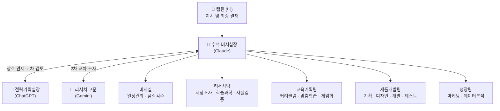

# 🏢 레벨업 캠퍼스 (LevelUp Campus)

> **나만의 1인 AI 에이전트 회사**
> 미션: 대학생 한 명 한 명의 수준에 맞춘 **눈높이 맞춤형 학습**을 **친구들과 게임하듯** 즐길 수 있는 모바일 앱 만들기

캡틴(나)은 **수석 비서실장(Claude) 한 명과만 대화**합니다. 비서실장이 16명의 AI 직원에게 일을 나눠 주고, 캡틴은 **결재 3번**만 하면 됩니다.

---

## 👥 조직도



| 부서 | 직원 | 하는 일 |
|---|---|---|
| 비서실 | 일정·업무관리 비서 / 품질검수관 | 업무현황판·주간보고, 결재 전 검수 |
| 리서치팀 | 시장조사원 / 학습과학 연구원 / 사실검증관 | 경쟁 앱 조사, 교육학 근거, 팩트체크 |
| 교육기획팀 | 커리큘럼 설계자 / 맞춤학습 설계자 / 게임화 기획자 | 스킬트리·문항, 수준별 난이도 규칙, 친구 대결·팀 퀘스트 |
| 제품개발팀 | 서비스 기획자 / UX·UI 디자이너 / 앱 개발자 / 품질테스터 | 기획서, 화면 시안, 앱 코드, 테스트 |
| 성장팀 | 마케터 / 데이터 분석가 | 학생 모집·홍보, 학습 효과 측정 |
| 외부 자문 | 전략기획실장(ChatGPT) / 리서치 고문(Gemini) | 반대 의견·교차 검토, 최신 정보 조사 |

---

## 🚀 출근하는 방법 (처음 한 번만 세팅)

### Step 1. 사무실(폴더) 가져오기
- 이 저장소를 컴퓨터로 내려받습니다. (GitHub 페이지 → 초록색 `Code` 버튼 → `Download ZIP` → 바탕화면에 압축 풀기)

### Step 2. 소통 창구 열기
1. **Claude 데스크톱 앱**을 설치하고 로그인합니다.
2. 상단의 **`코드(Code)`** 탭을 누릅니다.
3. Step 1에서 만든 폴더를 선택하면 끝! 이제 Claude가 이 폴더 안에서 수석 비서실장으로 일합니다.

### Step 3. (선택) ChatGPT·Gemini 직원 연결하기
유료 구독 중인 ChatGPT와 Gemini를 **회사 직원처럼 자동으로** 부르려면, 비서실장에게 이렇게 말하세요:

> "Codex CLI랑 Gemini CLI 설치하고 로그인하는 거 한 단계씩 도와줘"

- **Codex CLI** → ChatGPT 계정으로 로그인 → 전략기획실장 자동 호출
- **Gemini CLI** → 구글 계정으로 로그인 → 리서치 고문 자동 호출
- 설치하지 않아도 괜찮습니다. 그때는 비서실장이 **복사-붙여넣기용 요청서**를 만들어 드리고, 캡틴이 ChatGPT/Gemini 앱에 붙여넣어 답을 전달해 주면 됩니다.

---

## 💬 매일 쓰는 명령어 5개

| 명령어 | 언제 | 예시 |
|---|---|---|
| `/order` | 일을 시킬 때 | `/order 대학생 대상 게임형 학습 앱 경쟁사 조사해줘` |
| `/approve` | 결재할 때 | `/approve 승인` · `/approve 반려, 타깃을 1학년으로 좁혀줘` |
| `/feedback` | 마음에 안 들 때 (화면 캡처 첨부 OK) | `/feedback 버튼 글씨가 너무 작아` |
| `/report` | 현황이 궁금할 때 | `/report` · `/report 주간` |
| `/hire` | 새 직원이 필요할 때 | `/hire 영상 강의 대본 쓰는 직원` |

> 명령어 없이 그냥 말로 해도 됩니다. 비서실장이 알아서 처리합니다.

---

## 🔁 일하는 방식: 최초 지시 1번, 결재 3번

```
지시 → ① 리서치 → 사실검증 → 🔴결재1 (방향 확정)
     → ② 교육기획 + 서비스기획 → ChatGPT 교차검토 → 🔴결재2 (설계 확정)
     → ③ 디자인 → 개발 → 테스트 → 품질검수 → 🔴결재3 (완료 승인)
```

결재 요청은 `00_캡틴/결재함/`에 쌓이고, 캡틴은 "승인" 또는 수정 의견만 말하면 됩니다.
캡틴의 피드백은 `01_비서실/교훈노트.md`와 직원 지시서에 **영구 반영**되어, 회사는 일할수록 캡틴 스타일에 맞춰집니다.

---

## 📁 사무실 배치도

```
📁 레벨업 캠퍼스
├── CLAUDE.md               ← 사칙 (회사의 헌법, 비서실장이 매번 읽음)
├── 00_캡틴/
│   ├── 나의상황.md          ← ⭐ 가장 중요! 내 꿈과 상황
│   └── 결재함/              ← 결재 요청서가 쌓이는 곳
├── 01_비서실/               ← 업무현황판, 업무일지, 교훈노트, 주간보고
├── 02_리서치팀/
├── 03_교육기획팀/
├── 04_제품개발팀/           ← 기획서, 디자인 시안, app/(앱 코드), 테스트보고서
├── 05_성장팀/
├── 09_외부자문/             ← ChatGPT·Gemini 자문 요청서와 답변
└── .claude/
    ├── agents/             ← 직원 16명의 업무 지시서
    └── commands/           ← /order /approve /feedback /report /hire
```

---

## ✅ 첫 출근날 할 일

Claude 데스크톱 앱의 코드 탭에서 이 폴더를 열고 아래 문장을 그대로 입력해 보세요.

> **"비서실장, 첫 출근이야. `나의상황.md`에서 아직 안 정한 것들을 하나씩 질문해서 채워 주고, 그다음 리서치팀에 첫 시장조사를 시켜줘."**

> 시작이 어렵지, 시작만 하면 정말 어렵지 않습니다. 캡틴은 결재만 하세요. 🚀
